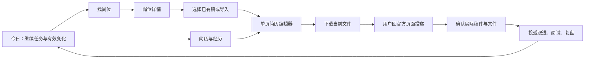

# Aijob 网页版 UI/UX 系统审查

日期：2026-10-15。范围：C 盘现有网页开发版。性质：审查结论与重构建议，**不是已完成改造的交付记录**。

后续实施：共同基础与简历主线已按授权推进，六套手工简历及单页 PDF 已完成本轮收口，见[最新收口记录](../../evidence/resume-module-closeout-2026-10-15.md)。[10/15 首轮交付](../../evidence/ui-ux-refactor-2026-10-15.md)保留当时落实行为；下文保留改造前观察，不作为当前界面仍全部失败的断言，也不表示全部 29 项问题已关闭。

## 1. 结论与本轮新约束

当前界面具备不少业务能力，但还没有形成顺畅、一致的用户体验。问题同时存在于信息架构、页面布局、交互完整性、内容结构、反馈语义和视觉体系。实际走查发现了按钮被裁切、链接进入 404、多选操作无选择入口等功能问题，因此不能把本轮工作缩减为配色和圆角调整。

**建议对前端呈现与任务流程进行系统重构。** 保留已经存在的正文、原件、修订、PDF 产物、申请快照、个人配置和后台服务能力，逐条重做用户使用这些能力的方式。少量影响体验的后端契约需要同步修正，主要是单页输出、方向相关性和可解释运行状态。

coco 本轮明确的要求：

- 审查覆盖整个当前网页版，不限于已指出的导入弹窗与分页。
- 简历预览和实际导出必须单页。该要求覆盖旧方案中的“不强制一页”“长内容自动续页”和“科研多页主推”等相关条款；**当前实现尚未满足**。
- 导入应支持拖拽文件，同时保留点击选择。建议进一步让模块、条目排序支持直接拖动，并保留键盘与按钮替代。
- 不以裁掉正文、隐藏第二页或把文字无限缩小达成单页；内容精简由用户选择，原件和完整经历保留。
- 继续使用当前网页版与已有资料；安装包专属工作仍暂停。没有启动旧阶段验收、全站测试矩阵或数据迁移。

旧稿和已投递文件属于历史证据，不因新规则被批量改写。后续编辑旧稿时，应清楚显示它与当前单页目标的差距，并在用户继续编辑时形成新修订。

## 2. 审查方法与证据范围

采用已安装的 `ui-ux-pro-max`（上游提交 `56ea9cf174ed86786187daa9de0e6247cb0747e4`），按照任务完成、导航、反馈、布局、可读性、键盘操作和组件一致性检查。结合实际 Chrome 页面、DOM/几何测量及当前未提交工作区源码；没有以旧提交替换现场。

Skill 的设计系统查询两次返回偏营销展示页的 `Product Demo + Features`。该结构不适合日常求职工作区，未采用其首页结构、在线字体或整套配色，未自动生成新的设计规范覆盖现行文件。空状态、错误恢复、拖动替代等定向结果与实际问题相符，作为评审参考。下文视觉建议是结合 Aijob 任务提出的设计判断，未冒充 Skill 的精准产品匹配。

证据标记：

- **实看**：在当前 Chrome 中观察到；可与源码交叉核对。
- **代码**：实现路径明确，但本轮没有为了复现而新增申请、修改个人配置或运行模型。
- **待复现**：已有可信线索，尚不能断言具体影响程度或所有输入方式均受阻。

| 页面或状态 | 本轮覆盖 | 主要发现 |
|---|---|---|
| 今日 | 当前真实摘要、继续编辑入口；原窗口、1366×768、390×844 | 无变化摘要挤占首屏；1366px 导航文字消失 |
| 岗位发现 | 全目录、已存方向进入筛选结果 | 自动化管理大卡压住结果；方向未知与相关性混淆 |
| 岗位详情 | 一条产品实习；DOM 与标题宽度测量 | 标题被压到约 80.6px，主操作与长说明挤压内容 |
| 方向图谱 | 当前分类、准备清单跳转 | `/planner` 404；与目录的筛选入口重复 |
| 简历库 | 当前已有稿件 | 同名卡片难辨认；新建比继续编辑更突出 |
| 简历编辑 | 用户现有稿件，只读；导入与模板弹窗 | 两页、断句、17 个模块、巨大导入空态、模板确认按钮裁切 |
| 经历与材料 | 当前已有经历 | 全文卡片过长；新经历缺少多选入口 |
| 投递管理 | 当前空状态、列表/看板入口 | 术语不统一，首次起步以导入私有 JD 抢占主行动 |
| 准备与日程 | 当前空状态 | 操作、筛选样式不统一；主任务引导分散 |
| 面试练习 | 起始表单，不启动练习 | 任务切换重复，模拟面试仍用泛化写作提示 |
| 求职指南 | 当前静态内容 | 仍鼓励多页，需与新规则统一；指导可在操作处复用 |
| 账户与资料 | 当前恢复与保留说明 | 仍有 Case、资产、旧 OS 等底层概念；摘要与实际材料难对应 |
| 连接与运行 | 当前已保存配置的说明、状态；不读取 Key 值 | Web 只读官网却画成禁用复选框；配置步骤有依赖闭环 |
| 全局快速查找 | 输入“自动找岗位” | 无结果；只按页面名称匹配 |
| 岗位准备、实际投递关联、复盘、推荐 | 路由及代码审查 | 上下文传递和默认选择缺口；未创建业务记录实测 |

本轮未做真实文件再次上传、正文修改、保存配置、收费模型调用、真实新搜索、强制采集、投递记录创建或全部错误状态模拟。当前空申请状态不能代表有大量申请时的可用性。移动端只抽查首页，不能据此宣称所有页面适配通过。内部维护台、研究工具和暂停的安装包不作为本轮日常用户界面结论的覆盖范围。

私有现场证据位于 `.data/runs/ui-ux-audit-20261015/`，包括截图与页面结构；含个人材料的现场不进入 Git。本报告只保留通用问题与源码定位，不复制个人正文、联系方式或密钥。

## 3. 优先问题清单

P1：阻断关键动作、明显破坏阅读或产生误导，需要优先解决。P2：显著增加理解和操作成本，纳入重构。P3：视觉细节与后续优化，不阻塞核心交付。以下未列“仅因为个人不喜欢颜色”的问题。

### 3.1 全局界面与导航

| ID / 级别 | 发现与影响 | 证据 | 调整方向 |
|---|---|---|---|
| G01 / P1 | 普通笔记本宽度下侧栏只有图标，不能正常展开，用户需要猜入口。 | **实看**1366px：导航文字及短标签 `display:none`，链接没有 `title`；CSS `career-os.css:5224` 强制折叠并隐藏按钮，`GlobalSidebar.tsx:68` 只在 React collapsed 时给提示。 | 侧栏只用一个响应式状态；常用电脑显示可读名称，折叠仍有短标签和提示，允许展开。 |
| G02 / P1 | 岗位详情的标题挤成每行约两字，页面大片留白而关键信息难读。 | **实看**1493×743，标题宽80.59px、高320px。`career-os.css:7776` hero 不换行；`:7831` actions 为 `flex:0 0 auto`；`ApplicationHandoffLink.tsx:26` 长说明又占动作区宽度。 | 标题与条件独立一行；动作区另起一行并允许折行；官方列表定位说明放投递说明区。按容器可用空间布局。 |
| G03 / P2 | Career OS、Studio、Native 各自定义按钮、字段、字体和反馈，原生控件与定制控件混用。 | **实看+代码**：`career-os.css:819`、`studio/studio.css:62`、`native/native-studio.css:37`；另有 `styles.css` 与多套 token。 | 共用控件与语义 token，组件明确主/次/危险操作；替换重复实现，不继续把补丁叠到巨型全局 CSS 末尾。 |
| G04 / P2 | 顶部查找视觉上像全局搜索，但常用任务词找不到入口。 | **实看**“自动找岗位”无结果，搜索框可访问名称为“Esc”；`UtilityBar.tsx:58` 仅 `label.includes`。 | 定位为“快速打开”，支持“上传简历、自动找岗位、API”等别名及方向键/Enter；不新增搜索服务。 |
| G05 / P2 | 两套弹层处理不一致；Native 对话框缺少名称，全局快捷键只识别另一套弹层。 | **代码**：`NativeImportPanel.tsx:259` 等原生 dialog 没有命名；`UtilityBar.tsx:44` 只检查 overlay-root。**待复现**：Ctrl+K 的隐藏叠层行为。 | 共用弹层命名、焦点、关闭/返回及快捷键互斥约定；保留已有有效焦点管理。 |
| G06 / P2 | 辅助文字过小过浅，页面导航与页内筛选又共用焦点/滚动重置。 | **代码**：`native-studio.css:571,580,590,596` 的11px文字；静态颜色组合部分低于常用4.5:1目标，需按实际背景复核。`use-workspace-scroll.ts:53` 随 query 变更聚焦 main。 | 统一可读字号、对比度；页内筛选保留触发控件焦点和结果上下文。**未进行全站可访问性合规认证。** |

### 3.2 找岗位、方向与变化摘要

| ID / 级别 | 发现与影响 | 证据 | 调整方向 |
|---|---|---|---|
| O01 / P2 | 今日页面展示大量历史日志，继续准备和近期安排被推到后面；文案说“先处理近期安排”，布局顺序却相反。 | **实看**连续两天无变化摘要占满首屏。`CareerOsHomePage.tsx:51`、`OpportunityDigestPanel.tsx:54`。 | 首屏突出继续上次任务、临近事项和有效变化。连续无变化合成一句；历史展开查看。 |
| O02 / P2 | 已经配置好的用户每次进岗位页，先看到约500px高的自动化管理面板，首屏没有岗位卡。 | **实看**1493×743；`JobDiscoveryPage.tsx:109`、`CatalogSavedFilters.tsx:184`。 | 未配置时给轻量起步；配置后收成方向标签、状态摘要和管理入口，让搜索与结果进入首屏。 |
| O03 / P1 | 未知方向也进入产品实习结果，并被说成“方向与筛选相关”。用户难以信任自动找岗位。 | **实看**产品方向摘要混入 Java、拍摄；`catalog/sql-search.ts:40,65` 对方向也放行 unknown，`opportunities/digests.ts:142` 给统一相关性解释。 | 分开方向相关性与资格信息完整度。明确相关进入主摘要；方向待辨认保留在可查看分组，准确说明未知，不擅自排除岗位。 |
| O04 / P1 | “已开启”“首次成功前不计为已验证”“部分来源未更新”不能说明当前到底完成了什么；故障没有对应网站和处理动作。 | **实看+代码**：`digests.ts:120` 用全库已注册来源的暂停/stale判定 partial，未限定本方向；`CatalogSavedFilters.tsx:146,250`。 | 区分启用、最近尝试、最近成功、下次执行；告知本方向实际受影响范围、是否系统会重试、何时需要用户处理。不能用配置开关代表成功。 |
| O05 / P2 | 关键词示例像多个词，实际却按整串子串检索；保存方向还继承看不见的旧筛选。 | **代码**：`CatalogSavedFilters.tsx:158,405,414`；`sql-search.ts:55`。 | 输入规则与查询语义一致；保存前展示完整方向条件，说明哪些继承，允许移除。目录筛选与订阅共用语义。 |
| O06 / P2 | 结果只有下一页，没有明确回程；隐藏未知项后总数仍可能把它们计入。 | **代码**：`JobDiscoveryPage.tsx:409,469`；`sql-search.ts:176`。本轮未翻完整目录。 | 选择“加载更多”或完整前后分页；当前结果与待核对数量分开，保留筛选和浏览位置。 |
| O07 / P1 | 方向图谱“我的准备清单”直接进入404。 | **实看**`/planner`不存在；`DirectionGraphPage.tsx:758`，正确路由在 `App.tsx:169`。 | 修复路径并统一路由常量；从方向到准备清单保留上下文。此项不需要重建图谱。 |

### 3.3 简历、导入、模板和经历

| ID / 级别 | 发现与影响 | 证据 | 调整方向 |
|---|---|---|---|
| R01 / P1 | 单页没有成为正文到产物的共同约束；预览只画所有页，模板和指南仍鼓励续页。 | **实看**当前稿2页；`native-export.ts:84` 读取页数后直接返回，`NativeLayoutPanel.tsx:200` 允许另起一页，`NativeTemplateGallery.tsx:312`、`GuidesPage.tsx:8` 保留多页策略。 | 把单页目标贯穿模板、布局、预览与导出；显示页数和溢出位置，提供安全收紧与可选择精简，不能把2页当完成。 |
| R02 / P1 | 现有稿件出现句子中间另起段、一个 bullet 后接普通段的情况，影响阅读并可能放大高度。 | **实看+代码**：`resume-core/import-blocks.ts:283` 保存物理行；`import-cn.ts:18,394` 逐块生成 p/list；`resume-renderer/studio-document.tsx:34,121` 再增加块间距。**待复现**具体原件以及这一原因对页数的贡献。 | 按正文语义恢复续行和连续列表，并保留来源映射；先处理结构，再调密度。不能把所有导入换行无差别合并。 |
| R03 / P1 | 初次导入与原件管理塞在近全屏弹窗；小型原生文件按钮配大片空白，没有拖放。 | **用户截图+本轮实看**；`NativeImportPanel.tsx:259,289,325`，`native-studio.css:236,422`。旧 `ResumeImportPage.tsx:61` 有拖放，但当前主线未复用。 | 未导入时用适量高度的拖放区；上传/解析有阶段反馈；已有原件再显示历史与预览，关闭不丢任务。 |
| R04 / P2 | 编辑器以完整数据结构组织成长表单：空模块也占位，模块顺序和经历排序操作藏得深。 | **实看**17个模块；`NativeStudioPage.tsx:1013`、`NativeAdditionalSections.tsx:39`，排序在 `NativeLayoutPanel.tsx:143`。 | 用已用模块/条目大纲组织编辑；未使用模块进入“添加模块”；支持拖动排序和上下移替代，预览与编辑选择同步。现有分栏拖动已存在，应保留。 |
| R05 / P1 | 主推模板只能看结构示意，无法在应用前看到自己的内容及页数。 | **实看**对应复选框禁用；`NativeTemplateGallery.tsx:163,271,341`。 | 用当前正文生成真实候选预览，明确是否单页和溢出。降低收藏/比较的优先级；主推名单与单页要求一致。 |
| R06 / P1 | 模板确认按钮在正常窗口被弹窗裁切，鼠标正常操作路径受阻。 | **实看**743px高窗口：dialog底713.59px，应用按钮顶723.45px、底765.18px；`native-studio.css:236,273,326`，`StudioTemplateSchematic.tsx:12` 自然高度把footer推下去，右侧无用户滚动区。 | 预览区有明确高度约束且可滚动/缩放；底部应用栏始终可见。**未验证Tab是否会使浏览器自动滚动，不能说所有输入方式都不可达。** |
| R07 / P2 | 每个富文本区重复7个同权重文字按钮，却不显示加粗、列表等当前激活状态；预览也没有明显页数。 | **实看+代码**：`NativeText.tsx:43` 未用 active/aria-pressed；`NativePdfPreview.tsx:239` 工具条无总页数，定位按钮28px且默认透明。 | 紧凑统一工具栏、格式选中反馈、明确定位与缩放。单页状态成为预览常驻信息。 |
| R08 / P2 | 点“导入”会先创建空稿再选文件；取消后留下同名稿。简历卡只有通用符号和日期，难分辨空稿与完成稿。 | **代码**：`ResumeLibrary.tsx:37,78,184`；**实看**多个同名卡片。不能据此断言每份现有空稿都由取消产生。 | 文件基本校验通过后创建稿件；列表显示真实缩略图、方向、内容状态、更新时间。已有资料不能自动删除。 |
| R09 / P1 | “用所选经历写简历”存在，但 Native 经历没有任何选择控件；只含新经历的账户不能多选组合。 | **实看+代码**：`MaterialsWorkspace.tsx:149` 依赖 selected，`:192–250` 没有选择入口，`:252` 仅旧列表有 checkbox；创建接口已支持数组。 | 统一经历多选、已选数量和组合动作；修复现有入口即可，不新增另一套经历库。 |
| R10 / P2 | 经历库全文铺开，操作沉在卡片下方；助手建议与当前条目、原文的关系不直观。 | **实看+代码**：`MaterialsWorkspace.tsx:207`、`studio.css:1378`；`NativeAssistant.tsx:284` 主要展示新文与理由。 | 经历卡默认摘要、展开全文；编辑器侧栏提供带目标条目的前后对照和局部采用。完整经历仍保留。 |

### 3.4 投递、面试和配置

| ID / 级别 | 发现与影响 | 证据 | 调整方向 |
|---|---|---|---|
| F01 / P2 | 为岗位准备后还停留中转页；无基础稿时离开岗位去简历库，回程信息不足。 | **代码**：`JobWorkspacePage.tsx:58`、`CaseResumeWorkspace.tsx:92,256,292`。 | 轻量选稿/导入后直达带岗位上下文的编辑器；保存申请关联和返回目标。 |
| F02 / P1 | 记录投递时没有默认带入刚准备和下载的材料，反而默认不关联，再让用户选择全部稿件/版本/文件。 | **代码**：`CaseApplicationWorkspace.tsx:204`、`SubmissionMaterials.tsx:126,167`。未创建真实投递记录复现。 | 默认建议本岗位最近使用的稿件和文件，由用户确认实际提交物；外部文件或不关联是明确替代选项。 |
| F03 / P2 | 面试和复盘的默认任务没有区分；独立面试页又重复按钮组选任务和下拉选任务。 | **实看**面试起点仍提示“描述做过的事/简历哪里不清楚”；**代码**`CaseWorkspacePage.tsx:146`、`CasePracticeWorkspace.tsx:20` 主内容始终interview。 | 面试围绕实际投递稿练习；复盘围绕真实问题、反馈和下一步；独立练习仍可不依赖申请开始。 |
| S01 / P1 | 不知道模型名的用户必须先填写模型并保存，才能读取模型列表。 | **代码**：`AiSettingsPage.tsx:230,244`。本轮已有配置，未清空重配来制造首次场景。 | 地址/Key→检测及读取可用模型→选择→保存；不能要求先猜模型。检测明确使用量和失败原因。 |
| S02 / P2 | Web 页面要求“选择持续刷新的官网”，却展示只有安装版可操作的禁用复选框。 | **实看+代码**：`LocalRuntimeCard.tsx:91,106,144`。 | Web 直观显示已启用网站与运行状态；方向启停是用户操作，维护者管理范围以只读列表表达。 |
| S03 / P2 | 对象名称与入口反复变化，设置页暴露Case、Requirements、资产、旧OS等；连接页侧栏设置不高亮。 | **实看+代码**：`navigation.ts:14,36`、`JobWorkspacePage.tsx:222`、`CareerDataControlPage.tsx:357`；`UtilityBar.tsx:87` 仍出现邮箱恢复旧文案。 | 统一词表和设置入口；恢复文件是当前本机找回路线，技术计数收进详情。资料摘要应能解释当前简历、经历和原件。 |

源码定位以文件名和行号为检索锚点：页面在 `apps/web/src/career-os/pages/`，公共组件在 `components/`，简历组件在 `native/`、`studio/`；`App.tsx`、`styles.css` 在 `apps/web/src/`。平台文件位于 `apps/platform/src/`，`native-export.ts` 在其 `resume-documents/` 下；简历包文件在 `packages/resume-core/src/`、`packages/resume-renderer/src/`。行号对应本次工作区快照，后续修改可能移动。

## 4. 根因：为什么局部修了还显得难用

1. **页面以功能和数据对象堆叠。** 每个新增能力都增加一块面板或一个入口，用户当前任务没有稳定的优先级。今日像摘要日志，岗位页像自动化配置，编辑器像字段总表。
2. **新旧界面分支没有完成能力对齐。** 旧导入有拖放，新入口缺失；旧经历列表可多选，新经历不可选。存在组件不等于当前路由中的用户能使用。
3. **组件几何关系缺少统一约定。** 文字可缩到不可读宽度、操作区不能缩、弹窗中部不能正确收缩；加按钮后容易把原本正常的布局挤坏。
4. **系统状态代替了用户结果。** “启用”不是“最近成功刷新”；“没有排除”不是“方向相关”；“已生成PDF”不等于“满足单页且可投递”。
5. **验证重点偏向能力存在，实际内容与任务完成证据不足。** 既有工程检查有价值，但短合成稿、静态CSS断言或接口成功无法发现这次真实长内容、标准笔记本宽度和中间步骤缺口。

这不是对所有已有实现的否定。单一工作区外壳、语义路由、错误边界、统一PDF产物、自动保存代次、局部撤销、原件找回、个人配置与申请快照，都应该成为新体验的基础。

## 5. 建议的全站结构

### 5.1 按任务收拢入口

建议常驻主导航为：**今日、找岗位、简历与经历、投递管理、日程**。设置固定在底部；指南放在相关操作处并保留可查入口。

- 找岗位内部：我的方向、岗位结果、方向探索。运行状态在本页可读，详细配置进入设置。
- 简历与经历内部：我的简历、完整经历、原件；三个对象相互有来源链接，仍可独立开始。
- 投递内部：申请进度、该岗位的材料、面试与复盘。独立面试练习继续可直接启动，不强制先建申请。
- 全局顶部保留简短面包屑和快速打开。避免侧栏、页面Tab、面包屑重复给同一组导航同等权重。

以上为建议的信息架构，保留原深链接兼容；不是删除现有能力或迁移业务数据。

### 5.2 核心页面的目标样子

| 页面 | 第一屏优先展示 | 次要内容放哪里 |
|---|---|---|
| 今日 | 继续上次简历、临近日程、相关新机会/重要变化 | 无变化历史、全部摘要和运行详情折叠 |
| 找岗位 | 当前方向标签、搜索/主要筛选、实际岗位结果 | 自动化管理侧栏；高级筛选按需打开 |
| 岗位详情 | 清楚的岗位名/公司/城市/时间要求，主动作“为此岗位准备” | 来源依据、官方列表查找说明、完整未知项可展开 |
| 简历库 | 最近编辑稿、真实缩略图、内容状态；导入与新建紧凑入口 | 历史版本、旧稿兼容入口保留但降级 |
| 简历编辑 | 常驻内容大纲、当前条目编辑、可读的A4预览；保存/页数/导出明确 | 模板/排版/助手按上下文切换，减少整屏弹窗 |
| 原件导入 | 拖放/点击/粘贴三种明确入口；大小格式就近提示 | 成功后原件记录与解析说明，不占初始空态 |
| 经历库 | 角色/时间/数行摘要、可多选、选中数量和组合操作 | 全文、来源及低频操作按需展开 |
| 投递管理 | 当前申请、下一步、实际投递文件和时间 | 全量历史/高级筛选；空状态优先引导选岗位 |
| 日程 | 今天/近期、事项状态、一个明确添加动作 | 已完成历史、日历导出与类型筛选 |
| 面试/复盘 | 选材料与任务目标；当前练习或真实反馈 | 底层模型选择、旧练习和技术运行信息 |
| 设置 | “可以做什么、哪里需要配置、当前是否成功” | 高级参数、预算明细、旧兼容记录 |

### 5.3 视觉与组件规范方向

建议采用安静、内容优先的工具型界面。白色内容区域、低饱和中性背景、少量深绿色主行动即可延续识别，不需要为了焕新改成重装饰或营销式大卡片。

- 字体先确保中文清晰、字重一致。UI与简历打印字号分开管理；不要直接套用Skill的拉丁在线字体。
- UI正文以14–16px为起点，重要标签不低于可读尺寸；弱化信息主要靠位置和字重，不靠11px浅灰文字。
- 使用统一间距、圆角、边框和焦点token；小卡片不再套多层卡片，表单、卡片、工具栏各有稳定密度。
- 一块任务区域只有一个明确主动作；删除、历史、复制等进入次级操作。禁用按钮说明原因或不在当前阶段出现。
- `Button / Field / Select / Checkbox / FileDropzone / Tabs / Status / EmptyState / Dialog / Drawer`共用尺寸、状态、键盘和反馈规则。
- 可滚动内容与固定操作栏明确分开；标题永远有可读宽度；文本长度增长不得把关键按钮推到不可见区域。
- 上传拖放、模块拖动、列宽调整都给明确落点与反馈，并有点击/键盘替代；不把所有操作强行做成自由画布。
- 成功、失败、空状态说明用户下一步。短暂操作提供就地反馈，长期状态可回看；不反复堆叠系统解释。
- 390px窄屏已有可用底部导航应保留；桌面优先修复1366px等常见宽度。不要每次把所有设备尺寸变成全套验收矩阵。

## 6. 单页简历应怎样落地

单页是需要内容结构、模板和服务端产物共同承担的结果，不能只改一个CSS高度。

1. **整理导入结构。** 判断哪些是句内续行、列表延续、真实新段落；保留来源关联、稳定条目ID和手改内容。对于不确定的拆分提供局部纠错。
2. **选择适合单页的默认模板。** 可读字号、合理页边距、标题层级和间距；已有四类主推中的“科研多页”不继续作为当前单页主推，旧稿仍可查看。
3. **常驻显示页数与占用。** 预览明确“单页已满足”或“超出单页”，定位超出区域；更换模板之前能看当前内容真实效果。
4. **提供可撤销的一键整理。** 在约定可读范围内收紧段距、模块距、页边距；不偷偷删内容，不以无限缩放兜底。
5. **内容确实过多时支持选材与精简。** 用户看到具体哪段占用、建议删掉什么重复表达及前后对照，再决定采用。完整经历与原件继续保留。
6. **输出使用同一产物判断。** PDF预览与下载继续同一产物；不能允许一个显示“单页完成”的状态下载出两页。DOCX继续可编辑，但需单独说明不同办公软件重新排版的边界，不能以PDF单页冒称任意Word/WPS环境都单页。

后续实施需明确导出超页时的具体交互，以及DOCX的一页排版策略；这是要通过实际材料确定的产品细节，不是放弃单页目标。当前两页稿保持原样作为修复输入，本轮没有改动它。

## 7. 重构顺序与必要验证

| 批次 | 交付行为 | 复用边界 | 必要检查 |
|---|---|---|---|
| A：共同基础与明确断点 | 可读导航、岗位标题、固定操作栏；修复404、多选经历入口；统一基础控件与页面骨架 | 不换框架、不迁库；已有路由与权限继续使用 | 只复看对应页面，1366px和当前窗口各按风险抽查；链接、焦点、选择动作有定向检查 |
| B：单页简历主线 | 拖放导入→局部编辑→真实模板预览→满足单页→当前文件下载；大纲排序、原件找回、就地助手 | 保留正文/原件/条目ID/自动保存/同产物PDF/撤销 | 使用本次失败稿及一份既有DOCX；检查文字完整、段落、单页、按钮可达、预览下载一致；不做模板×全部材料矩阵 |
| C：可信找岗位 | 保存方向后首屏见结果；相关与待辨认分层；可解释成功/失败状态；今日突出变化 | 保留搜索三选一、来源准入、原队列和刷新机制 | 一组方向/未知/失败状态夹具；验证筛选与摘要语义一致。没有连接改动不再真实搜索消耗额度 |
| D：连续准备与设置 | 岗位直达岗位稿、实际投递文件默认建议、面试/复盘区分；首次模型配置无需猜名称 | 保留申请与历史快照、个人AI预算和恢复能力 | 复用已有申请或隔离夹具完成一次上下文传递；必要时一次真实配置联调，不清除当前Key造场景 |

先把共同组件用于核心页面，再向其他页面迁移；同一页面切换后停止旧样式继续主导，但不为审美批量删除历史代码与资料。实施中每完成一条旅程即可交给coco使用，发现的新问题继续登记在本报告对应ID，不重新发起一轮泛化“最终验收”。

本轮没有运行lint、构建或业务回归，因为没有业务代码修改。文档完成后只检查新增文档、引用路径和本轮差异。下一轮代码验证按实际影响执行；已通过部分只有新改动、新失败或明确疑点才重跑。

## 8. 本轮交付与下一步

本轮交付：全站页面覆盖、29项分级问题、结构根因、逐页目标、重构边界与顺序。13类页面有实际查看，另外的创建/提交/模型执行路径明确标为代码审查；没有把未运行的路径写成通过。

建议下一阶段从A批的共同基础与断点开始，并紧接B批单页简历，把“用户自己可以完成一份可投递简历”作为第一条完整交付。找岗位的相关性与状态问题随后按C批统一修正；报告中的顺序是重构建议，不把审查完成包装成重构完成。

现场文件索引：`today.png`、`today-1366.png`、`today-390.png`、`jobs.png`、`direction-results.png`、`job-detail.png`、`direction-graph.png`、`broken-planner-link.png`、`resume-library.png`、`resume-editor.png`、`resume-import.png`、`template-gallery.png`、`materials.png`、`applications.png`、`planner.png`、`interviews.png`、`guides.png`、`settings-data.png`、`settings-ai.png`、`quick-search.png`。均位于前述私有运行目录，不随报告提交。
