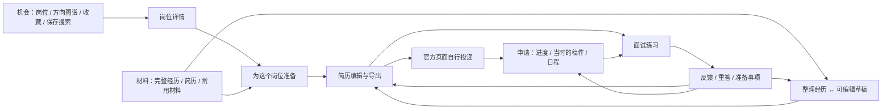

# Aijob 下一版 UI / UX 设计

设计日期：2026-09-07。面向中国大陆本科、硕士、博士在校生，覆盖实习、校招、应届和管培；承接 coco 已认可的完整经历、AI 挖掘、简历优化与面试连续性设计。

**本轮交付为设计规范与可交互原型。正式应用代码、数据库和真实 AI 配置未在本轮修改。** 原型使用虚构岗位、经历和示范对话，不代表产品已经具备新的智能教练能力。原有六阶段成果、OS-7、事实纠偏、公司上限取消与业务恢复继续保留。

**后续研究补充：** [简历编辑器与导航复核](resume-editor-and-navigation-review.md)对照 4 个商业产品参考与 3 个 GitHub 开源项目，提出编辑器能力补齐、收藏/常用筛选归位和经历/表达合并入口的建议。此补充尚未实施，不能把 V2 或正式应用描述成已经具备这些能力。

**系统方案汇总：** [经历、简历、AI 与工作区系统升级方案](../../plans/product-experience-system-upgrade-2026-09-07.md)整合本轮全部反馈，明确拟实施的完整编辑器、8 个主要目的地、真实 AI、数据迁移与 U0–U6 验收。它是待实施方案；本页及 V2 继续记录已经交付的设计与原型，不表示原型已同步完成这些新增能力。

当前入口：[工作区 V2](http://127.0.0.1:5188/prototype-v2/#today) · [V2 修订与组件覆盖](workspace-v2.md) · [V2 源文件](prototype-v2/index.html) · [研究依据](research.md)

2026-09-07 根据 coco 的实际浏览器反馈修订：V1 的三入口顶栏、展示页宽度和过少组件被 V2 取代。下面的产品原则继续有效；导航、布局、组件范围与自适应验证以 [V2 修订](workspace-v2.md) 为准。[V1 原型](http://127.0.0.1:5188/prototype/#welcome)及[V1 验证](coverage-and-qa.md)保留作对照，不能继续作为最新 UI 验收结论。

## 1. 设计判断

下一版应让人感到：**我知道现在可以做什么；我做过的事被认真理解；我的准备能够留下来、继续用。** 活力主要来自明快的重点色、清晰的操作和有帮助的反馈。求职工作区需要能长时间阅读、写作与比较。

当前系统已具备岗位、材料、申请、导出和面试的工程能力，但之前的走查复现了：新手缺少起步路径、完整项目被按标点拆散、确认后还要初始化、主任务被版本和证据栏目挤压、追问依据错位等问题。改善这些问题，比换一套配色更直接影响体验。详见[既有体验审视](../../reviews/product-experience-audit-2026-09-07/README.md)。

本轮采用五个贯穿界面的规则：

1. **以完整事情组织材料。** 用户面对课程、科研、社团、实习等经历；内部仍能定位原句与事实。
2. **先完成当前任务。** 输入区、采用修改、导出和下一题放在当前工作区；版本与依据按需展开。
3. **一次帮助解决一个卡点。** 有具体追问、可编辑草稿，也允许直接编辑、跳过或先写一版。
4. **动作产生可见结果。** 保存、采用、撤销、投递留存、延期等都能找到结果；中断后接得上。
5. **鼓励有事实基础。** 说明已经讲清了什么、还可补哪一点；不评价学生“能力低”、不预测 offer，不比较同伴进度。

## 2. 用户情境，而不是给所有人同一套流程

| 情境 | 此刻最需要的帮助 | 默认入口与交互 |
|---|---|---|
| 第一次写简历，只有课业和社团 | 知道什么能写，先得到一个完整产物 | “从一段经历开始”；先说两句日常语言，边聊边形成草稿；无需先上传简历 |
| 已有完整项目和 STAR 表述 | 快速修改重点，保留上下文 | 导入后直接编辑；整段核对归属；助手由用户按需打开 |
| 本硕博科研、非商业成果 | 说清方法、个人贡献、阶段成果和局限 | 采用研究/实验对应追问；不强制增长数字、业务指标或互联网术语 |
| 有明确目标岗位 | 判断要求，选材料，留下定制稿 | 岗位详情 → 选择已有稿件/经历 → 围绕岗位修改；岗位上下文持续显示 |
| 已投递，等待回复或收到面试 | 找回当时的材料，安排下一步 | 申请工作台 → 实际投递稿、安排、面试练习；未回复保持未回复 |
| 多方向、碎片时间、手机操作 | 快速切换、复用和恢复 | 保存搜索、方向稿、常用材料、草稿恢复；当前输入先于历史记录 |

这些是设计情境，不是对全部年轻求职者的心理画像。中文帖子支持关注同伴比较、回音不足和准备整理等问题，但不能证明它们在目标用户中的比例。[研究方法与来源](research.md)记录了全文可读性、样本偏差及设计推断。

## 3. 信息架构与导航

桌面采用分组侧栏：**找机会 / 做准备 / 跟进申请**，直接显示岗位、图谱、收藏、保存搜索、经历、简历、常用材料、投递、日程和面试入口；今日工作台放在最前。顶部负责当前位置、搜索和当前任务工具。手机采用四项底栏与完整导航抽屉。资料与设置固定可见；内部采集运营不进入学生导航。详见 [V2 导航与自适应规则](workspace-v2.md)。

这张图表达可往返的关系，不是所有用户必须依次完成的向导。没有简历也可浏览；没有投递也可练习；有成熟材料可直接编辑和导出。

| 现有路由 | 新界面归属 | 兼容策略 |
|---|---|---|
| `/today` | 今日安排、继续上次任务 | 老链接继续有效；新用户显示起步选择，回访用户显示自己的上下文 |
| `/jobs`、`/jobs/:jobId` | 机会列表、岗位详情 | 保留来源事实与收藏语义；详情可在桌面抽屉查看，也必须有可直接访问的页面 |
| `/jobs/insights` | 当前方向图谱 | 与列表共享筛选上下文；不用先建立分析运行 |
| `/jobs/insights/:runId` | 历史洞察 | 保留只读历史；不强制用户理解运行编号 |
| `/jobs/recommended` 及历史运行 | 有资料时的个人对照 | 从岗位或相关经历进入；公共发现入口不依赖个人资料 |
| `/resumes`、`/resumes/:documentId` | 材料入口与简历编辑 | 沿用唯一简历编辑器；经历库作为同一材料区域的主视图 |
| `/resumes/import` 及确认路由 | 导入 → 内容与归属核对 → 直接编辑 | 初始化由同一用户动作完成；兼容旧分析记录，不再单设 V1/V2 操作 |
| `/resumes/snippets` | 常用材料 | 自我介绍、项目长短版、邮件等；保留直达链接 |
| `/applications`、`/applications/planner` | 申请与安排 | 日程在工作台可见；独立日程链接仍可直达 |
| `/applications/:caseId/:tab` | 单份申请详情、简历、投递、面试和复盘 | 页面文案用“这份申请”；沿用 Case 和修订边界 |
| `/settings/data` 及删除状态 | 资料与数据管理 | 集中设置；删除流程保持明确结果 |

新增经历整理与练习直达地址在实施时制定前后端契约；本原型的 `#coach`、`#resume` 等只是演示路由，不替换现有地址。

## 4. 统一助手：三个任务入口，按情境选方法

用户看到同一个“求职助手”，通过 **整理经历 / 优化简历 / 模拟面试** 开始任务。岗位知识、贡献分析、事实核对等作为内部方法复用，不再增加“岗位导师、资深导师、模拟面试官”等相似菜单。

| 任务 | 要形成的产物 | 帮助方式 | 何时结束或转入其他任务 |
|---|---|---|---|
| 整理经历 | 完整事情、个人贡献、结果边界，以及可用草稿 | 先听描述；只补当前重要缺口；边聊边整理；可直接编辑 | 已能说明事情和个人动作，未知信息有边界，即可先用；用户决定是否继续深入 |
| 优化简历 | 当前目标下更清楚、相关的表达 | 对照改写；解释改变的重点；信息不足时回到经历追问 | 用户采用或拒绝修改；新事实需核对后进入材料，已有事实不重复确认 |
| 模拟面试 | 能回应问题的回答、具体反馈及下一次练习 | 围绕岗位和选定稿件追问；检查理解、方法、选择与局限 | 可练一题、结束一轮或重答；反馈回到准备和材料，不自动改写个人事实 |

追问策略记录适用情境、已有信息、缺口、例子和停止条件。新手可获得回忆提示，熟练用户直接谈具体取舍；研究经历问研究方法，运营经历问内容与协作，资格题只核对资格。深度根据任务与回答变化，不把人分成“低级/高级求职者”，不以问得多作为质量。

“边练边指导”在回答后给反馈；“模拟一轮”在结束后集中回顾。两者共享岗位和经历依据，区别在任务节奏。切换方式、暂停、跳过均保留已有回答。文字练习不评价语速、声音与发音。

## 5. 逐页设计与关键交互

### 5.1 首次进入与今日安排

首次进入呈现三个明确入口：从零整理、导入已有简历、先看机会。无需填写完整偏好或做问卷才能开始。登录用于保存个人资料，公开岗位探索不因缺少简历而被阻断；正式账号接入仍沿用现有身份体系。

回访首页只优先展示一个可继续的任务和近期真实安排，其下放最近材料与相关机会。没有安排时用平静的空状态，不人为制造每日任务。经历还未保存、已有草稿、最近刚导出等状态对应不同的“继续”动作。

首页可以有温暖的主句，编辑页标题直接写任务名称。避免每个页面重复大口号、圆形背景装饰和统计卡。首页的进展来自本人的记录，不展示同龄排名、连续打卡、简历总分和焦虑倒计时。

### 5.2 机会列表与岗位详情

列表优先让人扫到：岗位、公司、地点、招聘类型、学历原表述、出勤/时长、薪资是否说明，以及两三句实际工作内容。收藏保持可见的文字按钮；点击岗位名即可看详情。高频方向、城市、关键词放在列表前，其余招聘类型、学历、毕业月份/届别等条件展开后可见并保留已选状态。

筛选不等于系统替用户裁决。院校优先、否定、或条件和未知信息保留原意。筛选后的未知条目由“包含未说明”明确控制，不静默排除；页面默认不自动劝退。切到图谱、看详情再返回时，恢复筛选、列表位置与键盘焦点。

详情第一屏提供工作概览和重要资格原句。“为这个岗位准备”进入材料选择，列出最近稿件、相关完整经历及“先整理一段”；上下文显示目标岗位。“前往企业官网投递”是明确可见的动作，打开链接不自动记成已投递。来源日期用简短中性文字，发生撤回、过期或访问异常时再提高提示强度。

收藏沿用既有 `interested` 阶段。它在“机会”的收藏视图继续浏览；开始准备后，同一岗位进入申请工作区，不再让用户创建另一个同义对象。原型的本地收藏数组仅用于演示，正式实现仍复用既有状态模型。

### 5.3 方向图谱

图谱回答“这个方向常做什么、我能从哪段经历开始准备”。默认呈现一个已选方向；没有方向时提供少量职能选择，避免全职能混在一个榜单。

每行按任务、工具、产物分组呈现：要求名称、简短含义、岗位提及数/总数、企业覆盖数/总数及查看原句入口。岗位提及和明确硬性要求分开显示；必要性不明单独计入未知，不默认当成硬门槛。解析覆盖与核验日期范围作为表头一行状态，详细口径展开查看。

大公司岗位全部保留。企业分母用于帮助理解集中度，不删除岗位或替用户计算虚假匹配度。单条样本仍可查看，零条时给出条件与调整入口；小样本用事实性的样本数提示，不停显或渲染趋势。

方向对照保留两组各自的分母；共性与区别放在同一行。手机使用紧凑的两列计数和横条，表头随内容明确标识两方向，避免雷达图叠加、伪精确总分和高密度关系网。

点击统计项进入原句抽屉，可查看具体岗位、原句及来源。下一步提供“关联已有经历 / 整理一段经历 / 加入准备清单”。准备清单默认提出一件可完成的动作，例如整理一次复盘的依据；不一键生成十门课或把所有缺项都变成待办。私有 JD 的集合与公开统计分别标明范围。

### 5.4 我的材料

三个材料目的地：**我的经历 / 我的简历 / 常用材料**，桌面直接进入，手机保留页内切换。完整经历卡显示名称、类型与日期、个人贡献和产物摘要，以及相关方向；展开看全部内容。默认不展示证据 ID、版本号或“0 条证据”。已有 STAR 内容原样归属于一件完整事情；识别错误时提供合并、拆分为另一件事情和修改归属。

经历卡直接提供继续挖掘、放进简历或练习讲述。尚未完成的草稿与已整理经历明确标记，最近草稿可一键继续。系统内部可以提取任务、动作和事实片段；可见主对象始终是完整经历，不能只选“结果”而丢掉责任边界。

简历视图显示方向稿、最近修改及编辑/导出按钮；“另存为方向稿”复用现有文档能力。常用材料按用途展示正文、复制和修改，支持逐段复制。联系方式由资料模块提供给最终简历，不把去标识化占位符当作可投递联系方式。

### 5.5 经历整理：对话与草稿同时推进

桌面采用两栏：左侧约 55% 为当前问题和输入，右侧为完整草稿。顶部是返回、任务名称、保存状态。当前问题先于折叠的历史回答；草稿不只在所有问答结束后才出现。

一轮只问一个重点，包含一个主问题和必要的小提示。普通口语可直接输入；提供“先整理成草稿”“暂时想不到”“给我一点提示”。“不知道数据”“这部分不是我负责”“没有上线”等都是正常分支。系统可以指出信息缺口，但不把缺口等同于用户能力不足。

用户开始 AI 整理时，简短说明本次会用哪些材料、是否会发送给所配置模型；“开始整理”本身是明确操作。查看范围与处理说明可展开，不重复设置逐句确认勾选。确认新增事实在采用草稿时完成；上下文已确认的事实不再反复问。

右侧显示名称、整段草稿和本轮形成的具体信息。采用是整段写入或可检查的局部修改，允许撤销。准备计划、助手示例与面试假设不会随保存按钮自动变成已确认的经历。

手机切换“整理对话 / 经历草稿”，草稿更新有文字提示。两个视图共享保存状态，切换不丢输入；键盘打开时保留当前输入和发送操作，历史与解释保持折叠。开始新经历前，已有未完成内容保留为草稿，提供继续入口，不静默清空。

### 5.6 简历编辑：先编辑，需要时再求助

沿用现有编辑器。宽屏显示模块目录、可编辑纸张与任务辅助栏；工具栏明确提供模块管理、版式、版本记录、预览、AI 优化和继续挖掘。导出和练习放在页标题旁。中等窗口按可用空间收起目录或辅助栏，但同一操作仍在工具栏可见。全局导航保持稳定，内部事实与原句引用按需查看。

AI 建议显示当前内容、建议内容、变化理由及需要核对的新信息。用户可以采用、继续修改、拒绝或追问。不能在建议生成时覆盖正在输入的文字；采用需匹配本次建议基于的修订，冲突时给出可比较的两版。

保存只有一个清晰模型：编辑自动保存草稿；“采用建议”是一次明确修改；“导出”输出当前已保存稿。后台修订可以严格，前台不要求用户按多个保存按钮。保存失败时提供重试和复制，不能显示成功后才异步报错。

手机通过模块选择器编辑基本信息、教育、校园经历、课程项目和工具；当前整段输入优先，通过“完整预览”查看全稿。V2 已实现模块切换、直接编辑、隐藏恢复与排序。版式变化不要求重新填写正文；正式整合继续支持原有多章节和多方向稿。

导出区保留 PDF、DOCX 和打印，说明当前稿件及文件名。正式 PDF 继续使用既有后台导出与运行字体，不新增编辑器。本原型只实现浏览器打印和当前文字稿下载。

### 5.7 申请与日程

主工作台把申请列表、最近安排放在一起。“记录一次投递”和“添加安排”常驻可见。列表先显示岗位、阶段、最近动作、下一安排与进入详情的操作，减少泛化统计。

单份申请默认展示当前下一步；同一页面能打开当时的投递稿、岗位要求与面试记录。阶段可切换列表或以后增加看板视图，但不要求拖拽才能修改。批量修改有明确选中数量，部分失败逐条显示，不让成功项目重复提交。

记录投递时关联实际使用的正文及布局修订。仅修改为“已投递”不猜测用过哪份简历；未记录的稿件显示待补充。后续修改方向稿不覆盖历史，重新投递增加一条历史记录。

日程包含笔试、面试、截止和待跟进；北京时间、全天事项与明确时刻区分。完成、改时间、导出日历都可直接操作。已完成项不继续提醒，延期更新同一事项；重复加入相同准备项提示已有记录。未收到回复保持中性状态，结束由用户或明确结果触发。

### 5.8 面试：当前题优先，反馈能接着用

从经历卡、简历段落和申请都能启动，携带选定的经历、目标岗位与稿件。已投递申请优先使用实际投递稿，用户可主动切换并看见当前依据。开始练习前冻结本轮使用版本；后来改稿不悄悄改变正在练的内容。

主区放当前题、必要背景、输入和回答操作。旁边的依据可展开；手机把背景与旧回答收起。历史记录从不把下一题推到几屏之外。允许跳过、暂停或结束，进入下一题时将焦点移到新题目，继续输入时不抢焦点。

答后反馈呈现三项：回答中的具体内容、已回应的部分、下一次最值得补的一点。需要基于回答原句，不能按字数和关键词判定“已经很具体”。真实 AI 未运行时只提供明确标注的结构化自检。

重答时保留上一版回答，用户可对照关键变化；完整稿与聊天记录按需展开。建议可成为一项准备任务，或进入简历修改对照；不能自动回写成已发生的经历。动机、情境判断和反问等题型有独立策略，不全都套成 STAR 项目题。

### 5.9 指导内容、设置与内部运营

指导在卡点出现：不知道从哪件事开始、混淆团队与个人贡献、结果没有数据、解释不清方法等。每张卡先给当前有用的短建议；例子、来源、日期与适用限制可展开。另设可检索的帮助入口，但不让用户先学完教程再写简历。

头像设置集中管理账户、资料、AI 使用说明和删除。正常页面提供简短保存状态；真正涉及发送资料、扩大范围或不可逆删除时再清楚提示。减轻视觉负担不等于删去权限、保留期限和删除能力。

内部来源运营继续独立：异常队列 → 影响范围与证据差异 → 复核动作 → 结果。批量批准首次范围变化须能检查每一项；普通刷新自动流转。采集状态、适配器和请求预算不进入学生主导航。该界面的完整视觉改造后续随实际运营场景单独验收，不冒充本原型已覆盖。

## 6. 视觉系统

视觉意象是“可以持续写下去的求职工作桌”：暖白纸张、深青绿文字与操作、少量明亮标记。纸张、边注和折角用于材料场景，整体保持简洁；插画只出现在首次进入和少数空状态，编辑与面试区以内容为主。

| Token | 数值 | 用途 |
|---|---|---|
| `canvas` | `#F5F5EC` | 主背景，长时间阅读 |
| `paper` | `#FFFEF9` | 正文、表单与编辑纸张 |
| `ink` | `#173E38` | 标题与关键文字 |
| `text` | `#243D37` | 正文 |
| `muted` | `#5C6A61` | 次要说明，仍需满足对比度 |
| `green` | `#235C49` | 主操作、选中状态；配白字 |
| `mint` | `#E6EEE1` | 温和的上下文提示与选中背景 |
| `lemon` | `#E7ED85` | 少量重点标记；配深色字 |
| `coral` | `#E98565` | 小面积活力装饰，不能同时作为错误色 |
| `peach` | `#F9E9DC` | 柔和类别背景 |
| `danger` | `#A5372E` | 实际失败与破坏性动作，配明确文本 |
| `line` | `#D6DBCE` | 结构分隔；输入边框和焦点需另满足可辨识性 |

字体优先本机中文无衬线：Windows 为 Microsoft YaHei UI / Microsoft YaHei，macOS 为 PingFang SC，之后为 Noto Sans SC 等。原型不访问外部字体服务；本轮核对 Chrome 实际使用 Microsoft YaHei UI。正式跨平台版本如嵌入字体，另行提供许可、字形覆盖和大小预算，不把整套大字体放进首屏。

排版以可读和工作密度平衡：工作内容约 14–16px，常用按钮 13–14px，桌面页标题 28px，手机页标题 25px；紧凑的日期、来源和计数使用 11–12px。手机直接编辑正文保持 14px 与宽松行高。V2 用原生 200% 缩放检查可用空间重排；具体组件密度见 V2 原型，正式设备继续检查实际阅读舒适度。

间距使用 4/8/12/16/24/32/48px；主要区域间距大于同组控件。按钮常用高度 44–48px，圆角 8–10px；内容容器约 12–16px，纸张保留较直的边缘。可点击卡片不再嵌套多个同等强度的主按钮；图标配文本，只对关闭等熟悉操作提供带名称的图标按钮。

不使用满屏渐变、炫光、漂浮玻璃、全站胶囊、每栏一张统计卡和频繁的“AI 星光”。图表用横条与明确分母，状态不能只靠颜色表达。工作页面无需入场动画；状态转换保持短促，支持减少动态效果。完成任务可以有轻量文字反馈，面试中断与未回复不出现庆祝或羞辱动效。

## 7. 鼓励方式与文案规则

| 场景 | 推荐表达 | 避免造成的体验 |
|---|---|---|
| 首次开始 | “课程、科研、社团和个人作品，都可以从这里整理。” | 把没有实习等同于没经历 |
| 回访 | “上次的草稿还在，继续整理这段经历。” | 用断签、落后提示催促 |
| 回答泛泛 | “你提到参与策划，哪一步是你具体做的？” | 直接评判表达空洞或能力不足 |
| 没有数据 | “可以说最后交付了什么；不知道的数字先保留未知。” | 为追求效果逼用户编造提升比例 |
| 已有进展 | “个人分工和产物已经讲清，可以先用这一版。” | 没有依据地说优秀、完美、竞争力高 |
| 练习回顾 | “这次已经区分个人动作和团队结果；下次补一个选择理由。” | 以字数、套话或总分替代具体反馈 |
| 等待回复 | “暂未收到回复。需要时，可以安排一次跟进。” | 默认拒绝、虚构企业状态 |
| 保存失败 | “还没有保存成功，内容仍在本页。重试或先复制保留。” | 假成功、空泛报错或让人重新填写 |

产品应尊重用户停止、休息和改方向的权利。鼓励不自动开启，不在每条消息末尾贴同一句口号；工作区优先用具体、自然的语言。

## 8. 状态、可访问性与连续性契约

| 状态/边界 | 界面行为 | 实施与验收要求 |
|---|---|---|
| 无材料 / 无目标 / 无结果 | 给一个可开始的动作；保留浏览或直接编辑路径 | 不出现“先有简历才能创建简历”的循环 |
| 解析中 / 部分解析失败 | 显示进度及已获得内容；不确定位置局部标记 | 保留完整项目；乱码、跨页和项目归属可纠正，不要求重填全部 |
| 保存中 / 成功 / 失败 | 同一位置显示状态；失败可重试、复制和恢复 | 同一草稿幂等保存；冲突不覆盖；离开时未保存提示不等于每次离开都确认 |
| AI 排队 / 超时 / 预算不可用 | 给真实状态、取消和手动路径 | 不伪造逐字生成或完成结果；不重复扣用量；迟到结果标明基于哪版 |
| 用户在 AI 处理时继续写 | 用户输入持续可用 | 模型结果作为建议到达，不覆盖当前修订 |
| 完整经历与事实引用 | 页面以整段操作，依据可展开 | 保存父经历、事实范围、来源和修订；历史 Case 原句不回写 |
| 公开岗位撤回 | 从公开查询与图谱移除；收藏说明当前状态 | 私人历史保留授权范围内的既有快照；不继续作为当前公开机会推荐 |
| 投递状态批量更新 | 展示选中数量、成功和失败项目 | 不把状态更新视为提交到企业，也不猜测实际投递稿 |
| 删除个人资料 | 说明删除对象与结果，提供状态页 | 迟到任务不复活；普通编辑不复用删除式确认 |
| 列表返回 / 抽屉 / 模态框 | 恢复筛选、位置、当前对象与焦点 | Escape 可关闭；焦点限制在打开的对话框；关闭后回到触发按钮 |
| 键盘与放大 | 可见焦点、语义化标题、明确按钮名 | 320/360px、200% 原生缩放、Tab/Shift+Tab、屏幕阅读器实测分开记录 |
| 手机输入与长会话 | 当前题和输入先显示，旧记录折叠 | 真实软键盘、视口变化和安全区域另测；不把历史数组直接堆在输入前 |

公共统计、个人对照、经历草稿、简历正文、投递快照、面试回答与准备任务继续是不同的数据对象，但不成为用户反复填写的步骤。统一主操作可以在后台完成多个必要写入，其事务归属、失败恢复和修订冲突要显式设计。

## 9. 实施承接与取舍

正式落地采用可使用的连续小批次，不重做六阶段成果或全仓重写：

| 批次 | 可交付产物 | 依赖与最低验收 |
|---|---|---|
| A：先修现有任务面 | 导入后直接编辑、清晰保存、输入区前移、常用动作可见；修正已复现的错位追问 | Web 与现有命令整合；地点不生成项目题，确认不重复初始化，手机可直接动手 |
| B：完整经历与从零起步 | 新建/导入完整经历、可恢复草稿、AI 或规则引导、整段采用进入现有简历 | 经历与引用契约、前向迁移、owner 隔离、幂等与修订；本硕博和非技术语料回归 |
| C：简历与面试往返 | 对照改写、岗位/稿件正确带入、重答对比、准备回写 | 实际投递稿固定；新增事实采用；AI 无结果时诚实降级；指导策略版本和预算 |
| D：探索与日常统一 | 分组侧栏与移动替代入口、方向图谱行动、收藏/保存搜索、材料复用与日程统一 | 公共撤回缓存、双分母、私有集合隔离、部分失败、时区与提醒去重；旧地址兼容 |

视觉基础组件先覆盖导航、按钮、字段、通知、列表、对话框和保存状态，再逐页替换。可先消除无争议的重复操作和误判，不让完整视觉换肤成为修复旧问题的前置条件。数据变化按项目要求运行专项 PostgreSQL 验证；页面变化配相称的类型、构建与行为检查。

为“首次选择 AI 使用草稿”“完整经历与事实确认关系”等受既有边界约束的部分，实施时记录新的 ADR 与契约；本设计没有偷偷启用外部模型或放宽数据使用范围。共享岗位、后台任务和个人权限继续沿用 PostgreSQL、模块化单体与三个权限边界。

暂不增加独立导师市场、等级训练营、成就排名、社交动态、完整职业百科、语音评分和自动投递。反馈随交付收集，不能因不断补充候选功能无限延后已有首发工作。

## 10. 怎样判断改善成立

工程可用性先覆盖：无简历起步、完整 STAR 保留、硕博研究和未知结果、直接编辑、上下文正确开练、返回不丢草稿、历史稿不被覆盖。原型结果见[覆盖与验收](coverage-and-qa.md)，不可替代正式应用的相同检查。

真实使用阶段关注：从入口到首段可编辑产物的耗时与卡点、重复确认次数、丢稿率、常用动作寻找失败、追问相关性、用户能否解释自己采用的改写、重答是否更贴题。默认不采集简历或回答正文作为分析日志；记录必要操作事件、耗时与用户主动反馈，沿用用户控制与删除能力。

视觉和功能体验同时收口。目录、图谱与编辑器按需加载；保存不阻塞打字；只有真实执行中的任务显示进度。本原型静态加载的速度不能证明正式系统性能改善；既有冷查询、后台混合负载与真实运行配置的未就绪项继续存在。

## 11. 原型体验路径

1. 打开首次入口，选择“从一段经历开始”。原型可用“填入示例回答”走三次，查看整段草稿；也能输入自己的虚构内容。
2. 保存完整经历，在“我的材料”找到它，再放进简历。直接修改，试一次建议对照和撤销，查看手机上的完整预览与导出。
3. 在申请页记录投递内容；改动方向简历后，回来看当时稿件仍保持原样。
4. 从课程经历或申请进入面试，分别查看题目依据；试“边练边指导”“模拟一轮”、重答与加入准备。
5. 在机会里切换图谱，比较两个方向，点统计项看岗位原句，再加入一项准备。

顶部“切换示例状态”仅供设计评审，可查看空状态、AI 不可用和保存失败。原型输入保存在当前浏览器的专用键中；重置只影响本原型。正式应用不包含这个演示控制。

设计文件位于独立主目录 `C:\Users\72998\Projects\Aijob` 的 `docs/designs/product-experience-2026-09-07`，没有修改原 OS-7、旧工作树或恢复数据。
