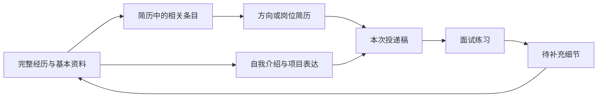

# 简历编辑器与导航复核

2026-09-07。回应 coco 对 V2 简历编辑过于简单，以及收藏、保存搜索、经历、常用材料入口重复的反馈。

**状态：研究与设计建议，尚未实施。** 本文不表示 V2 原型或正式应用已改版，也不表示真实 AI 已接通。保留现有左侧工作区框架、完整经历、一个求职助手、投递稿留存和既有工程成果。

## 结论

- 简历编辑器的完成度不足。正式系统已有编辑、修订和导出的基础，V2 只演示了一小部分；需要把模板、模块内多条经历、格式编辑、分页、恢复和多份简历组成完整工作流。
- 收藏有明确用途：保存具体岗位，稍后比较和准备。建议作为岗位页常驻的“已收藏”视图，保留直达地址，移除默认左侧独立入口。
- 保存搜索保存的是一组条件，适合反复查同一方向。当前实现只是部分条件的复用，尚无新增岗位提醒，连关键词契约也不完整。建议改为筛选区的“常用筛选”。
- 经历与常用材料有不同用途，但应共用“经历与材料”入口，并建立来源与表达的关联。我的简历继续独立，承担编辑和导出的高频任务。
- 完整经历是组织和理解材料的单位，不限制最终排版。一个项目可以呈现为若干要点，不能因此把每个要点变成需要独立确认、管理的经历。

这些是基于实际界面、仓库实现和任务流程的设计判断。竞品拥有某功能不能单独证明 Aijob 应当采用；本轮没有把竞品宣传、模板数量或用户评论当作求职效果证据。

## 参考范围与证据强度

本轮核对了 4 个商业产品参考及 3 个 GitHub 开源项目。商业参考包含免费与会员能力，不购买服务，不使用真实简历测试；区分实际访客界面、官方操作说明和宣传内容。

| 参考 | 本轮核对方式与看到的能力 | Aijob 适合吸收的部分 |
|---|---|---|
| [五百丁公开编辑器](https://www.500d.me/newcvresume/edit/?itemid=714) | 实际进入未登录预览并打开主题设置。可见模块管理、自定义模块、模板切换、字体字号、页边距、模块间距、分页显示、撤销恢复和导出入口；未验证会员保存与下载 | 模块和文档工具分层；排版参数集中；常用文档操作外显 |
| [FlowCV](https://flowcv.com/)、[官方付费范围](https://flowcv.com/pricing) | 实际从模板库进入空白访客编辑器，打开 Add Content 与 Customize。可见多种内容类型、单栏/双栏/混合布局、日期、字体、边距、条目布局和页脚；多份简历等付费范围以官方价格页为依据，未测试购买 | 内容与设计分开；模板可后换；模块内条目与整页布局各有控制 |
| [超级简历 WonderCV](https://www.wondercv.com/) | 官方页面核对模板分类、范文、AI 修改和多端入口；未登录会员编辑器 | 按求职情境起步、在填写处提供示例；不据营销文案承诺通过率或 AI 质量 |
| [简历本官方使用说明](https://www.jianliben.com/article/detail/100) | 浏览器阅读官方教程：格式编辑、插入一栏/一项、保存及 PDF/Word 导出；教程年份未明确，不作为现行会员完整体验的证明 | 区分章节与条目；常用富文本操作就近出现 |
| [Reactive Resume](https://github.com/amruthpillai/reactive-resume) | 官方仓库与当前文档核对实时预览、富文本、章节排序、自定义章节、模板、排版和多格式导出；本轮未部署仓库 | 结构化内容与渲染分开，模板复用，版本与分页有明确操作 |
| [OpenResume](https://github.com/xitanggg/open-resume)、[公开编辑器](https://www.open-resume.com/resume-builder) | 实际查看表单，存在模块标题修改、排序、隐藏、增加学校/工作/项目、要点编辑和 A4/Letter 设置。仓库说明 PDF 预览及导入；未上传简历验证解析 | 模块内多条记录、低门槛起步、输出预览；默认美国求职格式不能直接作为国内规则 |
| [猫步简历](https://github.com/Hacker233/resume-design) | 官方仓库说明固定简历布局与自由积木两种设计器、主题调整、草稿及 PDF/JSON 导出；本轮未部署或验证在线 AI | 中文模块、可配置样式、模板和数据分开；自由画布是否值得引入需另行判断 |

补充操作依据：[Reactive Resume 的跨章节移动](https://docs.rxresu.me/guides/moving-items-between-sections)、[页面容纳与溢出处理](https://docs.rxresu.me/guides/fitting-content-on-a-page)、[撤销与历史恢复](https://docs.rxresu.me/guides/undoing-changes-and-version-history)。只参考可解释的操作设计，不照搬其所有求职建议或默认页面格式。

## 仓库实际状态

| 能力 | 正式系统代码 | V2 原型 | 应补的用户能力 |
|---|---|---|---|
| 模板 | 契约目前枚举两个模板 | 两种简单样式 | 用实际内容预览模板，换模板不丢内容，能恢复 |
| 模块编辑 | 可增删章节和文本块、排序；主体仍是标题和纯文本 | 固定四类模块，排序、隐藏及整段输入 | 章节内多条完整经历；学校、组织、角色、日期、描述分别编辑 |
| 格式编辑 | 主体文本块以 textarea 编辑 | textarea 为主 | 要点列表、加粗、链接、清除格式、粘贴归一；编辑时保持完整项目归属 |
| 文档与布局版本 | 已有独立修订及冲突处理 | 最近修改和撤销演示 | 自动保存、可靠撤销重做、历史预览恢复、保存失败保留输入 |
| 分页与导出 | 有打印规则、超长章节处理、后台 PDF 和 DOCX 服务 | 浏览器打印及简单预览 | 真实纸张预览、页边界、局部换页、中文和长内容回归 |
| 多份简历 | 已有基础稿、派生稿和复制服务 | 主要是一份示例稿 | 列表中复制、命名、按方向/岗位查找，明确本次正在编辑哪一份 |
| 投递版本 | 已有固定正文与布局引用 | 示例快照 | 在编辑与申请两处都能找回实际投递稿 |
| 常用材料 | 已有类型、正文、来源文档/修订/块引用与 owner 隔离 | 独立列表 | 关联完整经历，按使用场景找到表达，不重复录入原始经历 |
| 保存搜索 | 保存/列出/删除部分 JobGraphScope 条件 | 保存并复用示例条件 | 完整往返关键词与筛选；放回筛选操作位置 |

代码核对入口：[编辑器](../../../apps/web/src/career-os/components/ResumeDocumentEditor.tsx)、[简历契约](../../../packages/contracts/src/resume-documents.ts)、[复制服务](../../../apps/platform/src/resume-documents/copy-service.ts)、[材料来源](../../../apps/platform/src/resume-documents/material-snippets.ts)、[保存搜索](../../../apps/platform/src/planner/service.ts)、[筛选范围](../../../packages/contracts/src/job-graph.ts)。

不能把“正式系统已有服务”写成“V2 已能用”，也不能因为 V2 简化而删除或重建正式系统已有服务。

## 简历编辑器的建议设计

### 1. 模板与内容预设分开

模板决定字体、分栏、标题、间距和纸张效果。内容预设决定初始显示哪些模块，两者可独立调整。

建议先做好 4–6 种经过真实内容验证的模板，覆盖清晰单栏、经典单栏、紧凑单栏、简洁双栏和适合多页材料的版式。提供缩略图和使用自己内容的预览，不用换颜色充当模板差异。默认 A4；照片为可选，不能使没照片的布局留下空洞。

内容起步可选“首次求职”“项目实践”“科研经历”等，也允许直接进入空白简历或导入已有文件。模块选择不限制专业；硕博用户可加入研究、论文、专利、学术报告等，运营、设计、财务、供应链等同样能使用完整项目结构。

换模板只改变呈现，不能重置正文、隐藏用户已有内容或偷偷改写事实。模板切换引起页数变化时在预览中呈现，允许直接撤销。

### 2. 模块、经历条目和要点是三个不同层次

```text
项目经历（模块，可改名、排序、隐藏）
  校园二手书研究（完整条目，可复用、移动）
    项目名 / 所在组织 / 角色 / 时间 / 链接
    背景或目标（按需展示）
    个人行动与产物（可以排成多个要点）
  社团投稿管理（另一完整条目）
```

模块和条目都要支持添加、编辑、排序、复制、隐藏/恢复。提供拖动及上移/下移替代，手机和键盘用户都能完成。用户隐藏一条经历只影响这份稿的显示，不删除经历库内容。

正文提供轻量富文本：加粗、要点列表、链接、必要换行和清除格式。不要求用户手工用空格对齐日期。粘贴内容保留可理解的段落/列表，消除乱字体和无法解释的空白。

“保留完整经历”约束的是组织和上下文。AI 审阅一个要点时仍能读取所属项目与相关回答，最终简历仍可简明分点。不能倒退到按标点切碎经历、再要求逐条勾选。

### 3. 排版必须能看到最终结果

常用设置包含：字体、正文/标题字号、行距、条目间距、模块间距、上下左右边距、主题色，以及单栏/双栏时的栏目分配。高级参数按需展开，提供恢复模板默认值。

预览显示真实 A4 页面、页码和跨页状态。应支持标题跟随首段、尽量保持一条经历完整，以及手动“从下一页开始”。超长条目允许合理分页，不能为了整块不拆而产生空白页或裁掉文字。

一页模式可先通过间距和排布改善；需要删减正文时展示建议，由用户采用。科研材料或较多相关经历允许两页及以上，不全局强制一页，也不悄悄缩小字体直到难以阅读。

PDF 需要文字可选择、中文字体正确、链接可用、纸张不溢出。DOCX 继续提供并测试可编辑性；不同格式不承诺天然像素一致，不能拿一份短示例 PDF 证明全部模板和页数正确。

### 4. 编辑操作与材料复用

顶部常驻：简历名、所属方向/岗位、保存状态、撤销/重做、预览、导出。模板、排版、历史有清楚文字入口。

桌面主要区域采用“模块目录 + 纸张编辑/预览 + 按需辅助面板”。AI 面板关闭后可以安心手工编辑；选中具体模块再提供局部辅助。手机在“编辑 / 预览”间切换，不把整张纸缩成小字编辑。

经历可从库中插入，也能直接在简历里新增；保存到经历库是自然操作，不是写简历前的门槛。导入后先恢复基本信息和完整项目归属，纠正解析错误时支持合并/拆分项目，避免再次进入逐句确认流程。

方向稿是独立可编辑文档；更新原始经历不自动覆盖各方向措辞。可以提示关联材料有更新，查看差异后决定采用。实际投递稿始终固定在当时的正文与布局版本。

### 5. AI 在编辑器中的边界

整份审阅关注选材、顺序和岗位相关性；局部改写关注准确表达；信息不够时进入动态追问。输出应带具体建议、理由和修改前后对照，支持采用、局部采用、忽略、撤销。

检查可具体提示空模块、疑似占位符、时间缺失、重复条目、过长表达和页面溢出；不使用没有依据的求职总分，也不承诺任何国内 ATS 百分之百通过。AI 尚未接通时明确提供手动编辑与规则检查。

### 6. 暂不作为这轮编辑器主体的能力

自由拖放所有文字到任意坐标、无限装饰素材、模板交易市场、多人协同光标、公开个人网站均不进入本次建议的优先集合。开源项目展示这些能力，只说明存在选项。

目前应优先保障用户完成一份可投递的文档。OCR 等已后置能力不因竞品具备就提前重开。

## 收藏与保存搜索

### 收藏：保存一条具体机会

例如今天看到 A 公司运营实习，尚未决定是否投入准备，先存起来；晚些时候和另外几家比较，再开始准备。

这个需求值得保留。独立的收藏视图在候选较多、需要比较或批量处理时很有用，但它不必默认占据一个全局导航位置。建议岗位页标题下固定“全部岗位 / 已收藏”页签，保留数量、筛选和深链接，避免藏在更多菜单。

同一个岗位只维护一份个人 Case。沿用 interested 起步；开始准备或投递继续推进原记录。收藏视图与申请视图需要共同显示当前进展，不创建两份岗位副本。

实现前要明确一个现有契约细节：interested 是阶段，不是可在全部阶段独立开关的收藏标记。本建议不把一次取消收藏直接映射为删除 Case。若要保留“已投递仍收藏”的独立标记，必须扩展同一 Case 的标记契约及迁移；本轮没有实施此变化。无论采用何种呈现，都要保留投递、日程与历史材料。

### 保存搜索：保存一组条件

例如经常查“杭州 + 数据分析 + 校招”，另一组是“上海 + 产品 + 实习”。保存条件后，下次一键复用，重新查询届时目录；不会固定为保存当时的岗位列表。

现有 SaveSearchRequest 使用 JobGraphScope：包括职能、子岗位、城市、招聘类型、学历和批次，没有关键词或排序字段。服务目前是保存、列出、删除，没有新岗位水位、推送或持续监测实现。因此现在不能称为“岗位订阅”。

建议放在筛选区，文案改成“保存为常用筛选”，已有条件以可点击标签出现，可命名、更新和删除。实施时保存完整查询条件并验证往返一致，尤其不能出现搜索了一个关键词却只保存城市的情况。

若后续来源更新稳定，可以再增加“本次新增”或用户主动开启的提醒：需要定义上次查看时间、首次入库/首次公开时间、同岗位新修订是否算新增，以及撤回恢复的处理。没有这些能力时不预先承诺通知。

## 经历与常用材料

两者的内容可能重叠，但用途不同：

| 对象 | 用户要解决什么 | 示例 |
|---|---|---|
| 完整经历 | 保存做过的事情，继续补充、理解自己的贡献 | 一次课程研究的背景、分工、方法、产物、局限 |
| 场景表达 | 按篇幅、岗位和使用场合拿来表达 | 200 字项目介绍、一分钟自我介绍、邮件正文 |
| 简历文档 | 选择多个材料并组成可投递文档 | 产品方向简历、某企业申请稿 |

一份自我介绍可能结合两段经历和教育背景，无法只挂在某一段经历下面。常用表达仍需要跨经历的集合视图；但当前两个独立页面都是文本卡片，缺少来源与用途关联，确实会让人感觉重复。

建议左侧统一为“经历与材料”，页内使用“我的经历 / 常用表达”。名称旁直接举例“自我介绍、项目介绍、邮件”。“我的简历”保持独立。



箭头表示可以使用与关联，不代表强制前后顺序，也不代表自动回写。面试练习的新说法不会未经用户确认成为经历事实。

经历详情里可以查看“用在了哪些简历、有哪些讲法”；生成或手写的常用表达能回看相关经历。在简历、申请与面试页面直接调用选择器，避免为了复制一段话来回跳三个页面。源经历变化时提示可更新，保留已有表达及投递版本。

## 导航调整草案

保持已认可的左侧工作区框架，将 11 个主要入口收敛为 8 个：

```text
今日工作台
找机会：岗位发现 / 方向图谱
做准备：我的简历 / 经历与材料
跟进申请：投递管理 / 准备与日程 / 面试练习
底部：求职指南 / 资料与设置
```

岗位发现内部包含已收藏视图，常用筛选紧贴筛选区。经历与材料内部包含完整经历与场景表达。旧路由保留直达或兼容跳转；收拢菜单不等于删掉功能。

这也修正了 V2 上一轮的一个取舍：为了让功能可见，把过多子功能升成全局入口。成熟度应体现为在合适位置完成任务，不以侧栏项目数量判断。

## 实施顺序与完成判据

以下为后续实施建议，不表示本轮已经执行。

1. **先校准编辑器对象与交互。** 明确模块/条目/要点、经历关联、模板和布局职责；复用现有编辑器与修订服务，扩展契约，不搭第二套简历真源。
2. **完成手工编辑的连续产物。** 从空白、已有文件或经历库进入，编辑多条经历、换模板、分页、恢复、生成真实 PDF/DOCX；同时落实资料入口合并。
3. **修正机会页组织。** 收藏页签、完整常用筛选、与 Case 的状态衔接，保留现有直达地址与个人数据。
4. **接入已讨论的真实 AI。** 在上述编辑对象上做整份审阅、动态追问和局部建议，再连接面试；AI 效果单独验收，固定示例不计完成。

| 验收任务 | 必须看到的结果 |
|---|---|
| 新手只有一次课程项目 | 可手工写成、预览和导出，无需先建材料库或完成 AI 对话 |
| 三段实习、两所学校 | 模块内可以增删与重排条目，日期对齐不靠空格 |
| 硕博研究与论文较多 | 可多页，标题和正文分页合理，不裁字、不生成异常空白页 |
| 切换单栏与双栏模板 | 正文、条目关联、隐藏状态可解释且不丢失，导出阅读顺序检查通过 |
| 修改两份方向稿 | 互不意外覆盖；更新源经历可查看差异；历史投递稿不变 |
| 编辑到一半断网或发生冲突 | 输入保留，可重试或处理差异，不出现虚假的已保存 |
| 收藏后开始准备 | 复用同一岗位 Case，状态一致，取消操作不删除已有投递记录 |
| 常用筛选包含关键词与多个条件 | 保存后重开与原查询一致；没有提醒能力时界面不承诺自动通知 |
| 把两段经历写成自我介绍 | 表达可关联多个来源，直接复用，改表达不改原始事实 |
| 360px、宽屏、200% 缩放和键盘操作 | 关键动作可见、焦点可恢复，编辑与预览可切换，不以整页缩小代替适配 |

本轮仅完成代码核对、竞品浏览和研究稿；没有运行数据库迁移、部署第三方项目、购买会员、启用模型或替换正式前端。研究文件校验不能计为上表功能验收。
