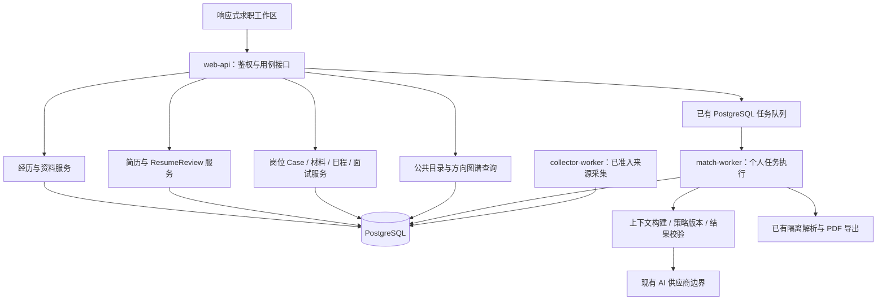

# Aijob 经历、简历、AI 与工作区系统升级方案

> 历史对齐前草案。下文“尚未实施”“唯一后续开发”和“获准后”等属于当日讨论，不再提供任务或授权；正式依据已由 [U0–U6 修正版](../product-experience-system-upgrade-2026-09-07.md) 与 [ADR-0038](../../decisions/0038-resume-workspace-and-direct-import.md) 取代。当前任务见 [路线图](../../06-mvp-roadmap.md) 和 [当前交接](../../handoffs/current.md)。

日期：2026-09-07。提出人：coco；本文根据当天从“这种证据形式是否合理”开始，到简历编辑器与导航复核的连续讨论编制。

**状态：完整方案稿，尚未实施。** 本次交付是系统设计与实施计划，不代表正式前端、数据库、AI 或 V2 原型已经按本文升级。文中“新增”“改为”“必须”均描述下一轮的目标与验收要求。新的架构决定在实施阶段落入 ADR 后生效，不以本文悄悄修改既有数据政策。

唯一后续开发目录：`C:\Users\72998\Projects\Aijob`。保留现有分支、未提交工作和业务数据。旧 OS-7 目录、旧副本不移动、不重建；OS-7、岗位事实纠偏、公司上限取消、业务恢复均不重做。

## 1. 升级结论与产品目标

本轮要把已经接通的求职功能，升级成**围绕完整经历持续积累、能够认真编辑简历、能获得真实 AI 帮助、可以连续管理求职的工作区**。

面向中国大陆本科、硕士、博士在校生，覆盖实习、校招、应届和管培。目标是形成可面向首批 1000 人以内累计尝试者发布的成熟主体，不增加固定人数的前置访谈要求，也不把这次升级变成没有终点的功能扩张。

用户应能完成以下结果：

1. 没有简历、没有目标岗位、没有开启 AI，也能从一段课程、科研、社团或实习经历开始写出简历。
2. 已有完整简历的人导入后直接编辑，保留项目上下文，不必重新完成逐句勾选、初始化、重新关联等流程。
3. 遇到写不清的经历时，AI 根据已经说过的内容追问；用户可以跳过、修改、停止或先形成一版表达。
4. 能用完整的模块编辑、模板、排版、预览、版本和导出能力，得到实际可投递的简历。
5. 在投递前后都可以练面试，练习依据与所选简历、岗位相符；反馈能回到经历、表达或准备事项。
6. 收藏、筛选、方向图谱、投递与日程沿着上述任务自然衔接，返回页面时保留工作上下文。

成功首先表现为“完成了一份可用材料、作出了更清楚的投递决定、能讲清一段真实经历”。不以 AI 调用量、问题数量、经历碎片数、匹配百分比或打卡天数代替产品价值。

### 1.1 本轮明确采用的设计

| 议题 | 本方案的决定 | 对系统的影响 |
|---|---|---|
| 经历组织 | 完整经历是用户管理与理解的单位；原句依据是内部定位单位 | 增加经历对象和版本，保留现有证据引用与历史 |
| STAR | 是可选表达方法，不是所有经历的必填表格 | 科研、课程、设计及非商业结果采用合适的提问和表达 |
| 隐私交互 | 简明说明、一次任务级选择、异常就地提示 | 后台保护保留；不再让用户反复完成审查流程 |
| AI 入口 | 一个求职助手，三个主要任务：整理经历、优化简历、模拟面试 | 共用执行能力，各业务服务负责自己的保存与修改 |
| AI 角色 | 根据任务、素材和回答调整策略 | 不设置功能重复的岗位导师、简历导师和面试官菜单，不给用户分“初级/高级” |
| 简历编辑 | 建设完整文档工具，内容与版式分开管理 | 扩展现有编辑器与修订服务，不另建第二套简历系统 |
| 工作区 | 保留已认可的 V2 分组侧栏与视觉方向，完善正式组件 | 不回到 V1 展示页式顶栏；局部页面内仍可使用标签页 |
| 收藏 | 岗位页常驻“全部岗位 / 已收藏” | 保留直达地址；收藏状态与投递进度解耦 |
| 保存搜索 | 改为筛选区的“常用筛选” | 保存完整查询条件；首版不宣称订阅或新增提醒 |
| 经历与材料 | 同一个入口，内部区分“我的经历 / 常用表达” | 原始事实与面向场景的表达保持关联，不重复维护 |
| 我的简历 | 保持独立入口 | 承担高频的编辑、复制、版本与导出任务 |

### 1.2 保留与后置

保留 PostgreSQL、模块化单体和 `web-api / collector-worker / match-worker` 三个权限边界；沿用身份、来源准入、岗位修订、任务队列、删除与导出基础。保留本硕博范围、单家公司无岗位上限、供给规模如实报告，以及官方页面自行投递的边界。

本轮不增加自由画布简历设计器、模板商城、多人实时协作、自动填表投递、全量邮箱扫描、语音面试、OCR、社区、职业百科、趋势预测、向量库或另一套认证系统。它们不属于完成本轮主体的条件。

## 2. 当前基础、真实缺口与方案依据

以下是代码与文档核对结果，不是本轮重新进行的生产验收。运行数字引用 2026-09-06 的交付记录。

| 领域 | 已有基础，应直接复用 | 本轮需要补齐 |
|---|---|---|
| 导入与资料 | 文件校验、隔离解析、去标识化、资料与证据修订 | 完整经历归属、无需上传的起步、一次保存进入编辑 |
| 经历证据 | 固定证据修订、原句引用、个人隔离 | 完整经历及其结构；避免标点拆分、归属错位和计数膨胀 |
| 简历 | 基础稿/派生稿、正文与布局修订、复制、Review、投递稿、PDF/DOCX | 模块内多条记录、有限富文本、完整模板工具、统一自动保存与历史恢复 |
| AI 简历 | 已有真实供应商适配器、ResumeReview 调用与预算服务 | 从块级建议扩展到整份材料判断，与经历追问联动 |
| 经历追问 | V2 有示范交互 | 正式的对话状态、动态问题、结构化提炼、采用与恢复 |
| 面试 | 会话、轮次、岗位/简历上下文、复盘与连续性规则 | 独立练习、真实模型参与、追问质量、同题重答及反馈回流 |
| 机会与申请 | 目录、图谱、原句、Case、准备任务、日程、ICS | 导航归位、可理解的筛选/状态、任务连续性 |
| 常用材料 | 类型、正文及源简历修订/文本块引用 | 完整经历关联、多来源表达、就地生成和复用 |
| 指导内容 | 已有用户私有 `knowledge-clip` 契约和数据删除范围 | 策划后的公共指导卡与按任务使用的策略，不把私有收藏变成公共知识库 |
| 运行 | 053 数据库版本、候选运行包、备份恢复、供给自动化基础 | 真实来源准入、持续更新、供应商配置、冷查询及混合负载问题仍未关闭 |

特别区分：

- 正式代码已经有真实 AI 简历 Review 路径；不能据此声称经历追问与面试都已经使用模型。
- 当前面试追问与部分反馈依赖固定规则，V2 原型中的 AI 对话是示例；二者均不能作为新 AI 功能验收。
- 编辑器已有两个模板枚举、文本块与导出服务，缺的是完整的编辑体验与内容结构，不需要把这些服务推倒重来。
- 最近记录为 93 条本机岗位、公共目录 0、34 个来源配置、0 个获准公开来源。这是历史运行快照，不是本轮刷新后的供给能力。
- 热目录/图谱本机性能曾达目标，冷目录约 5.8 秒，后台混合负载与 10 万岗位容量仍有明显缺口。不能在升级计划中略去。

依据入口：[产品体验审视](../../reviews/product-experience-audit-2026-09-07/README.md)、[UI/UX 设计](../../designs/product-experience-2026-09-07/README.md)、[V2 工作区](../../designs/product-experience-2026-09-07/workspace-v2.md)、[简历编辑器与导航复核](../../designs/product-experience-2026-09-07/resume-editor-and-navigation-review.md)、[既有六阶段执行记录](../product-core-execution.md)、[交付验收](../../evidence/product-core-upgrade-2026-09-06/README.md)。

### 2.1 成熟产品参考如何转成设计

| 参考 | 吸收的设计 | Aijob 的取舍 |
|---|---|---|
| [五百丁公开编辑器](https://www.500d.me/newcvresume/edit/?itemid=714) | 模块管理、主题工具、分页、撤销、导出入口 | 常用操作外显，不照搬会员限制 |
| [FlowCV](https://flowcv.com/) | 内容与设计分开、条目编辑、用自己的内容看模板 | 支持国内学生、中文日期和本硕博模块，不照搬国外求职字段规则 |
| [超级简历](https://www.wondercv.com/)、[简历本教程](https://www.jianliben.com/article/detail/100) | 按场景起步、填写处示例、章节与条目区分 | 示例帮助表达，不承诺通过率，不把宣传页面当作实测 |
| [Reactive Resume](https://github.com/amruthpillai/reactive-resume) | 结构化内容、富文本、模板、版本和页面控制 | 复用已有 Aijob 导出和修订体系，不整体移植应用 |
| [OpenResume](https://github.com/xitanggg/open-resume)、[猫步简历](https://github.com/Hacker233/resume-design) | 多条教育/工作/项目、自定义内容、预览与主题 | 选择必要编辑能力，首版不建设自由画布 |

详细研究已区分实际访客操作、官方说明和仓库能力；并未购买会员或部署全部开源项目。采用代码前单独核对许可证和依赖；参考交互无需复制整套代码。竞品的功能存在不等于已经证明 Aijob 用户需要它，取舍以本方案的任务链为准。

## 3. 用户旅程与页面组织

### 3.1 四条必须贯通的路径

**首次写简历：** 选择“写我的第一份简历” → 直接填写或说一段经历 → 可选 AI 追问 → 得到可编辑的完整条目 → 进入简历 → 调整内容和模板 → 下载。开始时不要求目标岗位、已有文件或 AI 配置。

**已有成熟材料：** 导入文件 → 查看可编辑结果，处理真正不确定的归属 → 保存并编辑 → 选择性优化/调整模板 → 下载。完整 STAR 段落可直接保留；不强制重新讲故事。

**为目标岗位准备：** 发现/收藏岗位 → 看职责、条件及原句 → 选择已有简历或复制方向稿 → 调整相关经历与表达 → 导出 → 自行投递 → 在申请中留存当时的材料和后续安排。

**面试与材料回流：** 选择岗位或经历开始练习 → 回答与追问 → 具体反馈/同题重答 → 将待补充信息加入准备事项，或把自己确认的新事实补入经历 → 主动更新某份简历。练习完成不自动认定事实成立，也不覆盖已投递材料。

### 3.2 默认导航

```text
今日工作台
找机会
  岗位发现       页面内：全部岗位 | 已收藏；筛选区：常用筛选
  方向图谱
做准备
  我的简历
  经历与材料     页面内：我的经历 | 常用表达
跟进申请
  投递管理
  准备与日程
  面试练习
固定辅助入口：求职指南、资料与设置
```

这里是 8 个主要目的地。桌面顶部负责当前位置、上下文和当前任务工具，不承担另一套重复导航。旧收藏、保存搜索、经历、材料路由保留兼容映射，并落到正确的标签、筛选或对象；直达链接、浏览器前进后退继续有效。

移动端保留 V2 的四项主入口与完整导航抽屉；编辑和面试进入专注任务视图，避免底部导航与软键盘一起挤占输入区。页面内切换编辑/预览不改变主导航体系。

### 3.3 页面中的常用操作

| 页面 | 始终容易找到的操作 | 按需展开的信息 |
|---|---|---|
| 今日 | 继续上次编辑、处理近期事项、开始写简历 | 完成记录、统计、更多推荐 |
| 岗位 | 搜索筛选、收藏、官方入口、为该岗位准备 | 原句依据、抓取/核验说明、完整资格核对 |
| 经历 | 新建、补充、整理表达、加入简历 | 原句定位、历史版本、来源修复 |
| 简历 | 正文编辑、模块、模板/排版、预览、导出、保存状态 | 修订编号、底层来源引用、完整版本列表 |
| 面试 | 当前问题、输入、提交、暂停、重答 | 历史轮次、依据详情、完整复盘 |
| 申请 | 进度、实际投递稿、下一事项、官方岗位 | 完整操作历史、批量更多动作 |

重要能力不能只藏在无文字的小图标里。删除、批量操作、版本恢复给出影响与撤销/恢复入口；普通保存与连续追问不重复弹确认框。

## 4. 系统架构与业务归属

### 4.1 总体结构



模型输出只成为建议、问题或分析结果。用户采用建议后，仍通过对应业务服务完成验证和写入。供应商不能直接操作用户资料或调用保存接口。

前端共享工作区外壳、对象选择、保存状态和助手面板；后端共享上下文构建、预算、模型调用和响应校验。共享执行能力不意味着把经历、简历、面试和材料塞进一个超大服务或一张无边界的通用表。

### 4.2 服务职责

| 归属 | 负责 | 不负责 |
|---|---|---|
| 经历/资料 | 完整经历、事实修订、用户确认、与旧证据映射 | 模型自动把建议变成事实 |
| 简历文档 | 可编辑草稿、模块条目、内容/布局版本、复制、导出 | 在后台同步改写所有引用它的简历 |
| ResumeReview | 简历 AI 分析、修改建议、采用建议的校验与归属 | 另起 Tailoring 新写入链路 |
| 面试 | 会话、上下文快照、问题与回答、重答、反馈和复盘 | 把“回答得好”当作经历真实性证明 |
| 材料/准备/申请 | 常用表达、待办、日程、投递进度和实际投递材料 | 自动投递或根据沉默推断拒绝 |
| AI 执行 | 上下文裁剪、策略/模型版本、预算、运行状态、结构校验 | 决定公共来源发布资格或绕开 owner 权限 |
| 公共供给/图谱 | 官方岗位事实、语义索引、公共聚合与撤回 | 接收个人简历和私有 JD 作为公共统计素材 |

沿用 README 指定的 **ResumeReview 作为新 AI 简历写入的唯一业务归属，Legacy Tailoring 只读兼容**。人工编辑继续使用文档服务；不把“唯一 AI 写入归属”误解为所有人工修改都必须走模型。

### 4.3 拆分现有大文件的方法

围绕用例抽取编辑器的模块树、条目表单、有限富文本、纸张预览、自动保存、版本与 Review 面板；平台按“准备上下文、执行、保存建议、采用”拆分。先保留对外接口和事务所有者，再逐步替换内部实现。避免全仓重写、同时更换数据库/框架/渲染器，或为每个 UI 面板建立一个独立后端服务。

## 5. 完整经历与个人资料的数据设计

### 5.1 三层信息及其关系

| 层次 | 示例 | 使用方式 |
|---|---|---|
| 完整经历 | 一次社团运营、一个课题、一项课程设计 | 用户创建、编辑、确认和复用的主要对象 |
| 内部事实与依据 | 在该项目负责访谈；产出整理表；观察到何种结果 | 定位原句、判断表达依据、解释岗位关联 |
| 场景表达 | 简历三条要点、面试两分钟故事、项目短介绍 | 引用经历版本，按目的组织，不反向自动改事实 |

一段经历可以产出多条简历要点。三条要点仍属于同一经历，不变成三个需要单独确认的“能力证明”。统计与匹配按实际要求、来源经历和去重事实判断，不能通过拆句抬高覆盖或可信程度。

### 5.2 逻辑对象

以下是待落地的契约设计，表名和接口编号在 U0 核对现有 schema 后确定。

- `Experience`：稳定 ID、owner/epoch、类别、标题、组织、角色、时间、当前修订、草稿/已确认状态。类别覆盖实习、项目、科研、课程、校园与其他；字段允许未知。
- `ExperienceRevision`：完整叙述、可选背景/任务/行动/产物/结果/反思、创建方式与时间。结构用于辅助，不要求每一栏都填写。
- `ExperienceFact` 或现有证据的扩展关联：事实类型、文本、来源经历修订、原句范围、确认状态及与旧 evidence ID 的映射。优先扩展已有证据存储，不复制一套相同事实库。
- 表达、简历条目、面试上下文引用具体经历修订。经历更新后提示“来源有更新，可比较”，由用户决定是否采用；不自动更新所有下游资产。

“已确认”表示用户选择作为自己的材料使用，不表示平台对其履历进行了外部认证。界面不显示“真实性认证通过”等夸大用语。

### 5.3 导入与确认的新流程

1. 保留既有格式、大小、隔离解析与原文短期生命周期。
2. 优先识别章节和完整条目边界，再识别条目内部要点。AI 可参与歧义处理；规则能给出可编辑的分组草稿。
3. 联系方式、教育、技能和项目分开；地址或学校名称不进入“请讲讲你做了什么”的经历问题。
4. 显示导入后的编辑结果，只对归属不确定、时间冲突等局部问题提示。用户可合并、拆成两个真实项目或直接保留整段。
5. 一个“保存并开始编辑”动作，由同一业务用例原子完成资料/经历确认及首份简历创建或更新；失败可安全重试，不留下重复简历或半完成状态。
6. 不要求再次点击初始化、逐块重绑来源或对已处理的手机号重复确认。

历史数据缺失项目边界时只能生成保守的可编辑分组，不能推测标题、角色、时间或成果。原文件已删除的记录，不为恢复上下文而重新抓取、要求重传或伪造原文；标明现有内容，允许用户主动补充。

### 5.4 隐私体验与数据生命周期

- 首次导入用简短说明解释原文件处理和结构化资料保存；设置页提供完整管理与删除入口。正常情况下不用整页黄色警告。
- 普通人工编辑不必经过 AI 授权。点击“让 AI 帮我整理/优化/练习”时，显示本次使用的经历、简历和岗位，可增减；同一会话普通回复无需重复确认。
- **新增边界需在 ADR 明确：** 用户可以主动把尚未确认的个人草稿用于提问和整理，但草稿、AI 建议、用户确认事实必须保持不同状态。不得沿用“只有确认事实才能输入”的旧规则强迫用户先确认一份尚未写好的经历。
- 用户主动输入的经历草稿和需要续接的对话属于私有职业资产，按明确的保存说明支持继续编辑和删除；这不等于永久保存原始上传文件。导入原文件和解析原文仍在确认后删除，最长不超过 24 小时。
- 个人资料中可保存用户填写或确认的联系方式用于正式简历；AI 上下文按任务去除无关联系信息。导出不得出现“[手机号已隐藏]”等解析占位符。
- 如果加入可选照片，按独立的私有展示附件处理，限制类型/尺寸、处理元数据、不进入默认 AI 上下文，使用受控本地资源导出；不能把它扩展为图片简历/OCR 输入。
- 单项删除、全部删除、迟到任务、缓存和历史副本的具体处理见第 12 节；后台规则不能靠用户反复勾选补足。

## 6. 专业简历编辑器

### 6.1 起步、内容与模板

进入“我的简历”后可新建、导入、复制已有稿，按方向或岗位找到稿件。首次求职、项目实践、科研经历是可选内容预设，不强制选择职业身份，也不锁死模块。

首轮交付 **5 种经过实际内容验证的模板**：清晰单栏、经典单栏、紧凑技术、简洁双栏、科研多页。模板变化应体现在信息组织与版式，不用换颜色凑数量。照片可选；无照片时不留空洞。默认 A4，科研等内容允许自然多页，不强行压成一页。

模板只控制呈现。切换模板、预设颜色或列布局不能删除正文或修改事实；已有模块不支持某种列分配时给出兼容布局。使用用户当前内容预览模板，切换后可撤销。

### 6.2 模块—条目—要点

```text
项目经历（模块）
  校园二手书调研（完整条目）
    项目名、角色、组织、起止日期、链接
    背景/目标（可选）
    行动、产物、结果（可以排成几条要点）
  课程可视化项目（第二个完整条目）

科研经历、教育经历、实习经历、技能、论文等是其他模块
```

必须提供：

- 模块增加、改名、排序、隐藏/恢复、自定义；条目新增、复制、移动、删除/恢复。
- 教育、实习、项目、科研等使用相应字段；论文、专利、竞赛、作品集等可选择专用或自定义模块。
- 经历以整条为单位加入简历，条目内可调整简历表达；默认不把整理经历的所有对话塞进正文。
- 有限富文本：要点列表、加粗、斜体、链接、清除格式、粘贴归一。首版不开放任意 HTML、任意嵌入组件或自由定位。
- 排序同时支持拖动与明确的上下移动按钮，键盘与触屏都能完成。
- 引用的经历是来源，简历表达是当前稿件内容。编辑某份简历不会静默改写原经历或另一份方向稿。

### 6.3 版式、分页与导出

字体、字号、行距、段距、模块间距、页边距、主题色和可用列布局集中在排版面板；高级设置按需展开。中文字体必须在运行环境中提供，预览与导出使用一致的字体选择。

纸张预览显示真实页边界、页数和溢出位置。支持条目尽量不拆页、指定模块/条目前换页和恢复自动分页；超长条目允许可理解的续页，不强行缩到不可读。双栏同时验证视觉顺序、文本提取和实际链接。

默认“导出”入口可直接下载 PDF，并可选择 DOCX；保留浏览器打印。PDF 文本可选中、复制和检索，中文、链接及多页内容正常。DOCX 保留合理语义与可编辑性，独立验收，不承诺不同 Office 软件的像素级一致。

现有后台 PDF 服务继续作为基础，复用打印版式和隔离环境，渲染不访问外网。模板固定版本、字体包版本与渲染版本可追溯；不能为了换编辑器直接更换全套导出引擎。

### 6.4 一个保存体验，清楚的内部版本

**前台只有一套自动保存状态，后台保留正文与布局各自的不可变修订。**

1. 增加 owner 隔离的文档草稿状态，一次保存包含内容和布局，使用草稿修订号与幂等键处理并发。
2. 输入先留在当前草稿；短防抖后保存，显示“保存中 / 已保存 / 保存失败，内容仍在当前编辑器”。不把每次按键都写成永久历史修订。
3. 在命名版本、采用 AI 修改、导出、投递留存等检查点，事务内生成或复用对应的正文与布局修订，并保存两者的成对引用。
4. 导出先确保当前草稿已保存，再固定本次版本。投递留存优先关联用户选定的那次导出/实际使用稿，不能默认把后来改过的最新稿认作已投递稿。
5. 本地撤销重做处理当前编辑动作；跨会话版本恢复创建新的当前版本，历史不可变。恢复前可预览差异。
6. 冲突不采用静默覆盖。允许保留本次输入为副本、比较差异后合并，或读取已保存版本。

首版不承诺完整离线编辑与跨设备实时协作。断网时保留当前输入并可重试；若实现跨刷新本地恢复缓存，必须有账号隔离、期限、退出清理及删除测试，不能无期限存储整份简历。

### 6.5 编辑技术选型

建议用 **Tiptap 的开源核心**实现条目内有限富文本，保持 React 技术栈；应用继续拥有自己的版本化内容契约。依据：[官方 React 集成](https://tiptap.dev/docs/editor/getting-started/install/react)、[JSON 持久化说明](https://tiptap.dev/docs/editor/core-concepts/persistence)、[官方仓库](https://github.com/ueberdosis/tiptap)。

只启用必要节点和标记，稳定条目 ID 在 Aijob 文档层维护，JSON 经契约校验后保存。不要以任意 HTML 为唯一真源，不引入其云协作或付费能力作为运行依赖。U0 用中文输入法、粘贴、历史恢复和现有 PDF 渲染夹具完成小范围技术验证后锁定版本；若不适配，只替换条目输入适配层。

## 7. 真实 AI 求职助手

### 7.1 一个助手，按任务改变工作方法

| 任务入口 | 主要输入 | 主要产出 | 用户采用后的去向 |
|---|---|---|---|
| 整理经历 | 一段完整经历、已有回答、可选目标方向 | 有依据的下一问、待补信息、表达草稿 | 经历修订；或加入某份简历 |
| 优化简历 | 当前稿件快照、相关经历、可选岗位及方向 | 整体判断、重点修改、前后对照与理由 | 通过 ResumeReview 更新所选简历 |
| 模拟面试 | 所选经历/简历/实际投递稿、可选岗位、会话回答 | 问题、追问、反馈、同题重答与准备建议 | 面试记录、准备事项；用户选择补充经历或表达 |

常用表达中的“起草自我介绍/邮件”作为就地子任务使用同一助手，不增加第四个角色导航。岗位解释优先读取已有公共语义和原句；只有用户明确选择个人对照时才加入个人材料。

### 7.2 动态追问的判定逻辑

每一轮读取：当前任务、完整经历摘要与原句、已经明确/未知/跳过的信息、最新回答、当前问题、可选岗位要求和策略版本。

模型应先判断“现在最值得澄清什么”，再提出一个主要问题；允许附一条解释或可选例子。问题必须能在已有上下文中找到触发点，且不重复询问已经回答或明确不愿回答的信息。

示例：“负责公众号运营”可能先问具体负责选题、制作还是复盘；用户已经明确“整理 26 份报名信息并调整排班”时，应追问如何发现冲突或如何验证安排有效，不能再问泛泛的“你做了什么”。研究经历则可能追问方法选择、个人贡献、实验局限或阶段产物，不要求杜撰增长率。

停止条件不是固定三题，也不是无止境深挖。用户可随时“先整理一版”；已有信息足以清楚表达时主动提供草稿，缺失信息标成可补充项。较长探索阶段定期给出阶段产物与继续选项，避免对话成为新的负担。

### 7.3 策略与 Skill 的使用方式

在内部维护版本化的任务策略包，内容包括：适用情境、需要的上下文、提问方法、可用指导卡、禁止推断、停止/转场条件、输出结构及质量案例。运行时根据经历类型、当前目标和回答缺口选用。

首轮覆盖经历梳理、岗位重点调整、研究贡献、行为故事、岗位知识/情境和模拟面试节奏。它们是同一助手使用的方法，不是让用户选择一排相似身份，也不限制某位用户只能使用某种“水平”。

系统提示词只放稳定职责、边界和输出契约；相关指导卡按需加入；用户材料和网上文章始终作为待理解的数据，不能变成可覆盖系统规则的指令。更换策略可配置化，但发布前必须跑对应回归，不能把临时网上经验直接热更新到所有用户。

### 7.4 任务运行与事务

```text
用户开始任务/提交回答
  → web-api 校验 owner、当前修订和幂等键
  → 保存输入快照与任务，立即返回运行 ID
  → match-worker 按已有租约领取
  → 构建最小必要上下文，预留预算
  → 调用已配置供应商
  → 校验结构、依据与任务状态
  → 保存建议/问题，前端展示
  → 用户采用时，由领域服务检查修订并写入
```

任务状态区分 `queued / running / succeeded / failed / cancelled / outdated`，前端显示真实等待、失败与过期。先复用已有任务查询机制；不为了打字动画伪造流式推理，也不将演示文本当真实响应。

每条输入和生成请求有幂等标识，应用层重复提交复用同一任务。供应商响应未知时不能承诺外部“恰好计费一次”：支持供应商幂等则沿用同一标识，否则记录结果未知，避免盲目自动重发。模型请求不占用长数据库事务。请求取消、超时、删除、源修订改变和 worker 重启都要有明确落点；迟到结果最多作为可比较的旧建议，不能覆盖新稿或复活已删资产。

### 7.5 上下文、缓存与预算

- 上下文携带任务用途、owner epoch、源对象和修订、岗位版本、策略版本、模型配置及会话轮次。正文按需要裁剪，不能随意截断掉整段经历的项目归属。
- 会话可使用带版本的摘要减少重复输入，关键事实仍能回到原文；摘要不是新的确认事实。
- 私人调用结果只能在同一 owner/epoch 和相同内容、用途、策略版本下复用。公共岗位语义复用公共缓存，二者不混用。
- 扩展现有个人用途到经历追问、面试出题/反馈与表达草拟，设置用途并发、输出长度、超时、会话预算和服务总预算；一次提交默认一次主要生成，避免多代理互评式成本放大。
- 现有 `matching.personal_ai_calls` 是**匿名预算账本**，不存 owner、提示词、结果或个人内容哈希。本轮保留该性质；私人会话与调用关联放在 owner 隔离的业务记录。若需要个人额度，单独使用私有任务/额度归属，不能污染匿名账本。
- 后台导出、解析与个人 AI 任务保持有限并发，删除及轻量交互任务不能被长任务一直挤压；先在已有 PG 队列与 worker 中调整调度，不增加 Redis 或第四个权限边界。

### 7.6 输出和用户控制

AI 修改必须展示具体修改、理由及所依据的经历/回答。用户可以逐处采用、编辑后采用、忽略和撤销。新数字、新角色或新成果没有依据时只能变成澄清问题或明确占位，不能直接写入可投递正文。

整份简历 Review 要检查信息优先级、贡献是否清楚、材料是否重复、与目标任务的关联，以及是否存在尚未解释的表述；不能只逐句塞关键词。资格要求仍显示为核对信息，不输出没有依据的录用概率或匹配百分比。

AI 不可用时，用户仍能编辑、用结构化提示整理经历、使用岗位题库和自检、保存与导出。界面明确“使用固定提示/自检”，不能显示“AI 已分析完成”。用户当前输入和已完成工作不得因失败丢失。

## 8. 面试、常用表达和指导内容

### 8.1 面试的两种节奏

- **边练边改：** 回答后给出具体反馈，可追问、看示例和重答，适合练清一段故事。
- **完整模拟：** 在约定范围内连续提问，过程中不过度打断讲解，结束后集中复盘。

这是任务节奏的不同，不是用户能力等级。开始时显示正在依据哪份简历、哪个岗位或哪段经历；允许无 Case 的通用/经历练习，也允许基于已投递稿练习。

现有面试契约虽然部分字段可空，但上下文校验仍要求 Case 或从 Case 分离的来源。需要前向扩展为明确的 `case / resume / experience / general` 上下文类型；不能为了支持独立练习创建虚假的申请记录。

### 8.2 问题与反馈质量

问题覆盖经历行为、岗位知识、任务情境、动机和向面试官反问等，按岗位和练习目标取舍。引用经历前确认它确实是项目内容，不能把地址、院校或简历开头任意一行当经历。

当前追问和下一主题分开呈现。短而准确的回答不因字数少被判差；空泛的长 STAR 不因包含“行动、结果”等词就获好评。反馈指出具体哪句有信息、哪点未答到、如何更清楚，不编造面试官心理或 offer 预测。

同题重答保留原题、回答版本和反馈，比较实际变化。回答中出现新事实时，提示可补充到经历；只有用户采用才写入事实。未完成的准备事项与已确认事实在界面和数据库中分开。

### 8.3 经历与材料共用入口

“我的经历”保存做过什么；“常用表达”保存如何针对场景讲述。表达类型包括自我介绍、项目长版/短版、邮件草稿和其他；可引用多段经历、某份简历和某个岗位，也可纯手写。

在经历页、简历编辑器和面试反馈处都能就地创建表达，自动带入所选来源。只需先选择用途和写/生成内容，标题、标签等可后补。保存后支持复制全文、逐段复制、编辑和用于某份简历；不把所有表达自动塞回经历库。

来源更新时显示可比较的更新提示；旧表达不会自动变成新版本。申请记录继续指向当时的实际文本与布局，不因常用表达被改动而改变。

### 8.4 将网上指导变成可用内容

coco 后续收集的经验先形成小型、可维护的指导卡。每张包含：来源链接与日期、内容类型（规范/方法/个人经验）、适用人群与场景、建议、例子、反例/限制、版本与撤回状态。

初始覆盖“没有实习也能写什么、个人贡献与团队结果、没有数字如何说明结果、科研表达、按岗位取舍、面试故事与反问”。只在当前操作卡点出现一两条短提示，可关闭或展开；求职指南作为完整索引，不要求读完课程后才能编辑。

系统策划的公共指导卡与现有用户私有 `knowledge-clip` 分开管理。首版可由仓库中的版本化内容文件发布，按标签和规则挑选；不先建设通用知识后台或向量检索。用户私有收藏不会自动进入公共提示词。

指导卡进入 AI 上下文时附适用条件与来源，模型建议回到实际材料验证。具体岗位要求以官方原句为准，网上经验不能升级成硬性资格、普遍招聘规律或保证有效的技巧。

## 9. 机会、图谱、收藏与申请的衔接

### 9.1 收藏是具体对象，常用筛选是查找条件

“已收藏”用于保留具体岗位，不要求已开始准备。岗位页始终可切换“全部岗位 / 已收藏”，卡片提供有文字的收藏状态；收藏后可继续浏览或进入准备。

原来用 `interested` 阶段代表收藏可以起步，但用户进入投递/面试后仍可能需要收藏该岗位。**建议在现有 Case 上增加独立的收藏标记/时间，继续复用 Case，不增加第二套申请实体。** 首次收藏创建最小 `interested` Case 或复用已有 Case；取消收藏只改变标记，不能删除申请历史；进度改变不自动取消收藏。

迁移时，旧 `interested` 记录可以按已收藏处理；其他状态无法证明历史收藏意图，不猜测回填。旧申请仍全部可在投递管理找到。收藏操作、重复点击和同一岗位已有 Case 的情况必须幂等；私有 JD 的 owner 边界保留。

常用筛选放在搜索筛选栏，显示命名条件及可移除标签，支持保存、应用、重命名和删除。保存完整的关键词、已支持筛选、排序与公开/私有范围，应用后视觉条件与实际查询必须一致。存在未说明字段时明确包含/排除含义，不能把未知当作不符合。

现有保存搜索只有部分 `JobGraphScope` 条件，新契约需版本化，旧记录转换为等价的完整查询。图谱仅支持其中一部分条件时，清楚显示实际作用范围，不能保留一个看似生效但被忽略的条件。

首版没有来源新增检测、通知水位与通知投递链路，因此用“常用筛选”命名，不出现“为你订阅、发现新增后提醒”等承诺。后续是否增加提醒独立评估，不阻塞本轮导航改善。

### 9.2 图谱与岗位卡片

- 无简历用户直接浏览。图谱先展示所选方向正在做什么、用什么工具、产出什么，减少全职能混合的泛化词。
- 保留岗位提及率、企业覆盖率、解析覆盖和核验范围，首层突出解释当前图的必要信息，计算方法放在展开层；不因小样本整体停显。
- 点击统计项看到具体岗位和官方原句，再选择关联经历、加入准备或收藏。未分类岗位仍可检索，大公司岗位全部保留。
- 岗位卡片显示已知事实和有意义的摘要；“待我核对”与“官方未说明”分开，不能把所有卡片统称“条件清楚”或“未确认”。
- 区分招聘截止、官方发布日期与系统核验时间，不能把导入或刷新时间包装成企业刚发布。公开撤回后公共目录与图谱及时失效；私有历史快照保留有明确状态的引用，不重新公开撤回内容。
- 从岗位进入简历或面试，持续显示目标岗位；返回后保留搜索条件、分页、滚动位置和焦点。

### 9.3 申请与日程

投递管理显示岗位、实际进度、所用稿件与最近事项；今日按截止/安排时间和待跟进优先级呈现。创建事项先填标题与时间/类型，来源、备注等可后补，不为一个提醒填写整页字段。

继续使用既有完成、延期、批量进度、ICS 和时区语义；批量部分失败逐条说明且可重试。未回复保留原进度，不自动拒绝；已完成提醒不重复出现。AI 建议可变成用户选择的待办，完成待办不自动成为简历成果。

账户与保存状态要一致：继续沿用既有身份架构，明确当前资料保存位置及恢复方式；不能同时展示“长期保存”和不清楚的访客到期提示，也不能在邮箱尚未配置时伪装发送成功。

## 10. UI / UX 与响应式规范

### 10.1 视觉方向

延续已认可的 V2：柔和浅底、清楚的文字层级、深绿主操作、少量明快黄绿/暖色强调。把活力用于开始任务、进度和轻量插画，不用大面积高饱和卡片挤占工作空间。

列表、表单、编辑器、纸张预览和对话采用各自适合的布局。避免每页都是大标题加同样的圆角卡片；首页欢迎区保持紧凑，重要工作在首屏可见。建立颜色、间距、字号、圆角、焦点和交互状态 token，减少页面各自拼样式。

鼓励基于实际内容，例如“这段已讲清你的行动，可以再补结果如何判断”，或“上次的草稿已保存”。不使用能力排名、机械完成度、无依据赞美、恐吓倒计时和 offer 保证。错误说明原因与恢复动作，不责备用户。

### 10.2 自适应规则

以下为实施起点，最终以内容宽度和实测调整，不能只检查几个截图尺寸。

| 可用宽度 | 工作区 | 编辑与面试 |
|---|---|---|
| ≥1440px | 完整侧栏；列表允许有效拓宽，长正文限制可读行宽 | 编辑与预览并排；助手按空间作为第三栏或替换次面板 |
| 1200–1439px | 完整侧栏；不保留展示页式大块空白 | 两个主面板；打开助手时不把正文压成窄条 |
| 768–1199px | 紧凑导航与完整导航抽屉 | 当前任务优先；编辑/预览切换，辅助面板可收起 |
| 320–767px | 移动主入口与完整抽屉；列表单列 | 输入与当前问题优先；预览单独查看，底部动作避让软键盘 |

纸张预览可以缩放，但编辑表单和交互控件不能跟随 A4 页面一起缩到不可用。正文、标签和按钮随容器换行；页面本身不产生意外横向滚动。单个大图或纸张如需横向查看，应有明确容器和缩放控制。

至少验证 320/360/390/768/1024/1280/1440/1920/2560px，以及浏览器原生 200% 缩放；不用 CSS transform 假装缩放验收。200% 时转入合适布局，功能与焦点不丢失。

### 10.3 连续操作与可访问性

- 输入区域在进入写作/面试后首屏可达，不再排在两千像素的历史和说明之后。
- 常用点击目标按约 44px 设计；文字、焦点和错误状态具有足够对比度，不只靠颜色区分。
- 弹窗打开后焦点进入；关闭后回到触发位置。抽屉、排序、模板选择和对照采用均支持键盘操作。
- 中文输入法组合输入期间 Enter 不触发提交；保留换行和明确的发送快捷键说明。
- 阅读器获得表单标签、保存状态及完成的回复，不在每个流式字上反复播报。
- 请求中保留当前内容；空态给出当前页面可做的事；失败就地重试；按钮禁用时在操作之前解释缺少什么，不等点击后只返回 409。
- 侧栏切换、弹出助手、返回岗位、改变筛选和选择模板，都不能无理由清空输入或跳到页顶。

### 10.4 共享组件及完整覆盖

建设或整理：工作区外壳、导航与面包屑、对象选择器、空态/错误态、表单与日期、筛选标签、岗位列表、详情抽屉、经历条目、模块树、有限富文本、模板选择、版式面板、纸张预览、统一保存状态、版本对照、助手对话、问题输入、反馈/重答、申请表格、日程列表、批量结果。

每个组件验证常态、长中文、空值、加载、错误、禁用和窄屏。既有 V2 的 18 类视图映射到正式路由与真实服务，不能因新首页看起来完整就省掉设置、私有 JD、原句、日程或复盘页面。原型通过不等于正式端通过。

## 11. 契约、存储与接口升级

### 11.1 内容真源与历史

| 对象 | 升级方式 | 兼容原则 |
|---|---|---|
| 经历及其依据 | 新增完整经历，关联已有证据修订 | 历史 evidence/Case 引用不重写 |
| 简历内容 | 新 schema 表达模块、typed entry 和有限富文本 | 旧正文结构仍可读取；转换保留原文与稳定映射 |
| 文档草稿 | 新增内容+布局原子保存和草稿修订 | 原正文/布局修订服务继续负责不可变历史 |
| 版本检查点 | 记录成对修订及模板/渲染信息 | 保存/导出/投递引用同一明确状态 |
| 表达 | 扩展经历/简历/岗位的来源引用 | 旧 sourceDocument/revision/block 引用继续可读 |
| 对话与 Review | 复用已有 Review、面试模型，新增经历会话 | 任务专属状态保留，避免万能会话表替代业务关系 |
| 收藏 | 现有 Case 增加收藏状态 | 旧 interested 数据按明确规则兼容，进度独立 |
| 常用筛选 | 完整查询对象版本化 | 旧条件等价读取，不默默加入新限制 |
| 指导内容 | 版本化公共卡片；私有知识收藏独立 | 不扩散用户私有内容，不为首版新建知识平台 |

富文本生成纯文本投影供规则、检索、旧兼容和部分导出使用；投影不是另一份可独立编辑的真源。简历中的条目、要点与事实引用保持稳定 ID，不使用当前数组位置作为身份。修改/排序后，AI 建议和来源仍能定位到正确对象。

### 11.2 用例接口清单

下列是建议新增或扩展的接口能力，具体 URL 在 U0 对齐现有命名；不是声称当前已存在这些 API。

| 用例 | 输入中的关键约束 | 输出/副作用 |
|---|---|---|
| 新建/保存经历 | owner、expectedRevision、完整条目、来源与幂等键 | 草稿或确认后的经历修订 |
| 完成导入并开始编辑 | 导入修订、用户修正、目标文档选择 | 一次原子操作完成资料/经历与文档准备 |
| 保存文档草稿 | expectedDraftRevision、完整内容/布局或可验证补丁 | 一个新的草稿修订和保存时间 |
| 建立版本/导出 | 指定草稿修订、输出选项、幂等键 | 固定正文+布局检查点、导出任务 |
| 开始助手任务/提交回答 | 任务用途、所选源修订、会话修订、输入 ID | 202 与运行 ID；后续查询真实状态 |
| 采用 AI 建议 | run/suggestion ID、目标修订、用户修改后的内容 | 业务服务验证并生成新版本 |
| 开始面试/同题重答 | 明确 context 类型、材料快照、问题/回答修订 | 会话或同题的新回答版本 |
| 创建表达/准备事项 | 来源对象、正文/待办内容、幂等键 | 对应私有资产，不修改事实源 |
| 收藏/取消收藏 | 岗位/Case、预期状态或修订 | 单一 Case 上的收藏状态变化 |
| 保存/应用常用筛选 | 完整查询版本、作用数据范围 | 可准确往返的条件对象 |

所有个人接口沿用 owner/epoch 与现有鉴权。对跨用户 ID、旧修订、重复请求及已删来源有统一行为；不能因为接口前缀是“assistant”就让模型获得泛化读写权限。旧接口并行读取；新 UI 使用新契约时，旧客户端不能对不认识的 schema 静默降级写入。

### 11.3 事务与索引

导入确认并创建文档、生成内容/布局检查点、采用 Review、记录实际投递稿分别有明确的事务所有者。跨服务调用复用事务上下文，不能前台串联几个独立保存后把部分成功显示为完成。

按实际查询建立 owner/epoch、更新顺序、源修订、会话顺序和任务状态索引；公共检索继续下推 PG。列表按页读取，正文与会话历史按需载入，避免每次打开工作台加载所有简历和面试全文。

## 12. 数据迁移、删除、发布切换与恢复

### 12.1 迁移顺序

1. **扩展：** 在实际最新 schema 后追加迁移，新增可空字段、对象与新契约；禁止修改已应用的 039–053 或更早迁移。
2. **双读：** 新服务读取旧格式与新格式，旧记录先保持原样。必要的纯文本/兼容投影必须能回溯源版本。
3. **可证明的转换：** 对能确定的章节、条目和引用做可重跑转换，记录输入/输出版本与数量。含糊的历史碎片保留原文，由用户编辑时整理，不批量猜测完整经历。
4. **受控写入：** 新 UI 对选定环境开启新草稿和内容写入；旧 AI 写入边界仍由 ResumeReview 维护。使用功能开关逐用例切换，不让同一对象同时被两套不兼容编辑器写入。
5. **业务库升级：** 先在专属测试 PG 和恢复副本验证，备份真实库后按手册升级；保留源快照、备份和转换报告。
6. **收口：** 旧路由继续读取/转到兼容视图。删除旧存储或旧接口属于后续独立决定，本轮不通过清理历史实现“迁移完成”。

### 12.2 历史与删除

历史 Case、岗位修订、匹配运行、证据原句以及已投递正文/布局保持不可变。新的事实补充或来源重新解析不能后台重写历史。用户主动删除与后台更新不同，按已有删除语义处理。

全量个人删除必须覆盖经历、草稿、修订、表达、会话、摘要、私人 AI 结果/缓存、导出附件和任务引用；单项删除检查关联关系，明确删除对象还是同时删除其副本。用户删除前能看到实际范围，不能承诺删除来源就自动删除所有已投递快照中的相同文字。

worker 在执行前和落库前校验 owner epoch、任务租约与对象状态。删除之后的迟到模型、解析和导出任务不得复活任何数据。匿名预算账本本就没有私人文本和身份，不向其中补入个人删除映射。备份生命周期及恢复后的删除重放沿用并验证现有政策。

### 12.3 回退原则

优先关闭新功能写入并退回兼容读取，保留已经产生的新格式数据。旧应用不理解新格式时不能直接允许它保存并丢失条目/富文本；提供只读或受控兼容入口。

数据库恢复不能简单等同于删除新表或执行破坏性 down。涉及恢复备份时先保存升级后用户写入并制定重放方案；正常失败优先前向修复。发布手册必须实测一次“新格式已有写入后关闭功能”的恢复过程。

## 13. 分阶段实施与可用交付

命名为 **U0–U6**，用于区分本轮升级和已经关闭的 OS / 六阶段工程。以下是方案顺序，当前没有任何阶段标为完成。每阶段交付一个可用结果，并同时记录 Contract、Database/Platform、Web、Integrated Gate 与 Evidence。

### U0：固定契约、错误基线与技术验证

**产物：后续能按同一对象、流程和验收口径开发。**

- Contract：确认经历三层模型、草稿与确认边界、模块/条目内容结构、统一保存、面试 context 类型和助手运行状态。
- Database/Platform：核对既有字段与迁移，形成前向方案；准备完整经历、历史碎片、联系人误识别、短回答、科研和空泛 STAR 等夹具。
- Web：V2 视图到正式组件/路由逐项映射；验证富文本、中文输入法和纸张渲染；明确常用操作位置。
- Integrated：复现审视中的核心问题；在当前规则路径先阻止地址当经历、追问夹带下一题、仅凭长度好评等错误。无关的已通过规则不重写。
- Evidence：ADR 草案、契约表、迁移清单、代表性输入/期望、组件映射和选型结果。

本阶段在获准实施后落地三个 ADR 主题：完整经历与草稿 AI 使用；文档结构与版本检查点；统一助手职责、知识使用和收藏/筛选语义。具体编号按仓库现状分配，不提前占号。

**完成条件：** 新旧数据与用例归属没有互相矛盾的定义；关键错误可复现且保护性修正已回归；富文本与现有导出可共同工作。不停留在“文档已写”就启动大范围 UI 替换。

### U1：完整经历与顺畅起步

**产物：新手和已有简历用户都能直接开始写。**

- Contract：经历增改/确认、保守分组、导入后开始编辑的一次提交。
- Database/Platform：完整经历及旧证据映射；原子创建文档；去重、修订、删除和原文生命周期。
- Web：正式工作区外壳与基础组件；“直接写 / 导入 / 从经历开始”；经历整条编辑；精简隐私与不确定内容提示。
- Integrated：无需文件创建首份简历；导入完整 STAR 保留项目归属；重复提交不产生两份文档；原文按既有规则删除。
- Evidence：真实前后端旅程、PG 集成、导入前后对照、320/360px 输入与键盘检查。

**完成条件：** 消除确认→初始化→重绑证据的断裂；AI 尚未可用时也能得到可编辑简历。旧 Case/经历引用仍可读取。

### U2：完整简历编辑器与可信输出

**产物：可持续编辑、复用和实际投递的专业简历工具。**

- Contract：新内容 schema、文档草稿、成对修订检查点、模板/版式、稳定条目引用。
- Database/Platform：复用文档/复制/Review/导出服务；自动保存与冲突；多格式兼容；投递快照不变。
- Web：模块和多条目、有限富文本、5 种模板、布局工具、纸张预览、撤销重做、历史和方向稿列表。
- Integrated：导入/手写→多条目编辑→切模板→撤销→导出→留存实际投递稿；之后继续改稿，历史仍一致。
- Evidence：长中文/科研多页/双栏/照片可选夹具，PDF 文本与分页，DOCX，保存冲突和 PG 验证。

**完成条件：** 换模板不丢内容；一个保存状态覆盖正文与布局；预览与输出一致到可用标准；移动端可完成编辑、保存和导出。

### U3：真实 AI 经历整理与简历优化

**产物：用户能明确感受到根据自己材料发生的提问与修改。**

- Contract：经历会话、轮次、上下文快照、建议和采用接口；扩展 ResumeReview 的整份文档分析。
- Database/Platform：共享执行与策略、现有队列/预算扩展、私人结果缓存、超时/取消/过期、删除竞态。
- Web：一个助手面板，任务与所用材料清楚；阶段草稿、跳过/先写一版、前后对照、采用/撤销、真实失败恢复。
- Integrated：相同经历在不同回答和目标下产生适当的不同追问；材料不足先澄清；采用通过业务服务；不能凭模型结果创造事实。
- Evidence：固定夹具自动回归、人工评价表、规则降级；有获准凭据与预算后增加脱敏材料的真实供应商验收，分开记录。

**完成条件：** 经历追问和 Review 使用实际任务上下文；不重复问已答问题，不强制补商业数字；无 AI 时工作可继续。若无真实配置，只能标为工程完成、AI 运行未就绪。

### U4：面试、表达与准备形成闭环

**产物：简历上的内容可以练习讲清楚，改进可以留下来。**

- Contract：独立/Case 面试上下文、题目与重答版本、反馈采用、多来源表达与准备任务。
- Database/Platform：复用会话/复盘/材料/日程服务，真实出题和反馈用途；公共指导卡与私人知识边界。
- Web：边练边改/完整模拟，当前输入优先，同题重答对照；“经历与材料”合并入口，就地自我介绍/项目/邮件表达。
- Integrated：投前独立练习；投后基于实际稿件练习；新事实由用户确认，待补信息进入准备；旧稿不变。
- Evidence：研究/运营/工程/非技术题目、长短回答、会话中断、AI 失败、迟到任务与无障碍测试。

**完成条件：** 不把经历整理与面试做成两套重复角色；不以长短和 STAR 关键词代替反馈；完整旅程能从复盘返回可修改资产。

### U5：机会与工作区全面贯通

**产物：查找、准备、申请和日常操作在一个清楚的工作区里接续。**

- Contract：独立收藏状态、完整常用筛选查询、旧路由映射、图谱到个人任务的上下文传递。
- Database/Platform：复用 Case/图谱/筛选/任务，补回填与公共撤回缓存；查询下推，列表分页。
- Web：8 个主目的地收拢到位；收藏/筛选归位；图谱信息分层；今日、申请与日程常用动作外显；完成全部视图迁移。
- Integrated：搜索→收藏→改稿→投递→安排→练习→回到相同搜索位置；收藏与进度互不误改；私有数据不进入公共统计。
- Evidence：全部路由/组件映射、窄屏及原生 200%、键盘焦点、批量部分失败、筛选准确往返与撤回回归。

**完成条件：** 没有仅存在原型或找不到入口的核心功能；用户无须理解 Case、owner、证据 ID 和版本编号才能操作。

### U6：迁移、性能与发布候选收口

**产物：可解释、可恢复、经过完整旅程验证的首发候选。**

- Contract：旧客户端读写兼容、功能开关和删除/恢复边界冻结。
- Database/Platform：真实库升级演练、回退演练、权限/删除/队列公平性、冷查询和后台混合负载优化。
- Web：全部开放能力连接真实服务；正式环境配置与状态正确；按需加载编辑器和面试。
- Integrated：完整旅程、代表性旧数据、导出/采集/解析/AI 并行、来源撤回、账户恢复和真实供应商检查。
- Evidence：候选运行包、部署与回退手册、监控、测试和性能记录、明确的未就绪清单。

**完成条件：** 本轮主体验收通过；真实运行与发布条件分别列清。未配置的能力不能用夹具冒充生产通过；正式部署和推广按既有边界处理，不通过继续加候选功能拖延。

### 13.1 依赖与可并行工作

主链为 `U0 → U1 → U2 → U3 → U4 → U5 → U6`。这表示阶段验收顺序，不要求所有人等上一阶段完全结束才做独立准备：

- 共享视觉 token、路由映射、测试夹具在 U0/U1 开始；U5 完成全覆盖，不把外壳留到最后才换。
- AI 运行契约与供应商检查在 U0 开始，U3 才对经历/简历的实际价值验收；U2 的保存与版本稳定后再允许模型采用修改。
- 常用筛选、收藏和图谱信息层级可在契约确定后独立推进，最终在 U5 合流。
- 既有来源准入、持续刷新观察、真实配置和性能调查从前期持续推进，避免最后额外等待观察周期。首次启用或扩围依旧按来源规则明确操作。

不预先承诺固定天数。每阶段开工前按现有实现拆成可完成的小用例，完成后更新剩余量；用上述明确产物限制范围，而不是设一个无法验证的“大重构完成”节点。

## 14. 验证、性能与质量标准

### 14.1 分层验证

| 领域 | 必须覆盖 | 通过依据 |
|---|---|---|
| 经历与规则 | STAR 原段、多个项目、联系信息、科研/课程/非技术、未知结果、旧碎片 | 无错误合并/事实补写；拆句不增加证据权重；历史原句不改 |
| 编辑 | 多条目、移动/隐藏/恢复、富文本粘贴、中文输入法、切模板、长标题 | 数据完整，来源定位稳定，可撤销；新旧内容可读 |
| 保存 | 刷新、断网、重试、并发编辑、布局与正文同时变化 | 无静默覆盖；原子检查点；无重复文档/修订膨胀 |
| 输出 | 中文、双栏、多页、长链接、可选照片、实际投递稿 | PDF 无裁切/意外空白页且文本可复制；DOCX 可用；投递版本固定 |
| AI | 无依据、格式错、超时、预算不足、已答/跳过问题、取消与删除 | 失败可继续；不伪装成功；采用前验证事实引用与修订 |
| 面试 | 独立练习、实际投递稿、当前追问、同题重答、长空话/短事实 | 问题依据正确，反馈具体，回答长度不作质量替代 |
| 数据隔离 | 跨 owner、私有 JD、私人缓存、删除后迟到任务、撤回 | 不能跨用户读取/采用；公共聚合无私人内容；删除不复活 |
| 工作流 | 收藏/进度独立、筛选完整往返、返回位置、准备完成 | 状态真实，语义一致，操作结果可找回 |
| 体验 | 320/360px、原生 200%、键盘/阅读器、错误与加载 | 主要任务均可完成；输入可达、焦点恢复、无意外横向滚动 |

每阶段运行相称的 lint、类型、测试与构建。修改数据或契约时，运行专属 PostgreSQL 集成，不借用真实业务库做自动测试。自动测试只使用夹具，不请求真实招聘站。文档/视觉 token 这类低影响修改不为凑数量写复述实现的测试。

### 14.2 真实 AI 的质量评估

U0 建立覆盖型评估集，起步约 40–60 个合成或获准脱敏情境，数量是组织工作量的建议，不是招募人数门槛。至少包含：经历薄弱、成熟 STAR、科研阶段结果、无量化数据、多个项目混杂、短回答、夸大表述、已跳过问题、不同目标岗位和对话中途改稿。

对动态追问使用成对案例：前文相同但最新回答不同，或素材相同但目标不同，检查问题是否合理变化；不要求同输入每次措辞完全一致。完整原始输入、策略/模型版本、结构结果和人工判定按允许的数据范围留存于验收环境。

人工按“依据正确、回应最新回答、避免重复、当前问题值得问、表达负担适当”评价；模型自评不能代替。建议候选集相关性与适用性通过率目标 ≥90%，所有失败逐项保留。编造个人数字/角色并进入最终建议、跨用户引用、无依据采用等严重错误在验收集中必须为 0；这不是对真实环境零风险的承诺。

规则路径与真实模型路径分开报告。仅固定模板通过时，不能把“动态 AI 帮助”标为验收完成。真实调用使用获准供应商、预算和凭据，不自动购买服务。

### 14.3 性能与可观测性

先记录硬件、数据分布、冷/热缓存、后台任务组合和模型供应商，再比较前后。沿用既有目标：1 万岗位、50 并发混合请求下争取热目录/图谱 p95 ≤500ms、首个有用概览 ≤2 秒；10 万岗位/100 并发用于观察容量边界，不把 1000 累计用户等同于 1000 并发。

新增体验目标需要单独测量：

- 典型多页简历编辑时，输入到局部反馈 p95 争取 ≤100ms；纸张排版、分析与自动保存不能阻塞输入。至少用 5 页、60 条条目的压力夹具观察编辑退化，并记录更长研究材料的结果。
- 自动保存正常网络下防抖约 0.5–1 秒，接口 p95 争取 ≤500ms；队列入队响应、等待、模型首个有效结果、完整结果分别记录，不把供应商耗时藏到页面指标之外。
- 编辑器、富文本和面试模块按路由/任务加载；长列表分页；预览按影响范围更新，避免每个按键重渲染整份工作区。
- 测量采集、语义解析、PDF、个人 AI 与 Case 写入同时运行的表现，重点处理已有冷查询和混合负载缺口。单一热缓存成绩不代表整体通过。

监控记录用途、版本、耗时、错误类型、队列等待、重试、预算和资源消耗。个人文本、邮箱、手机号和完整提示词不进入普通日志或产品埋点。

### 14.4 产品效果观察

随交付观察：开始到得到首份可编辑简历的时间、导入后重复操作次数、保存/导出失败、经历到简历的采用、面试重答及准备回流。结合用户实际反馈解释放弃原因，不把采用率和留存单独当成求职效果。

供给继续如实记录首次接入耗时、全部计划刷新中的自动成功率、人工介入、异常恢复和新鲜度，失败计入分母。本文不更改已批准的来源规则或恢复数量硬门槛。

## 15. 需求与已发现问题的追踪

### 15.1 对应本轮连续讨论

| 需求 | 方案落点 | 交付阶段 |
|---|---|---|
| 完整经历、避免碎片与虚高适配 | 第 5 节经历/事实/表达；去重与固定引用 | U0–U1 |
| 隐私不反复阻断、导入直接写 | 5.3–5.4；原子确认并开始编辑 | U1 |
| 经历 AI 挖掘与非固定追问 | 7.1–7.6；任务上下文与成对评估 | U3 |
| Skill/提示词策略、角色不重复 | 7.3；一个助手三个任务 | U0、U3–U4 |
| 优化简历、练成能讲的故事 | 第 6–8 节；修改采用和同题重答 | U2–U4 |
| 网上经验吸收进产品 | 8.4 公共指导卡与就地帮助 | U3–U4 |
| 温暖、活力、常用入口清楚 | 第 3、10 节；状态/组件/文案 | U1 开始、U5 覆盖 |
| 成熟侧栏、不同屏幕自适应 | 3.2、10.2–10.4 | U1、U2、U5 |
| 成熟简历模板与模块化编辑 | 第 6 节全部；导出和历史兼容 | U2 |
| 收藏/保存搜索的价值和入口 | 9.1；收藏状态和完整筛选契约 | U5 |
| 经历/常用材料重复 | 8.3；合并入口、分开对象用途 | U4–U5 |

### 15.2 对应体验审视 A01–A24

编号取自既有[体验审视](../../reviews/product-experience-audit-2026-09-07/README.md)，保留当时事实，不把计划写成修复结果。

| 问题 | 对应处理 | 阶段 |
|---|---|---|
| A01 无简历无法开始 | 直接写/从经历开始 | U1 |
| A02 项目被标点拆散 | 完整经历、条目内要点 | U1 |
| A03 地址/教育被拿来追问 | 类型与依据校验，上下文选择 | U0、U3–U4 |
| A04 长度/关键词代替质量 | 具体反馈与对照评估 | U0、U4 |
| A05 确认/初始化/重绑断裂 | 一次保存进入编辑 | U1 |
| A06 重复隐私审查 | 简短说明与任务级选择 | U1、U3 |
| A07 内部技术名词前置 | 业务语言与详情展开 | U1、U5 |
| A08 偏好与经历操作混杂 | 求职偏好独立编辑，不作写作前置 | U1、U5 |
| A09 所有要求显示未确认 | 未说明/待我核对区分 | U5 |
| A10 面试前置条件点击后报错 | 提前说明，支持独立练习 | U0、U4 |
| A11 追问与下一题拼接 | 一轮一个当前主题 | U0、U4 |
| A12 泛化反馈、无重答、投后才练 | 投前入口、重答与材料回流 | U4 |
| A13 正文/布局分开保存 | 统一草稿与版本检查点 | U2 |
| A14 手机输入在很下方 | 专注任务与响应式面板 | U1–U2、U4 |
| A15 新手首页缺少可做之事 | 写第一份简历/继续草稿 | U1、U5 |
| A16 图谱泛词 | 方向任务/工具/产物解释 | U5 |
| A17 图谱指标负担 | 逐层展示，保留计算依据 | U5 |
| A18 卡片资格状态失真 | 事实摘要和明确状态 | U5 |
| A19 核验与招聘新鲜度混淆 | 时间语义与真实来源观察 | U5–U6 |
| A20 常用表达从空表单开始 | 来源带入与就地起草 | U4 |
| A21 准备表单过重 | 最少起步字段与后补 | U4–U5 |
| A22 身份/保存/邮箱说法冲突 | 沿用身份并统一实际状态 | U5–U6 |
| A23 泛 STAR 不适合研究等 | 多情境策略与原句依据 | U3–U4 |
| A24 指导脱离当前任务 | 可关闭的就地指导卡 | U3–U4 |

## 16. 风险、取舍与不应发生的重构

| 主要风险 | 处理方式 | 避免的代价 |
|---|---|---|
| 经历、简历、表达多份真源打架 | 事实/表达分层，固定来源修订，主动采用更新 | 编辑一次引发全站自动改写 |
| 富文本后旧 Review/导出失效 | 版本化 schema、稳定 ID、纯文本投影、旧读兼容 | 同时重写所有消费者 |
| AI 只是固定题目换皮 | 真正上下文运行、成对评估、真实供应商记录 | 用示例截图冒充能力 |
| AI 新事实越权或改错版本 | 建议与采用分离，领域校验与修订冲突 | 模型直接写数据库 |
| 自动保存产生大量永久版本 | 可变草稿与检查点分开，内容去重 | 每次按键一条不可变修订 |
| 专业编辑器变成设计软件 | 有限富文本、5 个模板、可控布局 | 自由画布与无限参数耗时 |
| 简化 UI 导致能力被删 | 正式路由/18 类视图映射和全旅程验收 | 漂亮首页掩盖缺页 |
| 保护规则变成用户负担 | 后台执行、一次任务选择、异常提示 | 重复隐私勾选和技术说明墙 |
| 新功能掩盖发布条件 | 独立记录来源/配置/性能状态 | 用热缓存和模拟测试代替上线验收 |

## 17. 最终交付清单与进入实施的入口

本轮升级完成时应交付：

1. 正式应用中的完整经历、成熟简历编辑器、真实助手、面试回流和重整后的工作区。
2. 前向数据库迁移、旧数据兼容、固定历史与删除验证；真实业务库升级和恢复操作手册。
3. 明确版本的模板、字体/渲染配置、任务策略、指导卡及代表性评估夹具。
4. U0–U6 的五层记录、正式浏览器旅程、PDF/DOCX/移动端证据、真实 AI 与规则路径分开报告。
5. 更新后的候选运行包、性能基线、监控、真实来源/配置状态及剩余问题清单。

获准实施后的第一项工作是 **U0：固定完整经历、文档保存和 AI 上下文契约，建立核心错误与中文编辑夹具**；随后交付 U1 的“直接开始写”路径，再建设专业编辑器。不是先替换全站 CSS、铺模板数量或批量接入更多角色。

本次仅完成方案编制。既有六阶段工程成果与运行不足继续以[路线图](../../06-mvp-roadmap.md)、[当前交接](../../handoffs/current.md)和[既有验收](../../evidence/product-core-upgrade-2026-09-06/README.md)为准；本方案不声称新功能已完成，也不改变原目录和业务数据。
