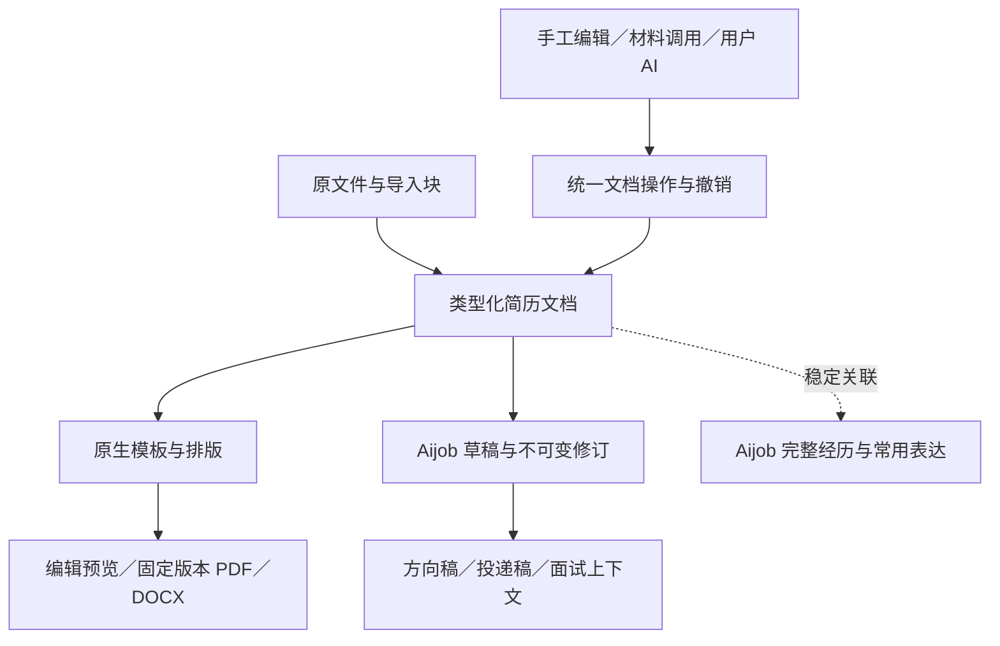

# Aijob 简历工作室：最终产品效果与底座调整提案

> 历史提案：本文未单独批准，已由 [K0–K5 批准方案](resume-cn-studio-production-plan-2026-09-11.md) 取代，后续排版方向再由 ADR-0042 更新。下文“尚未批准”“获准后”保留讨论时点，不是当前待审批事项或实施授权。当前任务见 [路线图](../06-mvp-roadmap.md) 与 [当前交接](../handoffs/current.md)。

2026-09-11 · 供 coco 对齐的方案草案 · **尚未批准实施**

本文件回答最终交付应是什么样、为什么这样调整、工程如何保证效果。它不表示已更换底座、修改应用或升级数据库。当前代码和业务数据保持原状；本文件不自动替代路线图、现行 ADR 或交接中的执行任务。获准后再同步这些文件。

## 1. 最终交付结论

建议对简历核心进行一次有边界的替换：**优先采用 Reactive Resume 的原生简历模型、文档操作、模板与输出体系，接入 Aijob 已有业务基础；重做与之对应的导入和编辑交互。**

用户最终应得到：

- 导入后能分别编辑学校、实习、项目和技能，不再面对整份简历组成的一块“工作成果”。
- 不需要 API、目标岗位或预先建立经历库，也能从空白写出并下载一份正常简历。
- 默认采用专业中文单栏；一份普通短稿自然为一页，长材料自然续页。
- 能在 **40 套真正不同、逐套合格的模板**中选择，换模板后纸张立即体现相应布局。
- 在编辑位置调用经历、优化表达、整理不完整的内容；操作可撤销，当前输入不丢失。
- PDF 下载与最终预览对应同一文件，正文、中文、日期和链接完整；DOCX 可编辑且内容完整。
- 方向稿、历史投递稿、原文件与练习上下文继续由 Aijob 管理。

整体 V2 工作区视觉保持认可方向。简历工作室采用更适合持续写作的专注布局，颜色与图标服从清晰、可读和操作效率。

## 2. 依据与选择边界

本提案基于[当前架构审计](../reviews/2026-09-11-resume-architecture-audit.md)。审计已复现：6 个模块、7 条记录的 PDF 经现有导入变为 1 个自定义模块；字段语义不一致；模板结构被通用输出压平；中等材料表单过长；默认纸张缩放不足以舒适阅读。上述问题不能仅靠修改字体参数解决。

成熟项目提供的可用依据：

| 对象 | 本轮采用的具体依据 | 不外推的结论 |
|---|---|---|
| [Reactive Resume 架构](https://docs.rxresu.me/contributing/architecture) | 类型化数据、文档操作、PDF 和 DOCX 已分包；适合研究完整核心的接入 | 内部分包不等于能直接安装的稳定 SDK，也不等于已经通过 Aijob 集成 |
| [Reactive Resume 当前 PDF 包](https://github.com/reactive-resume/app/blob/0a4608bf9d1dcafcbeba97b6217d5557b9f10221/packages/pdf/package.json) | 原生使用 React PDF，并提供浏览器及服务器生成入口 | 不能只复制模板名称，再改写为当前通用 HTML 结构，声称沿用了原生效果 |
| [Reactive Resume 导入说明](https://docs.rxresu.me/guides/importing-resumes) | PDF/Word 需要结构识别，其实现依赖配置的 AI，且可能识别错误 | 换底座不会自动解决中文复杂导入；不能强迫 Aijob 用户配置 API 才能手工写简历 |
| [OpenResume 解析](https://www.open-resume.com/resume-parser) | PDF 位置与行结构参与识别；可以审查其分层处理方法 | 面向英文单栏的规则不能直接证明中文双栏有效 |
| [LapisCV](https://github.com/BingyanStudio/LapisCV#format-and-style) | 中文专业单栏的完整字体层级、间距、字段关系 | 一张样图的像素字号不能直接换算成最终纸张字号 |
| [Magic Resume](https://github.com/Magic-Resume/Magic-Resume) | 中文模块及模板组件参考；保留为底座备选 | 不默认同时运行两个新编辑器 |
| coco 提供的 BOSS 截图 | 组织、职位、日期、正文就近编排，编辑与纸张之间对应清楚 | 不引入固定业绩、能力评分、年龄性别必填或另一套产品视觉 |

Reactive Resume 本次源码核对提交为 `0a4608bf9d1dcafcbeba97b6217d5557b9f10221`，提交时间为 2026-09-11。当前根配置声明 Node >=24、pnpm 12；Aijob 配置仍为 Node >=22、pnpm 11。该提交是研究定位点，实施采用的版本需要在兼容验证后固定，不能直接跟随 main 自动更新。[上游运行配置](https://github.com/reactive-resume/app/blob/0a4608bf9d1dcafcbeba97b6217d5557b9f10221/package.json)

这是基于源码边界作出的首选建议，尚未运行上游核心在 Aijob 中的中文导入、编辑、输出和负载联验。只有完成第 10 节的接入验收，才将其定为生产底座。

## 3. 用户最终如何使用

### 3.1 三条入口平等

“我的简历”提供从空白开始、导入已有简历、使用已有经历。三条入口最终进入同一个工作室。

- 空白：出现基本信息及可添加的常用模块，不预填虚构经历。
- 导入：上传后直接进入工作室；已识别内容进入对应字段，不增加脱敏、逐句确认或再次初始化流程。
- 已有经历：选择完整经历，插入当前稿中的相应条目。可以选择已有简历表达，或在当前稿中整理表达。

不要求先选择岗位；通用稿、方向稿、针对某个岗位的稿件都是合法用途。

### 3.2 导入后的实际样子

一份包含两所学校、三段实习、两个项目的材料，应出现对应的教育、实习、项目条目。学校进入学校字段，企业进入企业字段，职位和时间分别可改，列表仍然是列表。

新导入文档先采用专业中文单栏；用户已有明确选择时沿用该选择。工作室明确显示当前模板名称，提供“原件对照”和更换模板。**导入内容并重新排版，与恢复原文件的任意版式，是两种能力。** 本轮承诺前者；原件保留原样供查看、下载，不把采用默认模板称为识别出了原模板。

解析质量不足时：

- 已识别的部分先正常编辑。
- 未归类原文保留在当前工作室的整理区域，显示其原页或段落位置，不全部塞进“工作成果”。
- 可以选一段建立项目、移动到教育、拆成两条或与现有条目合并；操作支持撤销。
- 顶部只用一条简短状态说明尚有多少段没有归入正文，不制造整页错误警告。
- 这些内容不悄悄消失，也不自动混入最终纸张。下载时如仍有未归类内容，明确说明哪些部分不会输出，提供就地整理及继续下载的选择。

用户可以主动启用自己配置的 API 辅助处理复杂材料。没有 API 时，本地解析和手工整理可继续使用；识别能力不足必须如实呈现，不把“文本读取成功”包装成结构全部正确。

### 3.3 最终编辑工作区

桌面使用两个主要工作区：可读的模块表单与纸张。全局侧栏在专注编辑时收起，返回 Aijob 的入口始终保留。

| 区域 | 默认看到什么 | 主要操作 |
|---|---|---|
| 顶部工具条 | 文档名、保存状态、撤销重做、模板、排版、版本、下载 | 标题就地修改；PDF 为主要下载动作，DOCX 和打印容易找到 |
| 表单顶部 | 紧凑模块定位、添加模块、原件对照、整份简历审阅 | 快速到达教育、项目等；不占用独立的永久目录列 |
| 左侧编辑区 | 当前条目展开，其余条目展示学校/企业/项目、角色和时间摘要 | 点开即改；添加下一条、复制、排序、移动、隐藏和删除撤销 |
| 右侧纸张 | 用户真正填写的内容和实际分页 | 缩放、查看续页、点击实际条目定位编辑位置 |
| 就地辅助 | 当前条目的材料选择、AI 或整理操作 | 关闭后保留条目、输入和位置 |

默认宽度约 42% 编辑、58% 预览，并允许拖动调整。比例服从最小可操作宽度，不能把编辑栏挤成狭长表格。

改变当前“所有条目完全展开、重复显示全部工具”的做法：

- 当前条目显示常用字段与富文本工具；其他条目保留可识别摘要和主要操作。
- 部门、成绩、课程、论文状态等按模块类型合理展开；分页、栏位等放入排版/布局工具。
- 低频操作进入条目的更多菜单；新增条目、模板、下载、当前 AI 帮助保持可发现。
- 项目正文跟随内容展开，避免嵌套很小的滚动框。
- 纸张点击定位到对应条目；能确定字段时再定位到具体字段，不能所有点击都落在第一个输入框。

### 3.4 缩放和手机交互

**默认由“强行看完整页”改为“优先读清正文”。** 桌面初次以适应可用宽度为起点，提供整页适配和 100%；记住用户的缩放、分栏比例和编辑位置。短屏允许向下看纸张，不以缩小整页的方式消除纵向滚动。

- >=1200px：完整双栏。
- 900–1199px：收起全局导航和低频工具；双栏无法保持最小宽度时切换任务视图。
- <900px：编辑/预览切换；表单、当前条目和未保存输入保持连续。
- 320/360px 和原生 200% 缩放：主要动作可达；不能依靠把按钮和整张页面一起缩小完成适配。
- 手机软键盘出现时当前输入保持可见，顶部工具不层层堆叠占去大半屏幕。

输入过程中不强制滚动纸张，异步预览不能抢走焦点或覆盖新输入。

## 4. 模板最终应达到什么效果

### 4.1 40 套独立版式继续作为本轮范围

本次核对的 Reactive Resume [原生模板目录](https://github.com/reactive-resume/app/tree/0a4608bf9d1dcafcbeba97b6217d5557b9f10221/packages/pdf/src/templates)有 15 个模板目录。完整 40 套仍需额外适配，不能把引入开源底座描述成自动获得 40 套合格模板。

| 来源 | 最终目标数量 | 采用方式 |
|---|---:|---|
| Reactive Resume | 15 | 优先保留原生模板组件与相关布局逻辑 |
| JobPilot | 13 | 将已选模板的完整布局适配到确定的新模板接口 |
| Magic Resume | 5 | 同上，保留中文模块和字段编排特点 |
| LapisCV | 1 | 中文专业单栏，作为默认版式候选 |
| billryan/resume | 1 | 中文专业排版 |
| RenderCV | 2 | Classic 与 Engineering Resumes |
| best-resume-ever | 3 | Cool、Creative、Oblique |
| 合计 | 40 | 配色和字号选项不计作新模板 |

其中后 25 套需要真实适配，不能直接执行另一种引擎的模板文件。上游许可证、固定版本、原样张及适配差异分别登记。未通过中文内容及输出验证的模板不进入“已完成”计数，也不能用旧通用模板充当新版效果。

### 4.2 保留完整设计关系

模板决定的不只是颜色和字号，而是：

- 姓名、联系方式、照片及求职方向的关系。
- 学校与学历/专业如何成组；企业与职位如何成组；日期如何对齐。
- 模块标题、条目标题、说明、正文和列表之间的层级。
- 正文的可用宽度、侧栏内容类型、条目间距与续页行为。
- 中英文、长公司名、论文长标题、链接与多行日期如何换行。

每套模板保留独立的完整组件；共享字体、列表、链接等基础部件。不能再次把所有模块输出成同一套标题/meta/details/body 后，仅用 CSS 调整外观。

默认专业单栏以 LapisCV 及用户提供的正常中文简历样张作为参考：紧凑但可读，教育和经历的信息层级清楚；照片可选；不用大块装饰挤占正文。初始字号和间距必须按真实 A4 输出确定，再对照原生样张调整。屏幕上的观看比例不改变纸张排版参数。

短稿一页；多段经历和科研内容允许续页。绝不自动删除内容或缩成难读的小字来满足一页。空模块不生成空标题或占位页。

### 4.3 模板选择最终交互

- 图库左侧/主体是独立滚动的缩略图网格，候选详情保持可达。
- 默认展示统一的单页中文样稿；样稿明确标记，与用户资料完全分开。
- 选中模板可以看大图、长材料续页，以及“用我的内容预览”。个人预览最多同时比较 3 套。
- 选择候选不会把 40 套列表挤到屏幕下方；返回保留搜索、筛选和位置。
- 应用一次即可看到相应模板布局，并可以一次撤销。
- 应用模板重置与旧模板冲突的布局参数；正文、隐藏状态、经历关联与组内顺序保留。跨栏组织按新模板规则进行，用户可继续调整。
- 按真正能力筛选，例如单/双栏、照片位置、紧凑程度和长材料支持，不再依据名称猜测能力。
- 推荐入口帮助新手缩小选择范围，“全部 40 套”始终可浏览，不减少用户选择。

## 5. 内容、经历与 AI 的最终关系

### 5.1 模块有真正的专用字段

教育使用学校、学历、专业和时间；工作使用企业、职位、部门和时间；项目使用项目名、角色和时间；论文使用标题、作者、刊物、年份和状态。

不同入口写入同一含义的字段。新底座原生模型缺少中国校园/科研字段时，必须增加明确类型、编辑方式和对应输出；不能放入模板不会读取的附加对象。未填完整的草稿仍可保存。

### 5.2 完整经历与这份简历的表达分开

完整经历保存背景、角色、做法和产物；简历条目保存这份稿件选用的表达，两者建立稳定关联。

- 新增/导入经历首次自动收录，同一条目连续编辑不产生重复经历。
- 新条目收录使用稳定标识和明确的收录生命周期，不由“是否点过导出/助手”等无关技术动作决定后续同步。
- 后续针对岗位改写只作用于当前稿件。
- “更新经历原稿”是当前位置可见的操作，修改原稿不自动覆盖其他方向稿。
- 插入材料时使用已选表达，不把完整背景、方法、结果和正文机械叠加打印。

具体去重与首次收录边界在新模型联验中固化，用户不需要理解 capture_open、证据 ID 或内部修订。

### 5.3 AI 操作与编辑操作共用同一套能力

继续由用户配置 API。助手在当前内容上精简、突出贡献、追问、结合岗位调整和整份审阅。

结果既可以修改正文，也可以建议拆分项目、整理字段或移动条目；采用后走与手工编辑相同的文档操作和撤销机制，保留格式与关联。

不把 AI 结果再次存成一个无类型的大段 custom，不用纯文本覆盖原有列表、加粗和链接。迟到响应先检查对应修订，不覆盖已修改的内容。

用户可以直接编辑、跳过问题、先形成一版。采用修改不是逐句事实审批；不编造经历、数字或角色。没有 API 时，整个手工制作与输出链路独立成立。

## 6. 下载的最终含义

正式下载固定为：保存当前输入 → 固定本次内容/布局版本 → 生成文件 → 检查 → 显示下载结果。

- 刚输入、刚导入、刚换模板或刚恢复版本后立即下载，也必须包含本次输入。
- 下载过程中继续编辑，影响下一次文件，不改变本次快照。
- 最终 PDF 预览和下载使用同一个产物；重复下载不偷偷重排。
- 编辑过程预览与正式导出采用同一核心、模板与字体版本；异步任务按当前修订淘汰旧结果。
- 中文、数字、邮箱、链接、列表和全部续页正文可以选择与复制；DOCX 另行校验内容和可编辑性。
- 只有姓名也允许保存；下载前仅简短提示尚无正文，可继续下载。
- 实际缺段、遮挡或生成失败不能返回“成功”。保留输入并提供重试，不让用户用一个残缺文件继续投递。

完整性分三个独立环节判断：原文有没有被保留和正确分组；结构化字段有没有进入模板；最终文件有没有完整输出。只校验“错误草稿中的文字都导出了”不能再算导入与输出全部正确。

## 7. 底层如何调整

### 7.1 首选是完整简历核心的接入

建议将成熟核心作为有来源记录、固定版本的内部模块接入。复用其类型化内容、文档操作、模板和原生输出；编辑组件按可分离程度移植并接入 Aijob 服务，保持模块语义一致。不是只取模板 CSS，也不是把另一整套账号、数据库和申请系统搬进来。

新文档采用一种可编辑的内容真源，不能每次保存都在新底座数据和旧通用 Entry 之间来回转换。Aijob 负责保存信封、owner、版本、附件和业务关联；模板布局不再写入经历事实。

### 7.2 本提案明确改变此前的一项工程约束

此前“新简历必须继续使用 HTML/Chromium”的要求，建议改为：**新文档跟随通过验证的成熟核心原生输出体系。** 若采用当前 Reactive Resume，就保留其 React PDF 路径，不将它重新翻译回当前 HTML 渲染器。

这不是认定 Chromium 无法排简历，而是减少再次自建模板表达层的范围，保留成熟核心的一致性。旧 HTML/Chromium 路径用于已有历史数据的兼容读取和必要输出，不作为新版文档在两个引擎间任意切换的机制。

浏览器生成预览使用独立任务，避免阻塞输入；服务器生成确定版本的正式产物。共用字体资产、模板版本和内容语义，验证两端的一致性。是否升级 Node/React 等运行依赖由接入验证给出明确清单，不为移植工具链整体重写全仓。

### 7.3 导入需要独立建设

PDF 保留文字坐标、换行、列关系与字形线索；DOCX 保留段落、列表和表格。先恢复内容块，再识别模块和条目，最后映射到类型化字段，并保留原文位置关系。

本地结构解析、可选 BYOK 与手工整理共用该中间结果。开源底座不自动提供符合 Aijob 全部需求的中文解析器。复杂双栏和科研材料必须用实际样本验证，不承诺任意版式百分之百自动识别。

### 7.4 有边界的保留与替换

| 部分 | 处理 |
|---|---|
| Aijob 账号、owner、PostgreSQL、岗位、申请、日程和三个权限边界 | 保留 |
| 原件、草稿/修订、导出产物和已投递快照 | 保留服务能力，增加新版内容适配 |
| 新文档内容模型、模板表达、编辑操作与主要预览输出 | 采用经验证的成熟核心，并补齐必要中文/科研字段 |
| 当前 PDF 扁平化导入和成功判定 | 替换 |
| 当前重复且缺少结构整理能力的表单交互 | 重建，复用能保持语义的字段组件 |
| 经历及 BYOK | 保留供应商/owner 边界，改为类型化插入与统一操作 |
| 当前 40 套简化模板 | 保留历史身份及参考资产；不自动算作新版已验收模板 |

Magic Resume 是首选无法通过关键接入条件时的备选，不与 Reactive Resume 同时作为两个新编辑核心运行。

## 8. 旧稿与误识别导入如何处理

- 已保存原件、导出产物和历史投递稿原样保留。
- 旧稿通过读取适配进入兼容视图；升级编辑时创建有来源关系的新稿，先核对字段映射，不直接批量覆盖旧数据。
- 已被压成一段文字的导入优先从保留原件重新识别。用户导入后的修改与原始材料分别保留，无法自动合并时提供对照，不能用重新解析覆盖用户后来写的内容。
- 新旧稿关联明确，避免用户看到重复但分不清版本的文件。
- 方向稿和练习引用继续锁定当时的正文与布局；不能随核心升级重新生成并替换。
- 删除及迟到任务仍经过现有 owner、版本和删除状态检查；本机恢复草稿随退出/用户变化清理。

先上线新版读取能力，再启用新版写入。回退目标必须能读取已产生的新数据；不能回退到无法识别新文档的旧程序。

## 9. 按成熟产品验收最终效果

| 维度 | 必须看到的结果 | 不再接受的替代证据 |
|---|---|---|
| 导入 | 原件中的学校、实习、项目、时间、正文关联正确；错误可就地整理 | 文本非空、接口 succeeded、姓名和几个关键词存在 |
| 排版 | 原生参考与适配后同内容对照；层级、对齐、留白和续页合理 | 模板名字一致、改了颜色、没有溢出就算合格 |
| 编辑 | 实际新增和改写多段材料，连续操作可达，格式和输入保留 | 页面可以打开、按钮存在、截图没有横向滚动 |
| 输出 | 全部页面与内容完整，中文复制正确，最终预览和下载一致 | 文件大小、页数、第一页或最终草稿文字覆盖率 |
| 业务 | 同一经历可产生不同稿件，投递与面试上下文稳定 | 单个简历接口通过 |

样本不能只有内部预先结构化的三份数据。需要包括：原失败样本、其他工具生成的单/双栏 PDF、带表格的 DOCX、长标题科研材料、中英文混排，以及留出的未用于调规则的样本。个人材料只在本机授权范围内使用，不提交到仓库。

40 套分别运行短、中、长材料，保留至少 120 组输出检查；同时增加从外部文件进入的完整旅程，逐字段核对。对每套有真实原生/适配样张和差异说明，不能用概念效果图替代。

体验验收包含 320/360px、原生 200% 缩放、中文输入法、实体软键盘、键盘操作和焦点恢复。性能继续测输入 p95 <=100ms、正常保存 p95 <=500ms、典型模板切换约 1 秒内稳定，记录同机数据与后台并行负载；未达到时如实记录，不能先许诺换底座一定更快。

真实 BYOK 未配置时单列未联调；手工编辑和输出必须独立合格。

## 10. 获准后的执行顺序与交付

| 步骤 | 交付物 | 进入下一步的条件 |
|---|---|---|
| 1. 核心接入验证 | 固定上游版本，接入 Aijob 的最小保存/修订边界；三类代表版式的中文真实工作室；失败导入样本走通结构映射；列出依赖与许可证 | 能编辑、换模板、撤销、保存、重新打开并下载；中文/论文必要字段、PDF/DOCX 和非 AI 路径成立。仅独立启动上游不算通过 |
| 2. 完成内容与导入 | 类型化全部模块；完整文件解析和就地整理；旧稿转换/误识别恢复；经历关联 | 外部文件的模块、条目、字段和正文通过核对；不再出现成功的整份 custom 替代 |
| 3. 完成正式工作室 | 收敛表单、可读预览、模板图库、响应式；材料和 AI 统一操作；确定版本下载 | 空白/导入/材料三条真实旅程连续完成，错误恢复与输入保护通过 |
| 4. 完成 40 套模板 | 按 10/20/30/40 批次交付完整适配、样稿、缩略图和全部输出 | 每套逐项合格后计数，样稿和用户内容均验证 |
| 5. 形成候选版本 | 历史兼容、owner、删除、修订、完整求职链和负载验证；准确更新路线图/交接 | 主体质量与真实运行配置分别有证据，未完成项明确 |

第一步的三类版式覆盖专业单栏、原生双栏和科研长材料；是技术决策所需的真实集成样本，不减少最终 40 套范围。若出现无法接受的中文输出、数据语义或框架耦合问题，在扩大迁移前比较备选，记录结论，不继续堆模板掩盖底座失败。

每一步按实际改动完成 lint、类型、测试和构建；涉及数据/owner/修订/幂等时运行专属 PostgreSQL 集成。普通自动化不访问真实招聘网站。

## 11. 本次需要对齐的效果决定

1. 简历核心按成熟底座重新接入，Aijob 的求职业务和资产继续保留。
2. 导入直接编辑，同时具备看原件和就地整理结构的能力；不再引入隐私复核或逐句确认。
3. 编辑采用聚焦当前条目的双区工作室，预览优先可读，手机按任务切换。
4. 40 套经过验证的完整模板，默认专业中文单栏，短稿自然一页，长稿合理续页。
5. 下载内容和最终预览一致；导入质量、字段含义、排版及文件完整性分别验收。
6. 技术首选 Reactive Resume 原生核心；允许为此调整之前固定 HTML/Chromium 的约束，但正式采用以前述集成验证为准。

**截至本文件交付：仅完成方案与资料核对，没有开始实施。等待 coco 对最终效果和调整范围确认后，再进入执行。**
