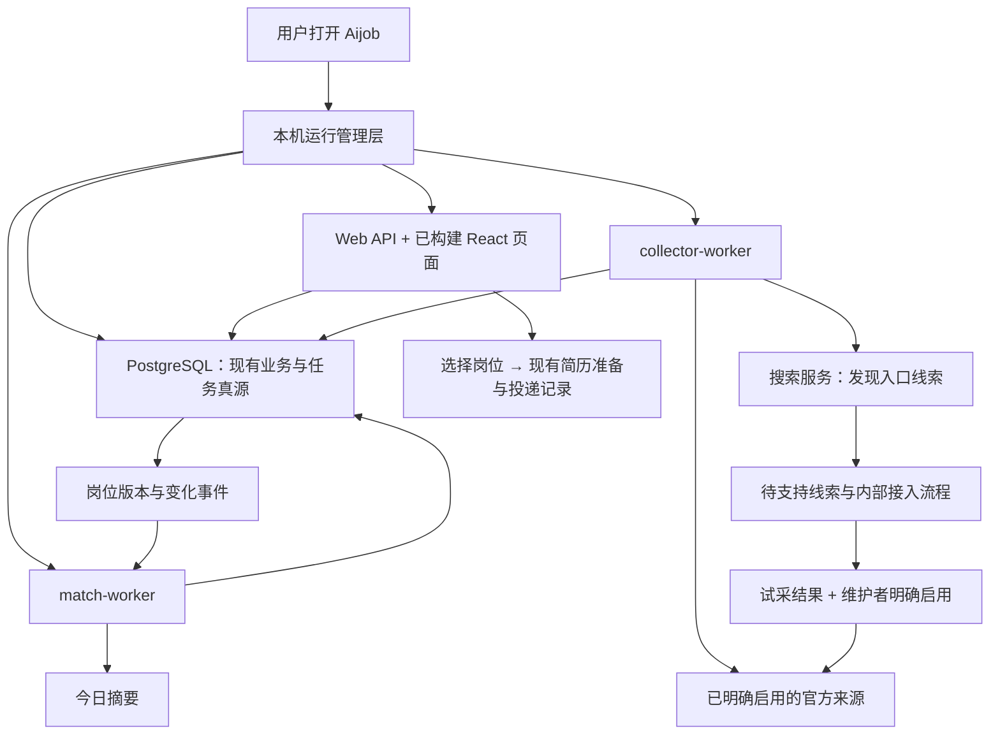

# Aijob 本地自动找岗位：开源研究与产品化设计报告

研究日期：2026-10-12 至 2026-10-13。面向 coco 已确认的形态：**本地安装使用，启动 Aijob、填写配置即可**。

> 2026-10-13配置设计修订：不强制“模型 Key + 搜索 Key”两套配置。优先复用经确认支持搜索的现有 AI 连接，允许切换独立搜索或仅刷新已有来源。第 5 节已同步，能力检测、供应商证据和实现边界见[连接与搜索选择分析](connection-search-choice.md)。这是设计修订，未切换当前 Tavily 或个人模型配置。

本文是设计建议及其依据，不是新的实施授权或交付验收。没有改动业务代码、数据库、密钥和正在运行的任务，没有安装或执行第三方项目，也没有为研究增加真实招聘站采集。现有 C 盘工作区及全部未提交改动保留。

## 1. 建议：把现有能力做成普通用户可独立使用的产品

Aijob 应继续使用现有 React/Vite、Fastify、PostgreSQL 和三个服务边界，围绕一条用户路径补齐能力：

**打开应用 → 保存求职方向 → 获得已接入官网的真实岗位 → 持续寻找更多来源 → 看新增和变化 → 为岗位准备简历。**

这次最值得实施的五项改进是：

1. **单一启动入口。** 应用负责启动和恢复数据库、API 与 worker，用户不安装开发工具、不执行终端命令。
2. **按用途配置。** 用户能分清“更新已有岗位”“寻找更多招聘网站”“简历与求职助手”，无需先理解协议、JSON 模式和后台服务。
3. **产品维护可用来源目录。** 预置经过维护核验的企业官网配置，用户选择方向即可使用；目录随版本维护，不把搜到的 URL 当成已经支持的来源。
4. **自动完成已支持招聘系统的新企业接入准备。** 从官网识别招聘入口、读取租户参数、试采并生成结果，消除本次由 Codex 手写配置的环节；首次启用继续由维护者明确操作。
5. **持续运行可解释。** 告诉用户实际找到了什么、哪些来源在更新、什么失败了、下一次何时运行；重启后恢复，不重复报新。

“用户不用维护”应准确表述为：**用户不用维护已支持的来源；产品维护者负责来源目录和兼容修复，用户启动、配置并更新应用。** 纯本机形态仍需要有人维护产品。没有维护服务时，未知网站不能显示“正在接入”，更不能承诺任意网站都能无人处理。

你最初给的两个参考项目仍然重要：**RecruitOps 是本机启动和官网接入的重点参考；ai-job-search 是目标、搜索、选材、准备之间连续流程的参考。** 本轮新增的 Job Seek 补充了最关键的“来源如何持续接入和维护”的工程证据。它们各解决一个明确问题，不替换 Aijob 整体。

## 2. 从这次真实运行反推缺口

以下是 10 月 12 日运行记录及本轮代码读取的结论，不是 10 月 13 日重新执行的探针结果。依据：[当前交接](../../handoffs/current.md)、[真实连接与交付记录](../../evidence/system-upgrade-2026-10-12.md)、[哈啰来源记录](../../evidence/ingestion/hellobike-internships-2026-10-12.md)。

| 环节 | 实际已做到 | 本次仍依赖的帮助 | 产品化应承担的责任 |
|---|---|---|---|
| 启动 | 原工作区各服务可以运行 | Codex 重启 Docker/数据库、API、Web、两个 worker 和内部台 | 一个入口按依赖启动，失败可恢复 |
| 模型配置 | OpenAI 兼容连接和一次结构化输出测试通过 | 需要解释地址、模型、返回格式 | 预设、模型列表、手填回退、有效默认值 |
| 新网站搜索 | Tavily 一次调用获得 10 条网站线索 | 配置在另外的内部页面；需解释与模型的区别 | 主工作区内完成配置，显示搜索用途和状态 |
| 新来源落地 | 哈啰官网已接入 | 哈啰不是原十条搜索结果之一；Codex 另行发现、核验、提取 PortalId、写配置并安装 | 已支持 ATS 的入口识别、参数提取和试采成为产品功能 |
| 定时刷新 | collector 计划刷新哈啰，42 条实习岗位、0 拒绝 | 首次启用来源及运行环境仍需维护操作 | 启用后按周期运行，范围和下一次时间清晰 |
| 用户价值 | 2 条明确上海产品实习可见；杭州明确产品实习未新增 | 结果解释仍需人工区分 | 城市、方向明确匹配与未知信息分开表达 |
| 每日变化 | 事件已记录，首份“当前机会”摘要已有 | 次日 09:00 摘要尚未提前运行验证 | 沿用订阅基线和事件机制，显示真实生成时间 |

**不能把这次结果描述为“两套模型自动完成了搜索到入库”。** Tavily 是搜索服务；用户配置的 DeepSeek 兼容接口在这条接入过程中没有承担上述维护工作。岗位采集、去重、版本和摘要主要由确定性程序完成。真正的缺口集中在“线索变成可靠来源”和“本机自动运行”之间。

另有两个直接影响实际使用的问题：

- “保留官方未说明条件”会带入方向未知的岗位。本次新来源的 10 条方向查询结果中，只有 2 条已明确属于上海产品实习；其余 8 条含未知方向，不能全部计为产品机会。应改善展示和证据提取，继续保留未知条件，不能静默排除。
- 哈啰某条岗位的任职要求仍混入“我们能提供什么”福利段。API 返回结构化字段不等于字段内容已经干净。这是正文提取的实际失败，优先级高于再加一种抓取框架。

### 2.1 已有代码可以继续用，主要补连接处

| 现有代码 | 已有职责 | 应增加的部分 |
|---|---|---|
| [discovery.ts](../../../apps/platform/src/opportunities/discovery.ts) | Tavily Basic、查询共享、额度、线索去重 | 查询质量、用户可见进度，线索后续处理状态 |
| [subscriptions.ts](../../../apps/platform/src/opportunities/subscriptions.ts) | 方向订阅、查询生成、执行时间 | 避免把所有招聘类型拼入每个方向，按城市轮转查询 |
| [source-leads.ts](../../../apps/platform/src/opportunities/source-leads.ts) | 线索转为禁用来源草案 | 当前含未配置选择器占位符；需要真实 ATS 探测及参数填充 |
| [onboarding-service.ts](../../../apps/platform/src/sources/onboarding-service.ts) | 样本验证、公开 HTML 的 AI 选择器建议、配置安装 | 自动取得合规样本、输出可读试采结果，复用现有安装流程 |
| [source-tenant-config.ts](../../../apps/platform/src/sources/source-tenant-config.ts) / [source-vendor-config.ts](../../../apps/platform/src/sources/source-vendor-config.ts) | 厂商模板与企业实例分离 | 增加识别入口、模板能力和版本状态 |
| [beisen-zhiye-adapter.ts](../../../apps/platform/src/sources/beisen-zhiye-adapter.ts) | 已有北森采集 | 同模板新租户无需手填 PortalId；真实栏目、翻页、字段验证 |
| [operations-console.ts](../../../apps/platform/src/sources/operations-console.ts) | 预览、reviewedHash、安装、注册与内部操作 | 操作从 JSON 变成“识别—试采—查看结果—启用” |

现有公开网页 AI 建议接口要求先提供页面样本，使用维护层配置及预算；它没有把个人 `/settings/ai` Key 自动接入 collector。设计必须保留这一区别。当前可确认的通用厂商模板是北森，不能提前宣称已有 Moka 或其他 ATS 通用接入。

## 3. 横向检索结果：哪些值得取，哪些应放弃

按“是否减少普通用户操作、是否能拿到完整官方岗位、是否能持续恢复、是否适合现有栈”筛选。没有按 star 数排名，也没有以 README 中的“自动”“任意网站”“一键”作为实现证据。

下表为结论索引。固定提交、具体代码、安装方式、许可证及文档与源码差异，分别保存在三份附录：[求职产品](job-products.md)、[来源与采集](source-engines.md)、[本地运行与配置](onboarding-runtime.md)。这些核对属于文档和源码研究，不表示实际运行过对方产品。

### 3.1 求职产品

| 项目 | 有用的设计 | 真实边界 / 不适合之处 | Aijob 取舍 |
|---|---|---|---|
| [RecruitOps](https://github.com/849879772/recruitops-agent) | Windows 单入口、官网入口识别、逐公司结果、采集和评分分离、恢复 | 企业发现依赖固定目录；当前默认排除实习，模型限制和自动表单等与本项目不同 | **重点参考运行与接入机制** |
| [ai-job-search](https://github.com/MadsLorentzen/ai-job-search) | 方向到多种职位表达、来源出处、求职连续流程 | 依赖 Claude Code 编排 CLI；新门户仍让 Agent 写代码；无独立桌面常驻产品证据 | **参考流程与搜索策略** |
| [JobOps](https://github.com/DaKheera47/job-ops) | 配置完成状态、企业目录、Watchlist 首次基线 | Docker 前置、综合招聘板、许可附 Commons Clause；打开页面刷新不等于全天自动监控 | **参考交互，保留现有数据和调度** |
| [JobNavigator](https://github.com/vesaias/JobNavigator) | URL 识别 ATS、API 优先、逐来源健康和失败原因 | 国外 ATS 为主；URL 识别不等于完整抓取；重启将旧运行标失败不等于断点续跑 | **参考接入和状态表达** |
| [JobTrail](https://github.com/kaylaehman/jobtrail) | 搜索结果与已保存岗位分开，操作简单 | JobSpy sidecar；岗位发现主要手动，未确认官网生命周期闭环 | 局部交互参考，不作采集底座 |
| [MR.Jobs](https://github.com/humancto/mr-jobs) | 向导、发现与评分分别调度 | 任意官网 fallback 只筛部分链接，JD 为空；多模型宣称与当前注册实现有差异 | 用于界定发现与完整采集的区别 |
| [JobSpy](https://github.com/speedyapply/JobSpy) | 多来源统一输出、并发和字段整理 | 同步抓取库，不含产品调度；主要综合招聘板不合 Aijob 事实源边界 | 不接入核心来源链路 |

### 3.2 来源工程与变化监控

| 项目 | 有用的设计 | 真实边界 / 成本 | Aijob 取舍 |
|---|---|---|---|
| [Job Seek](https://github.com/colophon-group/jobseek) | ATS 自动探测、租户参数、列表与详情分离、来源维护工作流 | 新企业仍由维护者/托管 Codex 接入；完整系统依赖额外服务 | **最贴合来源接入缺口，借机制** |
| [RSSHub](https://github.com/DIYgod/RSSHub) | 连接器元数据、网址识别、维护一次多人复用 | 未知网站仍需维护路由；RSS 不负责岗位关闭判定 | 借目录和版本设计，不接整套路由 |
| [Crawl4AI](https://github.com/unclecode/crawl4ai) | 模型生成提取 schema，验证后确定性复用 | Python/browser 依赖；提取成功不等于语义和翻页正确 | 借配方生成方式，复用已有实现 |
| [changedetection.io](https://github.com/dgtlmoon/changedetection.io) | 过滤后比较、变化历史、错误和最后成功状态 | 页面变化不等于岗位变化，另有存储/调度 | 借状态和差异解释，不重复部署 |
| [Crawlee](https://github.com/apify/crawlee) | TS 的 HTTP/浏览器执行、有限重试 | 仍需开发提取规则；自有请求队列 | 当前没有执行器瓶颈证据，暂不引入 |
| [Scrapy](https://github.com/scrapy/scrapy) | Spider、请求去重、JOBDIR 恢复 | Python 第二栈；不能替代 PG 事务、租约和 fencing | 参考恢复边界，不迁移 |
| [Stagehand](https://github.com/browserbase/stagehand) / [browser-use](https://github.com/browser-use/browser-use) | 观察网页、结构化提取、有限步骤 | 模型操作成本；缓存/云浏览器有条件；不提供岗位完整性和准入 | 后续复杂站维护工具候选，不进每日刷新主路径 |
| [Firecrawl](https://github.com/firecrawl/firecrawl) | 统一 API、提取配方与失败反馈 | 当前自托管引入 Redis、RabbitMQ 等，部分云能力不随默认栈提供 | 不接整套服务 |

### 3.3 本地运行与配置

| 项目 | 有用的设计 | 真实边界 / 成本 | Aijob 取舍 |
|---|---|---|---|
| [AnythingLLM](https://github.com/Mintplex-Labs/anything-llm) | 下载安装体验、模型列表和手填回退 | 桌面 wrapper 不属于该核心开源仓库；不应搬向量库和全部模型参数 | 参考首用配置 |
| [Open WebUI](https://github.com/open-webui/open-webui) | OpenAI-compatible 连接、高级参数折叠、启停与验证 | `/models` 可用不保证任务生成可用；当前许可有品牌条件 | 参考连接交互 |
| [Dify](https://github.com/langgenius/dify) | 服务依赖就绪、健康检查、配置层次 | 面向管理员部署的完整平台，WSL/Docker 等前置 | 不作为 Aijob 后台平台 |
| [Electron](https://github.com/electron/electron) / [Forge](https://github.com/electron/forge) | Node 子进程、托盘、单实例、打包工具 | 体积、原生依赖与更新维护；不会自动管理 PG | **薄桌面壳优先候选** |
| [Tauri](https://github.com/tauri-apps/tauri) | sidecar、登录启动、签名更新 | 仍须捆绑 Node/PG，增加 Rust/WebView2 构建考虑 | 有明确包体限制时的备选，不同时引入 |
| [Graphile Worker](https://github.com/graphile/worker) / [pg-boss](https://github.com/timgit/pg-boss) | PG 持久调度、时区、去重及补跑语义 | 自有队列不能与现有任务系统重复 | 对照补齐语义，不换队列 |

**许可会影响直接拷贝，但不妨碍学习设计。** JobOps 的 Commons Clause、Open WebUI 的品牌条款、Dify 的附加条件，不能省略成“全部宽松开源”。RSSHub 当前是 AGPL-3.0；Crawl4AI 的许可文本附署名要求；Job Seek 代码 MIT 与岗位数据集 CC BY-NC 4.0 分开；Firecrawl 服务与 SDK 的许可也不同。具体原文链接见各附录，本方案默认借机制、自行适配现有代码，不导入第三方岗位数据集。

## 4. 决定方案的几处关键证据

### 4.1 RecruitOps 证明单入口可行，也暴露升级责任

当前公开 v0.1.7 确有约 739 MB 的 Windows 便携 ZIP。解压完整目录、运行 EXE 后由运行管理层拉起依赖，不能把它说成只有一个独立二进制文件。源码分别处理组件核验、端口、PG 初始化、就绪等待、迁移前备份和退出。这直接对应 Aijob 当前需要人工启动多个服务的问题。[发行包](https://github.com/849879772/recruitops-agent/releases/tag/v0.1.7)、[supervisor 实现](https://github.com/849879772/recruitops-agent/blob/1584307eef66b7e3f839e55cd74dd7e12d7b876d/packages/desktop_runtime/supervisor.py)。

但其升级仍要求完整迁移 `.data`、保持原用户及绝对路径。Aijob 应从一开始分开程序目录与稳定的用户数据目录，避免把升级变成手工搬数据库。该判断来自升级文档，未实际运行对方安装包。[升级说明](https://github.com/849879772/recruitops-agent/blob/1584307eef66b7e3f839e55cd74dd7e12d7b876d/docs/UPGRADE_EXISTING_DATA.md)。

其入口路由先从真实网页找链接，再匹配已有适配器；它没有凭模型生成任意接口。这比“每天让模型从官网首页摸索”更贴合 Aijob。[entry_crawl.py](https://github.com/849879772/recruitops-agent/blob/1584307eef66b7e3f839e55cd74dd7e12d7b876d/packages/recruitment_core/entry_crawl.py)。

### 4.2 ai-job-search 的价值在工作流，新增门户仍是开发工作

`/scrape` 会按个人目标选择已安装门户 CLI，失败时使用 Agent 的 WebSearch；`/add-portal` 则要求调查网站、生成 CLI 和技能、跑一次查询。它把来源接入步骤整理得很好，但没有消除接入开发。把它直接接入 Aijob，只会让普通用户依赖另一个 Agent 环境。[scrape 说明](https://github.com/MadsLorentzen/ai-job-search/blob/a011214d60f943770e33f7d5f070e1a5f91e3822/.claude/skills/job-scraper/SKILL.md)、[add-portal](https://github.com/MadsLorentzen/ai-job-search/blob/a011214d60f943770e33f7d5f070e1a5f91e3822/.claude/commands/add-portal.md)。

Aijob 应借“同一求职目标贯穿搜索、岗位选择、材料准备”，保留自己的网页和执行器。用户不需要把 `/scrape`、`/rank` 等命令学一遍。

### 4.3 Job Seek 最接近本次由 Codex 代劳的环节

其 monitor registry 为不同招聘系统定义探测能力和成本，识别成功返回租户参数；北森实现可以从页面 bootstrap 读取 PortalId，并检查总数、分页和截断。这说明“已支持 ATS 的新企业接入”有明确的可自动化范围。[registry](https://github.com/colophon-group/jobseek/blob/915d34ac84adbda9be528171cd0936660725bb6f/apps/crawler/src/core/monitors/__init__.py)、[北森实现](https://github.com/colophon-group/jobseek/blob/915d34ac84adbda9be528171cd0936660725bb6f/apps/crawler/src/core/monitors/beisen.py)。

对方把列表监控与正文提取分开：发现新岗位后取详情，既有正文按策略复核，避免每小时重复下载全部内容。Aijob 可利用原生列表已携带的正文，按现有版本语义决定是否更新。[设计说明](https://github.com/colophon-group/jobseek/blob/915d34ac84adbda9be528171cd0936660725bb6f/docs/04-monitors-and-scrapers.md)。

不过其新公司接入仍是维护者或托管 Codex runner 的工作。正确借鉴是把重复的识别和验证做成产品工具，保留少量真正的维护判断；不能把对方“有 Agent 工作流”写成“普通用户填 Key 后任意站可接入”。[接入说明](https://github.com/colophon-group/jobseek#add-a-company)。

### 4.4 配置体验要验证具体能力

AnythingLLM 的兼容接口组件在模型列表不可用时允许手填。Open WebUI 把高级参数折叠，但其连接验证不能直接证明 Aijob 的结构化生成可用。JobOps 则将配置状态区分为可用、待处理、无效及暂时无法检查。三者合起来支持一个清楚的设计：**少量输入，按实际任务验证，显示下一步。**[AnythingLLM 组件](https://github.com/Mintplex-Labs/anything-llm/blob/6100f0c8b995511439402ed36d95c9667cadff57/frontend/src/components/LLMSelection/GenericOpenAiOptions/index.jsx)、[Open WebUI 连接文档](https://docs.openwebui.com/getting-started/quick-start/connect-a-provider/starting-with-openai-compatible/)、[JobOps 配置状态](https://github.com/DaKheera47/job-ops/blob/cb8803c0566a1d8ec789f1f1ecf121f58ac8b769/orchestrator/src/server/services/onboarding-status.ts)。

### 4.5 提取规则可以受模型辅助，日常刷新不必依赖模型

Crawl4AI 支持模型生成选择器 schema 后复用；Firecrawl 也有提取器缓存和显式失败路径。可取的是“先形成规则，随后重复执行”，不必安装它们的整套运行环境。Aijob 已有公开 HTML 配方建议和配置验证，沿它补齐即可。[Crawl4AI 提取实现](https://github.com/unclecode/crawl4ai/blob/aadd82bebf989f1c36e1b557b8bb2b7c9dae393f/crawl4ai/extraction_strategy.py)、[Firecrawl 提取实现](https://github.com/firecrawl/firecrawl/blob/94ba4a3eb1ef71aae28f0635b453eef75f416001/apps/api/src/lib/deterministicJson/extract.ts)。

其他 ATS 官方文档也支持优先结构化接口的判断：Greenhouse 提供公开职位 GET，Lever 按企业站点返回岗位，Ashby 提供已发布岗位接口。但这些是特定生态，不代表中国目标公司的覆盖；缺失字段依然可能缺失，完整 HTML 也可能混合公司介绍。北森之后是否做 Moka，应由真实中国在校生供给决定，不因国外项目已经支持某 ATS 就跟随扩充。[Greenhouse](https://docs.greenhouse.io/job-board.html)、[Lever](https://github.com/lever/postings-api)、[Ashby](https://developers.ashbyhq.com/docs/public-job-posting-api)。

## 5. 最终用户应该怎样使用

### 5.1 第一次打开：先求职目标，再配置增强能力

1. **启动 Aijob。** 页面显示“正在启动本机服务”，就绪后进入工作区；失败时给可处理的原因，不打开一个空白或永久加载的页面。
2. **填写方向。** 例如“产品实习，上海、杭州”。不用先上传简历或配置模型。
3. **选择持续寻找。** 显示本版本已核验来源范围及运行方式。已有明确启用范围直接沿用；新安装实例通过明确操作启用选定范围，不悄悄开启所有历史配置。
4. **先读当前机会。** 先呈现已有有效岗位，再后台更新；没有匹配时说明实际覆盖和最后核验时间。
5. **按需扩大来源。** 优先检查现有 AI 连接是否提供可用搜索；支持时可复用，不支持或尚未识别时允许选择独立搜索、换连接或稍后配置。显示“用于寻找更多企业招聘入口”；保存成功不等于已经找到可入库岗位。
6. **稍后配置写作助手。** 在第一次需要 AI 起草或分析时引导，也可主动进入设置。手动简历、经历、模板和下载照常可用。

普通使用不再要求访问 `8091`、选择 worker、填写 PortalId、编辑 JSON 或读终端日志。受限内部维护台继续存在，维护权限不下放到普通 Web API。

### 5.2 连接页只保留用户能理解的三项能力

| 能力卡片 | 最少输入 | 成功后代表什么 | 未配置或失败时 |
|---|---|---|---|
| **更新已接入的岗位** | 求职方向、运行偏好 | 已启用官网可按周期刷新 | 单来源故障具体显示；其他来源继续 |
| **寻找更多招聘网站** | 复用可用 AI 连接，或选配独立搜索 Key | 可执行搜索并产生网站线索 | 只暂停新网站搜索，既有来源继续 |
| **简历与求职助手** | 服务商或兼容地址、Key、模型 | 所选模型可用于对应个人任务 | 保留手动编辑、规则提示和导出 |

模型配置提供“DeepSeek 官方”“OpenAI 兼容 / 中转”两个常见入口，预设自动填地址。尝试读取模型列表；服务商没有 `/models` 时允许手填其模型 ID。协议、返回格式、Token、并发和超时放入高级设置。兼容模式按已有实现设置默认值，不能编造一个服务商实际不支持的能力。

验证只在首次设置或配置改变后做一次有意义的小请求；不要每次打开设置页自动消耗 Token。分别显示“已保存”“连接可用”“该任务可用”；Key 只回显保存状态和掩码，保留已有配置，避免要求 coco 重填。

当前可用的 Tavily Basic 继续保留，作为用户可选的独立搜索方式，不自动切走已有配置。研究时官方仍为每月 1,000 免费 credits、Basic 每次 1 credit；该适配器沿用每日 20 次、每月 500 次网络尝试上限，重试计入，24 小时内共享规范查询，不开启超额付费。需要显示应用自身的使用计数，它不等于用户账号在其他应用的总消费。模型平台搜索另按其实际工具调用和 Token 使用计量，不能机械等同于 Tavily credits。[官方额度说明](https://docs.tavily.com/documentation/api-credits)。

**内部职责分开，不等于用户必须配置两次。** 现已有模型平台提供同一认证下的搜索能力；本地版应允许一套连接兼任，并由产品识别和验证。不能仅凭“OpenAI 兼容”或模型自称能联网判定，无法识别时也不能直接断言不支持。连接用途、凭据归属和预算需明确，避免个人写作 Key 被暗用于全局后台。详细方案及官方证据见[连接与搜索选择分析](connection-search-choice.md)，无需为此引入 MCP 或通用 Agent 平台。

### 5.3 “自动找岗位”页面必须给出结果含义

页面主区建议只有三个层次：

| 层次 | 默认内容 | 用户主要动作 |
|---|---|---|
| 方向卡 | 产品实习 · 上海/杭州、启停、上次成功、下次更新、来源覆盖 | 编辑方向、立即更新、暂停 |
| 真实岗位 | 当前机会、新增、关键变化；官方链接、最后核验、为岗位准备 | 查看并准备材料 |
| 来源状态（可展开） | 已接入、待支持、试采中、暂时失败，各自真实数量 | 查看原因；必要时打开配置 |

“发现 10 个网站”留在来源区，不能代替“10 条新岗位”。方向未知的岗位单列“方向待确认”，保留访问入口；不得算入“明确产品岗位”的主计数。学历等官方未说明条件继续按现有规则展示，不改成自动劝退。

建议状态文案示例：

- **暂无明确匹配：**“本次已完成刷新，上海/杭州暂无新的明确产品实习。方向会继续保留。”
- **仅搜索不可用：**“新网站搜索 Key 无效；已接入官网仍在更新。”
- **来源改版：**“这家官网暂时无法读取。上次成功为……，其他来源继续更新。”
- **未知网站：**“当前版本暂不支持该招聘页。”有实际接入任务在执行才显示“正在试采”。
- **本机恢复：**“已恢复运行，正在更新离线期间未核验的来源。”不承诺能补回所有离线期间曾出现又消失的短暂岗位。

这里不新增大而全的运维仪表盘。错误要说明谁负责：Key 由用户修改，站点兼容由维护者处理，重试及恢复由程序处理。

## 6. 来源接入设计：自动化重复工作，保留明确维护边界

### 6.1 三类来源走不同路径

| 来源类型 | 自动完成什么 | 人的责任 | 给用户的承诺 |
|---|---|---|---|
| 已登记、已启用来源 | 常规刷新、版本、变化事件、摘要 | 产品维护兼容性；用户可暂停 | 正常运行期间持续更新 |
| 已支持 ATS 的新企业或变体 | 从官方页面发现入口、识别租户、填模板、有限试采、输出证据 | 维护者核对新范围和试采结果，明确首次启用 | 可自动完成接入准备；通过后进入刷新 |
| 未支持的网站 | 在获准诊断范围内识别公开结构、记录具体失败，必要时建议提取配方 | 维护者决定新增适配器或暂不支持 | 保留真实状态，不保证任意网站都接得上 |

正常刷新不重新要求用户确认。访问登录、验证码或明确禁止时按现有边界停止，不尝试绕过，也不把失败记成官方零岗位。综合招聘平台仍不作为事实源。

### 6.2 首个可交付目标：北森新租户不需要 Codex 写配置

维护台输入官方招聘入口后，产品自动完成：

1. 判断与企业官网的可核对关联，识别受支持的北森页面变体。
2. 从真实页面或 bootstrap 读取租户及 PortalId，不猜测参数。
3. 选择并核对实际招聘栏目，记录本次访问范围。不能因为网站属于北森，就把其他企业或其他栏目都算获准。
4. 调用现有北森适配器作有限试采，核对原生 ID、分页、官方总数/结束标志、职责或要求、投递入口和城市信息。
5. 展示实际条目及固定诊断，生成现有配置格式；核验通过后复用 `preview → reviewedHash → install → PG register`。
6. 由已有 collector 完成首刷。保存公司实例与模板版本；未来同模板修复能够复用。

上述探测遵守现有网络白名单和内部试采权限。未知主机不能因出现在搜索结果里便获得任意访问权；内部接入操作明确诊断范围，首次启用、扩大范围和恢复暂停继续按既有要求记录。不额外建立一套审批中心。

一次试采返回四种明确结果（建议契约，尚未实现）：

| 结果 | 含义 | 可否判定岗位关闭 |
|---|---|---|
| `complete` | 列表范围完整，字段和结束条件已核对 | 继续走既有完整覆盖、间隔、两次缺席规则 |
| `explicit_empty` | 官方响应明确为零，并满足正常结束条件 | 同样走既有规则，不立即全关 |
| `partial` | 部分页/详情有结果，但覆盖不完整 | 不可据此关闭未出现岗位 |
| `failed` | 网络、访问政策、结构解析等失败 | 不可；保留上次结果和失败原因 |

识别出 ATS 只是前置条件。最终必须回答“是哪家公司、哪一栏目、覆盖是否完整、正文是否可用”，否则只是把手写配置变成大量人工看草案。

### 6.3 普通 HTML 与模型的合适位置

先使用公开结构化接口、JSON-LD、内嵌数据及已有选择器。无法直接适配时，维护台可以调用现有公开 HTML 建议能力，生成**声明式选择器和字段映射**；在保存样本上回放，成功后保存版本供 collector 重复使用。不要每日重新用模型理解全部页面，也不执行模型生成的任意代码。

该能力首版可以后置。北森新租户自动识别、已接入来源刷新、普通方向查询和摘要均应不依赖模型。需要模型辅助时，使用明确的维护用途与有限预算；个人写作 Key 不因勾选“启用我的 AI”而自动授权全局后台消耗。公开页面样本与个人简历继续分开。

初次建议加一次定向修正仍不能得到可靠结果，就记录不支持的具体环节。错误反馈应是“列表分页未闭合”或“正文选择器包含福利”，不能只返回“AI 失败”，也不无限循环烧额度。

### 6.4 搜索应服务接入成功，而非制造更多线索

当前查询会把方向、多个城市和“实习 校招 应届生 招聘 官网”拼接。对 coco 已指定的产品实习，这会稀释意图。

建议保持现有方向模型，增加小型确定性查询计划：

- 上海、杭州分开轮转，先各有一条明确的“产品实习 + 城市 + 官方招聘”查询。
- 后续周期轮换“产品经理实习”“产品助理实习”等有依据的表达，不把产品运营等扩展方向静默等同于原方向。
- 已发现企业再查官网招聘入口，避免反复拿到同一公司首页；已支持来源优先复用，不重复创建公司。
- 同一规范查询仍共享 24 小时线索，查询版本进入缓存标识；多个方向公平调度。不要按“城市 × 同义词 × 公司”全组合调用。
- 搜索只发方向、城市和公开岗位关键词；保存 URL、标题、出处及必要状态，不把搜索摘要正文当岗位职责。

效果观察按“有效官方入口 → 可接入来源 → 已核验相关岗位”逐步统计。它们帮助决定下一步补哪类适配器，不作为新的硬性数量 Gate。

### 6.5 纯本机来源维护怎样形成闭环

首版由 Aijob 维护者维护版本化来源目录，随应用或维护包发布。目录应有配置版本、厂商模板版本、企业身份和访问依据、可用能力、核验时间及适用范围。发布目录不等于在用户电脑上已经成功，应在首次运行后显示每源结果。

兼容修复可以复用原有范围；新增企业、扩大路径或恢复暂停来源不能静默生效，应通过现有受限维护入口明确启用。新安装时可展示并批量选择已经核验的来源范围；其安装信任和操作身份要在后续 ADR 中明确，不能把远程目录更新变成普通 API 的管理权限。

未知网站先保存在本地待支持清单。可提供“导出接入诊断”，包含公开 URL、结构和失败信息，由用户主动提交给维护者；不自动发送个人材料或创建外部工单。本轮没有托管受理服务，因此不承诺自动有人处理、完成时间或即时扩大覆盖。

这项维护责任由产品方承担，不能靠每位用户都拥有 Codex 来补足。如果暂时无人持续维护，发布说明就应限定为“预置来源的本机工具”。

## 7. 本机运行设计：保留现有业务，补上运行管理层

这只是推荐职责图，不代表已新增服务或迁移了现有数据库。

### 7.1 推荐发布形态

采用**薄 Electron 启动壳 + 原 React 工作区 + 受控本地运行时**作为优先方案。桌面层只负责启动、托盘、运行状态、打开工作区和退出，岗位与简历逻辑仍在现有模块。Forge 可用于构建制品；不新增桌面招聘浏览器或跨站自动填表。

在一次针对 Aijob 现有 native modules、PDF 渲染、字体及采集浏览器的打包试验后确定具体子进程方式。不要假设 Electron 内置 Chromium 可以直接替代现有隔离采集环境。如果不需要原生业务窗口，启动器打开原网页也可达成目标；不为选择壳再做一轮广泛框架研究。[Electron 进程 API](https://www.electronjs.org/docs/latest/api/utility-process)、[Forge 原生依赖处理](https://www.electronforge.io/config/plugins/auto-unpack-natives)。

安装包应包含固定兼容版本的 Node/所需执行环境、PostgreSQL、编译产物、必要浏览器和本地字体。用户不运行 Vite dev server，不预装 pnpm、Docker 或数据库。Docker Compose 继续是开发和技术维护者选项，不能用“命令很短”证明普通用户安装已经简单。

### 7.2 启动、停止和恢复

- 取得本机单实例锁，只管理 Aijob 自己启动的进程与 PG，不杀其他程序或接管其他数据库。
- 新实例才初始化；旧实例检测版本，仅有待执行业务迁移时做一次必要备份，再前向迁移。正常重启不重复备份整库。
- 依次等待 PG、API、collector 和 match 的实际就绪，再展示可用工作区。进程存活和正在处理任务要区分。
- 用户选择后台运行时，关窗口进托盘；“退出 Aijob”明确停止后台。登录 Windows 后启动为可见选项，不默认装系统服务。
- worker 意外退出有限恢复；持续失败显示原因。正常退出先停领任务，再按顺序关闭；强制退出仍依靠 PG 租约、幂等和 fencing 恢复。
- 休眠、断网或关机期间暂停。恢复时合并到期任务，不逐日重放搜索和采集；同一来源保持一项有效待办，预算和订阅版本继续生效。

Graphile Worker 的补跑窗口、稳定标识，以及 pg-boss 的时区/数据库时钟实现可作对照；不用它们替换已有队列。[Graphile cron](https://worker.graphile.org/docs/cron)、[pg-boss timekeeper](https://github.com/timgit/pg-boss/blob/c91e31f51e00892b98be0610a25c5dd004e085b8/src/timekeeper.ts)。

### 7.3 数据和更新

程序资源按版本安装，个人数据固定在 Windows 用户应用数据目录。PG、原件、简历产物和加密材料随用户数据保留；更新应用不能使密钥或资料消失。保持现有 PG major 和三个 DB 权限角色，不切换 SQLite/PGlite，也不新增 Redis。

coco 当前 C 盘开发工作区继续使用原库和原有密钥。新安装包首先在独立实例验证，不能自动接管、重建或迁移当前业务库。现有数据迁入安装版需要明确的备份、兼容检查和本机迁移步骤；不是本次研究行为。

首版可先使用完整便携制品，再加安装器和受控手动升级。网络自动更新后置，避免为首轮交付加入新的更新平台。程序版本更新与数据库回滚不同，不能承诺任意旧程序都能直接打开新库。

## 8. 保留什么，以及明确不引入什么

| 维度 | 保留 | 增量 | 本轮不引入 |
|---|---|---|---|
| 用户工作区 | React/Vite V2、现有岗位和简历页面 | 首用向导、清楚的能力设置和任务状态 | 全站重构、另做一套求职聊天 UI |
| 来源配置 | 厂商/租户配置、preview/install、reviewedHash、PG 注册 | 识别器、试采结果、目录版本与内部易用操作 | 全量迁到 GitHub/CSV 或新配置数据库 |
| 采集 | HTTP/隔离浏览器、既有适配器和网络规则 | 北森识别、正文清理、真实失败状态 | Firecrawl/Crawl4AI/Scrapy 多服务组合 |
| 任务 | PG、租约、幂等、预算、既有 worker | 有界补跑、用户可见运行状态 | 新队列、消息总线、向量库 |
| AI | OpenAI 兼容个人任务和既有维护层公开提取 | 好用的默认配置，必要时有限配方建议 | 每轮刷新都跑 Agent、全局暗用个人 Key |
| 简历 | 当前编辑器、原件、统一 PDF 产物、岗位稿、投递快照 | 从岗位进入既有准备流程，随包带正确渲染依赖 | 再选排版器、再加模板库、OCR/自由画布 |

本报告不重新研究简历架构，也不把已批准的统一输出链路推翻。“为岗位准备”继续复用当前稿件与实际投递版本，用户最终回官方页面自行投递。

## 9. 建议实施顺序与有限完成判据

以下是由研究推导的下一轮范围，**待形成实施任务后执行**；不覆盖已批准的系统升级计划，也不把当前研究写成阶段通过。

| 顺序 | 交付行为 | 主要工作 | 一次有意义的完成检查 |
|---|---|---|---|
| 1. 先补接入缺口 | 已支持北森新企业可由界面识别、试采、安装 | 复用厂商模板和内部安装；清理已知福利误入；查询按真实方向组织 | 一个获准新租户，全程无手写来源文件或 Codex 临时脚本；完整/零条/失败用同组夹具覆盖 |
| 2. 收拢首次使用 | 用户在工作区配置方向、搜索和运行，知道结果含义 | 配置卡、状态、明确匹配与未知方向区分；保留已填 Key | 同一页面旅程验证保存、当前机会、启停和具体失败；不重复原连接成功测试 |
| 3. 打包本机运行 | 下载后一个入口启动，用户无开发环境 | 薄壳、固定运行环境、数据目录、就绪、有限恢复 | 一次干净 Windows 用户环境安装启动，无 Node/pnpm/PG/Docker 前置；顺带验证当前 PDF 可用 |
| 4. 连续使用闭环 | 退出重开恢复方向和任务，正常获得变化摘要 | 合并补跑、来源目录更新规则、明确维护出口 | 合并一次退出/重开/worker 故障旅程；时间推进夹具检查补跑、预算、摘要幂等；必要迁移一次数据保留检查 |

第 1 步与运行时打包小验证可以并行；共享契约、权限和迁移由同一负责人串行维护。不要先做完漂亮启动壳，再发现仍需维护者每天手写来源配置。

必要检查只回答下列问题：

1. 普通用户能否独立启动、配置方向，理解两种外部能力？
2. 已支持 ATS 新租户能否不靠 Agent 编码而完成内部接入？
3. 页面显示的是真实岗位，还是只有线索和未知方向凑出的计数？
4. 失败、完整零条、部分结果会不会误关岗位或重复报新？
5. 关闭重开后，方向、密钥、已保存材料及任务是否保留？

沿用已有相关单测和 PostgreSQL 集成检查，改动后只验证受影响部分。真实网络只在明确启用范围内做必要的一次联调，不重跑旧 120 组、40 模板回导、大容量矩阵，也不等待多日观察才交付本机运行行为。

**新增安装包唯一不可省的检查是干净环境首次启动。** 开发机原本装有全部依赖，在它上面双击成功不能证明用户到手能用。除此以外不扩成实体设备大矩阵。

来源稳定性和一轮联调仍分别报告。在线期间的新变化可以检测；关机期间出现又关闭、且官网不再保留的岗位，不能保证事后重建。没有明确杭州供给时如实说明覆盖，不能用生成岗位或放宽事实边界完成演示。

## 10. 决策记录与研究范围

建议直接采纳的取舍：保持现有技术栈；本机安装版为目标；Tavily 保留可选，同时支持复用具备搜索能力的 AI 连接；不强制两把 Key；模型可选；北森新租户优先；目录由维护者负责；已接入官网正常刷新不依赖模型；来源识别和运行状态进入产品；不增加通用 Agent 平台。

实施前需要固化两项新契约：

- **本机运行契约：** 程序/数据目录、进程所有权、关闭行为、既有工作区数据迁移；具体打包可行性用一次小验证决定。
- **来源目录分发契约：** 哪个版本经过维护核验、谁可安装/启用、何种变更扩大网络范围、旧来源如何兼容。这是现有首次启用边界的产品化，不能以“开箱即用”为由静默取消。

暂不决策：第二种 ATS、在线自动更新平台、托管来源请求服务、外部通知、邮箱和自动投递。它们不影响先把核心路径做成可独立使用的本机产品。

本轮没有发现足以证明“任意 OpenAI 格式 Key + 任意招聘网址 = 长期可靠自动采集”的项目。更有依据的方向是：**产品提供维护好的来源和可靠运行，把模型留在真正需要理解与写作的地方。**

### 详细研究附录

- [求职产品比较](job-products.md)：原指定两个项目及 JobOps、JobNavigator、JobTrail、MR.Jobs、JobSpy；固定 SHA、关键源码、真实自动化边界。
- [来源接入与采集比较](source-engines.md)：Job Seek、RSSHub、Crawl4AI、changedetection.io、Crawlee、Scrapy、Stagehand、browser-use、Firecrawl；许可、执行成本及取舍。
- [本地运行与配置比较](onboarding-runtime.md)：RecruitOps、AnythingLLM、Open WebUI、Dify、Electron/Forge、Tauri、Graphile Worker、pg-boss；安装、恢复、Key 配置和数据升级。

附录中的单专题阶段建议用于支持本报告，不另行形成三条并行实施路线。后续以本报告收敛后的范围及实际获批计划为准。

