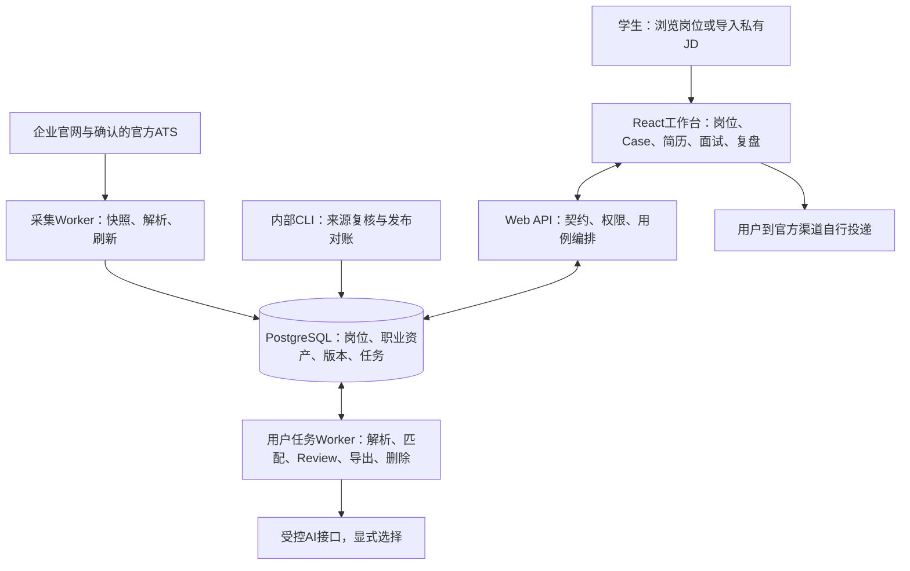

# Aijob 产品、需求、架构与首发状态审视

审视日期：2026-09-05。代码基线 `4f20b7f`，目录 `C:\Users\72998\Projects\Aijob`。本次读取产品文档、ADR、路由、核心服务、数据库迁移和已有验收证据；未修改产品代码、重新采集来源、启动业务库或进行新一轮全仓测试。

**coco本轮最终明确的目标：面向本科、硕士和博士在校生，尽快把产品正式发布，先推广给1000人以内的尝试者，通过实际使用继续迭代。不再把2人校准、6人正式研究作为发布前的执行路线。** 本文按累计尝试用户理解1000人，不把它换算为1000人同时在线；收费方式和明确并发目标尚未确定。下面的优先级为审视建议，尚未启动部署或供应商采购。

## 1. 这个项目究竟为了什么

产品要帮助正在真实求职的在校生，把一个招聘机会变成一次有依据的准备与投递，并把过程中产生的经历证据、简历和复盘长期积累下来。

它的用户结果可以表述为：找到可考虑的机会 → 看清岗位条件与自己的差距 → 用真实经历准备有针对性的简历 → 完成官方投递并追踪进展 → 为面试准备与下一次申请复用成果。

“高质量投递决定”仍是有用的结果定义：用户知道为什么投、为什么暂缓、缺什么信息以及下一步做什么。决定理由清楚只是可观察的中间结果，不能代替实际完成申请、持续使用或最终求职结果。目前没有证据支持增加录用概率的承诺，也不能用测试通过证明它比用户现有流程更有用。

产品已经经历四次范围演进：

1. 官方岗位聚合与投递决定：解决来源分散、资格不清和判断成本。
2. 加入简历解析、证据匹配、定制与导出：帮助用户从判断走向行动。
3. ADR-0030/0031升级为岗位Case与长期职业资产：让简历、投递、面试和复盘共用上下文，不在每个页面重新开始。
4. ADR-0035/0036放宽供给范围与任意数量限制：涵盖在校生可投的实习、校招、应届与管培，不设单家公司岗位上限。

因此，单纯增加抓取数量、页面或AI调用都不是完成目标。首发的交付对象是“学生可以独立使用、数据能持续保存、机会能够返回官方渠道申请的求职工作台”。

## 2. 从用户需求看

下面是仓库提出并试图解决的需求，不能把它们都称为已被真实用户证明的痛点。

| 用户要完成的事 | 当前产品提供什么 | 首发应交付的实际结果 |
|---|---|---|
| 找到值得考虑的机会 | 岗位目录、筛选、来源追溯、推荐、私有JD导入 | 有相关且能核验的岗位；目录找不到时也能带入自己找到的JD |
| 判断“我能不能投” | 资格、经历证据、偏好三轴分开，未知保留 | 明确条件冲突和信息不足能区分；系统不把“简历没写”当成“没有能力” |
| 判断“怎么准备” | JD完整原句、独立要求、证据关联与待确认问题 | 知道要补什么事实、选择哪段经历，而非只得到一个匹配分数 |
| 为岗位准备简历 | 基础简历、岗位派生简历、Review建议与DOCX | 保持事实真实，建议可接受/修改/拒绝，产物能够实际使用 |
| 同时管理多个申请 | Case看板、阶段、事件、显式投递记录 | 清楚每个岗位做到哪里，能继续上次工作，不丢版本和材料 |
| 准备面试和积累经验 | 文字面试、反馈、复盘、知识引用、确认后回流 | 已确认的经验可以服务下一次申请，不自动把建议写成个人事实 |
| 安心保存和取回资料 | owner隔离、长期资产、账号认领模型、单项/全部删除 | 换会话后能找回自己的材料；删除可执行，其他用户不能访问 |

用户不会因为系统有很多模块而受益。关键是首次使用时能否顺着一个具体岗位走到可用产物，再次使用时能否少做重复劳动。信息密度、字段确认和版本提示的可靠性已经得到工程投入，但是否给学生增加过多操作负担，仍需在首发验收中以完整任务检查，不能从组件测试推断。

**发现一处已确认的需求冲突。** coco明确首发包括本科、硕士和博士，但供给可达性规则会在对外可见层排除仅招硕士及以上、包含若干学校层次词等岗位。这会把某些目标用户可以申请的岗位提前排除。首发前应区分全局岗位范围与个人资格核对，让具体用户的学历、学校和其他已确认条件参与判断；保留原文限制和未知状态。本次只记录冲突，未改代码。

## 3. 从产品设计看

产品有两条入口、一套共同工作区：

- 官方目录入口：平台提供经过来源与岗位资格核验的机会，用户选择后创建Case。
- 私有JD入口：用户带入自己找到的岗位，为自己建立Case；这份JD不进入公共目录、推荐分母或其他用户的数据。

Case是“一次针对具体岗位的申请档案”，不是操作系统概念本身。它把固定的岗位要求、所选经历证据、定制简历、申请状态、面试和复盘关联起来。

基础简历、事实和经历证据可跨Case复用；针对某岗位的材料与判断保留在该Case。这样既能积累长期资产，也不把甲岗位的条件、乙岗位的简历和丙岗位的面试内容混在一起。

产品设计上值得保留的重点：

- 原文、个人事实、系统判断和AI建议有明确区别。
- “未说明”是可以继续处理的状态，不用模型补事实。
- 招聘要求变动不会静默改写已经准备的材料，用户确认后再升级。
- 官方直达投递页、官方列表和缺少入口分开表达；打开链接不能冒充投递完成。
- 推荐解释由可检查的规则产生；AI用于表达优化等受控步骤，故障时仍能继续基本流程。
- 单家公司数量上限已取消；岗位数量多本身不构成隐藏或惩罚理由。

首发不宜再同时新增大量能力。已有目录、Case、简历、投递、文字面试和复盘应以完整旅程验收收口；更丰富的模板、复杂知识功能、装饰性改版、社区、语音和新的基础设施，都不能因为“成熟产品”四个字自动进入首发范围。

## 4. 架构怎样支撑目标

这是模块化单体：一个代码库中的不同业务模块，共用同一事实源；API、采集任务、用户任务分别运行。它不需要因为目标1000名累计用户就改成微服务，但目前也没有证据证明已经承受1000人同时在线。

| 架构设计 | 对应的用户需求 | 代码与证据入口 |
|---|---|---|
| React、规范路由、共享工作台 | 页面切换、刷新和返回仍能继续同一任务 | `apps/web/src/App.tsx`、`apps/web/src/career-os/` |
| 共享Zod契约与API适配器 | 前后端对状态、字段、错误含义一致 | `packages/contracts/src/`、`apps/web/src/api/` |
| Platform应用服务编排 | 多模块共同完成一项用户动作，避免浏览器自行拼出业务事实 | `apps/platform/src/app.ts`、`applications/service.ts` |
| 来源修订→岗位版本→要求集；当前与公开指针分离 | 可追溯、可复查，入库不等于对外发布 | `catalog/materialize.ts`、`catalog/publication-reconciliation.ts` |
| Case固定岗位版本与要求集 | 准备中的简历和面试不随网页刷新悄悄改变 | `applications/service.ts`、迁移023/029/038 |
| 事实、偏好和经历证据分离 | 硬条件、意愿与能力依据不混为一谈 | `profile/`、`matching/ranking.ts`、匹配契约 |
| 简历正文、布局、Review分离 | 换模板不改变事实，AI建议不自动覆盖正文 | `resume-documents/revision-service.ts`、`review-service.ts` |
| PostgreSQL任务表、租约、幂等、过期执行者校验 | 重试不重复建材料，慢任务不阻塞页面，删除后旧任务不能写回 | `workers/owner-task-worker.ts`、`workers/owner-task-lease.ts`、数据库迁移 |
| owner权限与修订冲突、删除墓碑 | 不串用户数据，不静默覆盖编辑，删除可追溯 | `identity/`、`career-assets/`、`profile/deletion-service.ts` |
| 独立采集进程与数据库角色 | 高风险网页访问与用户简历处理分开 | `collector-worker.ts`、`match-worker.ts`、迁移021/022 |

当前本机使用本地压缩快照文件和独立PostgreSQL数据卷，不能把架构文档中的云Bucket、生产独立身份和容灾目标当成已经部署好的服务。代码已有数据库角色和环境检查，实际生产凭据、隔离部署、监控与演练仍需落地。

## 5. 目前到底处于什么状态

**已经有完整本地工程基础，并完成独立工作区和业务恢复；尚未具备可以直接面向外部用户持续运营的发布环境。**

| 方面 | 核实结果 | 不能据此推导的结论 |
|---|---|---|
| 代码与历史 | OS-1至OS-7完成；Kiro后续供给与纠偏承接；公司上限取消 | 不需要重做OS-7，也不代表正式发布已完成 |
| 工程测试 | 最新代码验收949/949，lint、类型检查和构建通过 | 合成1000岗位容量测试不是1000用户负载测试 |
| 浏览器验收 | 上轮双库、四视口和纠偏专项通过；取消配额后未重跑浏览器总Gate | 不宣称本次重新逐屏验证过全部界面 |
| 恢复数据 | 038迁移；93岗/7公司为最近恢复API实测；公共0 | 这些是历史数据恢复，不是当天重新核验的在招供给 |
| 来源 | 34配置：26 pending_review、8 paused、0 approved；访问政策pass为0 | 7次历史robots检查通过不等于7来源获准公开 |
| 用户资产 | 恢复主库Case、简历文档、已确认资料均为0；122个owner保留 | owner数量不是活跃用户数，没有真实长期使用证据 |
| 账号 | 会话、邮箱认领、账号模型与测试已有；真实邮箱发送仅有disabled/fixture实现 | 还不能提供真实用户可依赖的邮箱注册、登录与恢复服务 |
| AI与解析 | 受控Review接口和模板降级已有；真实AI关闭；生产解析容器要求已写入配置 | 真实供应商效果、成本与生产解析镜像尚未验收 |
| 运行 | 独立恢复库及页面/API通过恢复验证，当前服务均停止 | 本地恢复演练不等于线上自动备份、持续运行和故障值守 |
| 产品证据 | 仓库记录仍E0，无可复核真实目标用户使用结果 | coco选择直接首发不等于已经证明市场需求，后续从真实使用中取得反馈即可 |

## 6. 发布给1000人以内，真正还卡在哪里

1. **人群范围与真实账号。** 先修正仅硕博岗位被全局排除的冲突，再接上真实身份验证与邮件发送，确定首次进入、再次登录、会话过期和资产恢复。现有匿名兼容模式存在到期规则，不能用它向外承诺永久账号资料。
2. **有用且能持续更新的正式岗位供给。** 首发按目标学生的实际方向准备有意义的岗位集合。100家/1000岗已由ADR-0035降为报告目标；旧推广清单另有10000岗条件，建议在冻结本轮首发清单时明确处理，不能把“1000名尝试者”自动解释成满足或取消了任何岗位指标。逐来源准入、投递入口、关闭检测仍要工作。现有collector明确限制local环境，部署Web不会自动得到服务器采集能力。
3. **真实部署与运行。** 固定HTTPS入口、进程管理、迁移发布、受限数据库凭据、生产解析镜像、备份恢复、故障告警及错误反馈。`infra`当前只有本地Compose，CI负责检查与构建，不能称为完整生产交付管线。
4. **完整任务的首发验收。** 新用户无开发者帮助完成“进入→选岗/导入JD→准备简历→导出→记录投递→退出后回来继续”。已有能力以集成为主，不重建。
5. **承诺与实际能力一致。** 如把AI简历优化作为首发卖点，就必须完成真实供应商接入和异常/成本验证；不能用模板测试声称真实AI已可用。收费、服务支持方式与明确并发目标尚未冻结，不在本次自动补造。

推广人数是运营范围，岗位数是供给指标，同时在线数才是容量输入，三者分开管理。可以面向1000以内推广并控制开户/请求节奏，不必把“1000”做成新一轮任意技术门槛；但现有单机测试不能代替部署环境的负载与故障检查。

## 7. 本次发现的文档与需求冲突

- `docs/00-product-definition.md`、`docs/01-prd-v0.2.md`、`docs/09-product-discovery.md`仍含早期实习/产品运营、供给硬门槛或旧邀请机制描述，与ADR-0029/0031/0035及现行代码并不完全一致。
- `docs/plans/private-alpha-readiness-gates.md`仍写单家统一30，已被coco和ADR-0036取消。该清单也保留研究阶段与更大公开推广条件，不能直接作为本轮1000人以内首发任务队列。
- 架构文档保留“数据库角色尚未实现”的历史状态，但迁移021/022和运行角色检查已有实现；又把目标云存储/运行保障与本地状态写在同一文档里，需要明确分层。
- 当前动态文档保留948和949两轮验收、22和93两轮业务快照，以及恢复前后的叠加说明。事实可以追溯，但接手容易读错时点。

这些冲突不代表要回到旧需求，而是要用coco本轮发布目标与已接受的产品边界整理一份简洁、唯一的首发清单。历史验收保留为证据，不再产生新的“先做完这些研究才允许继续”的开发循环。

## 8. 审视后的建议

把下一轮工作限定为首发收口：先冻结对外承诺和用户范围，然后打通账号、真实岗位供给与部署环境，并在同一环境完成整条求职流程验收后推广。已完成的OS能力持续回归维护，暂不扩大模块范围。首发后关注用户是否完成一次可用申请准备、是否回来继续第二个Case、卡在哪里，以及错误和任务失败率。

这不是重新做一轮产品研究，也不要求证明商业成功后才发布；它是把现有本地系统交付成用户能够直接使用的服务。

主要依据：[ADR-0030](../decisions/0030-adopt-job-centric-career-os-and-interaction-first-integration.md)、[ADR-0031](../decisions/0031-long-lived-career-os-architecture-realignment-2026-08-06.md)、[ADR-0035](../decisions/0035-student-applicable-supply-admission.md)、[ADR-0036](../decisions/0036-remove-company-job-cap.md)、[端到端契约](../14-career-os-end-to-end-experience-contract.md)、[949项验收](../evidence/product/company-job-cap-removal-2026-09-05.md)、[业务恢复记录](../runbooks/recovered-local-workspace.md)。本次未作现行法律适用判断、供应商选型或采购建议；对外运营相关决定需与最终服务方式一致。
