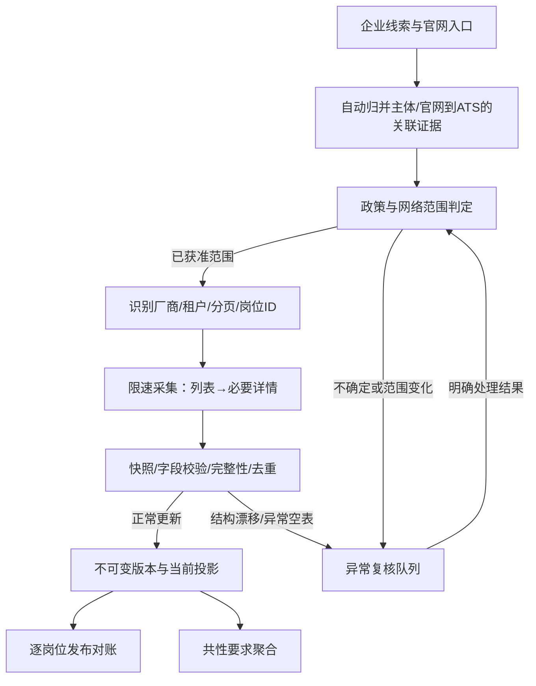
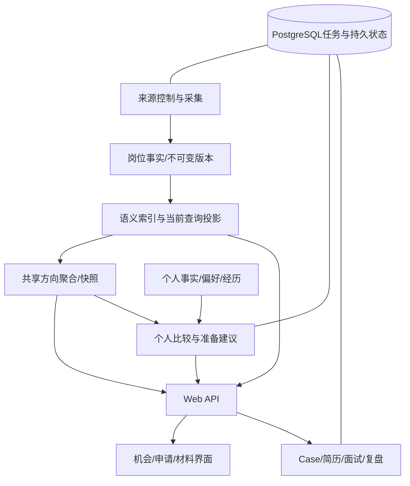

# Aijob 产品主体研究与架构审查

研究开始：2026-09-05；整理完成：2026-09-06。代码基线：`f385ed5`。主目录：`C:\Users\72998\Projects\Aijob`。

本轮目标来自coco最新指示：产品主体尚不满意，先研究需求、体验、采集自动化与岗位共性分析，再决定如何改进。上一轮“先收口账号和部署”的优先级由此调整；面向本科、硕士、博士在校生及1000人以内首批尝试者的方向仍保留。

交付：[证据索引](sources.md)、[实施顺序](implementation-plan.md)、[可交互方向图谱示意](role-map.html)、[只读复现结果](audit-results.json)。本文是研究结论与建议，涉及边界调整的部分未伪装成已接受ADR，未修改业务代码或来源准入状态。

## 1. 结论：主体的问题在哪里

上一轮把“功能闭环存在”过早等同于“主体已经满意，只待上线”，判断不充分。代码、中文求职经历与国内产品对照表明，当前工程完整性明显领先于产品决策能力和日常易用性。

最重要的五个问题：

1. **求职从选择方向开始，产品却主要从选定一个岗位之后开始。** Case能组织申请，但没有充分帮助用户比较岗位方向、理解可迁移能力、建立可持续关注的机会范围。
2. **来源管理有不少机制，运营却仍被配置、证据粘贴和广泛复核牵住。** 已有北森租户复用和刷新队列；缺少自动发现到“只处理异常”的完整工作流。
3. **“诚实”被局部实现成了少展示、停止展示和机械排除。** 硕博、院校否定语句、混合岗位分类，以及小样本洞察，都存在证据明确的损失。
4. **工程概念进入了主要用户页面。** 洞察让学生创建“可恢复运行”，首页强调确认和边界；用户更需要知道今天做什么、这一方向在要求什么。
5. **洞察与推荐仍偏一次性计算，尚未形成共享的岗位知识与个人准备循环。** 这同时影响体验、计算成本和维护复杂度。

建议将产品主体组织为：**机会与方向 → 申请工作台 → 可复用材料**。Case继续作为申请档案，后台继续保留可靠的版本与权限机制；新增或增强的核心是“机会发现—共性要求—个人准备—申请复盘”之间的连接。

“性能最高、架构最优雅”没有脱离约束的唯一答案。本项目的优化目标应具体化为：学生完成任务所需时间、信息判断的正确性、服务响应与稳定性、每条有效岗位和每次有用AI结果的成本、开发者修改一项需求时需要触及的模块数。不能只优化QPS，也不能因追求优雅而重写已有系统。

## 2. 中文讨论揭示的需求，以及如何转成产品

本轮是有目的的公开资料研究，不是随机抽样。保留的14条讨论覆盖本科、硕士、博士、运营、软件和部分硬件，仍偏牛客与技术人群。帖子提供需求线索，效果、发生率和用户身份没有独立核验。具体来源与访问限制见[证据索引](sources.md)。

### 2.1 从需求到动作，不能只从痛点到功能名

| 需求/触发 | 当前覆盖与缺口 | 转成什么体验 | 判断是否有帮助 |
|---|---|---|---|
| 不知道有哪些方向、自己的经历能迁移到哪里 | 有大类筛选，缺少子方向比较和任务解释 | 先看岗位方向地图：日常做什么、常见产物、要求及可复用经历；允许“暂不确定方向” | 用户能依据原句选出值得进一步了解的方向，系统不宣称替其确定职业 |
| 岗位散在官网、公众号、群和平台 | 官方目录+私有JD已有；覆盖和持续关注弱 | 保存搜索与关注企业、招聘批次更新；任意渠道的个人申请可收进私有工作台 | 减少重复查找；公共事实与个人线索不会混入同一统计 |
| 多个岗位要求相似，却不知道先准备什么 | 已有共性洞察，但粗分类、小样本停显、无准备接续 | 按子岗位汇总任务/工具/要求，列“能同时帮助哪些目标岗位”的准备动作 | 同一份真实成果能关联多个目标岗位，点击能回看依据 |
| 实习与课程、租房成本冲突 | 出勤/时长等字段已有，用户需要组合判断 | 把入职日、天/周、月数和薪资周期放在决策首屏；费用只用用户输入估算 | 不把最低时长与优先时长合并；不把未知工资估成确定收入 |
| 每家公司都要重新填已有资料 | 有简历与DOCX，缺少可快速复制的网申材料 | 常用字段、自我介绍、项目长短版、邮件草稿、文件命名；逐段复制 | 能复用确认过的内容，用户自行填写与提交 |
| 几十上百份申请难跟踪，错过时间 | 看板、阶段与截止排序已有；首页只是最近更新 | 截止、笔试、面试、待跟进驱动的今日安排；日历导出与批量修改 | 未回复不能被系统猜成失败；提醒能关闭且不重复轰炸 |
| 一份简历投所有岗位或反复为相似岗位改稿 | 基础/岗位简历已有，缺少方向级复用 | 基础事实→方向稿→少量岗位差异；保留实际投递稿 | 用户能找回某次面试对应的版本，而非看到后来改过的稿 |
| 博士研究与企业团队不对口 | 学历规则冲突；通用能力大类不足 | 研究对象、方法、工程环境、论文贡献、团队方向并列；不把论文数当统一分数 | 能说明哪项研究与岗位任务有关，未知团队信息保持未知 |
| 模拟面试只是模板问答 | 文字面试与复盘已有，深度未证明 | 围绕已投递稿和目标岗位追问；暴露论证缺口、允许反问、复盘变成下一步 | 相比通用聊天工具，提供可检验的岗位依据与材料连续性 |
| 最终选择不只看薪资 | 当前申请链覆盖到结案，选择支持有限 | 轻量比较业务内容、导师/团队、地点、工时、待遇构成和回复日期 | 自述与官方字段分开，不输出未经核实的企业评分 |

自建进度表和Word转PDF来自[本科秋招记录](https://www.nowcoder.com/discuss/541018206169845760)；重复网申在[产品/运营求职经验](https://www.nowcoder.com/discuss/353156028957138944)与[牛客网申助手说明](https://www.nowcoder.com/discuss/864183883103772672?sourceSSR=subject)中相互印证。后者的量化数据是供应商自述，本报告不将其视为需求发生率。

对博士，重点不能只加一个学历筛选项。[博士实习经历](https://www.nowcoder.com/discuss/751834414258081792)指出研究方向与团队不对口会让面试双方难以深入；[物理博士秋招记录](https://www.nowcoder.com/feed/main/detail/ceb941adb36847bfad44264348e46ebe)补充了半导体/光学方向选择场景。两者都支持更细的任务和领域表达，不能推出所有博士都应走相同路线。

实习可行性不能只看日薪，[出勤与租房讨论](https://www.nowcoder.com/feed/main/detail/4e5f5c593d1243bfb69a31c6407ff796)和[实习课程冲突](https://www.nowcoder.com/discuss/353156376786575360)说明多个时间、地点约束共同影响决定。这里应复用已有字段，避免再造一个与资格核对脱节的“实习测评”。

### 2.2 不应吸收成产品规则的帖子内容

- “海投”“精准投递”都存在有效个案；支持用户不同策略，而非强制每份申请完成全部准备流程。
- 用户抱怨岗位不回复，可以转换为时间管理和跟进能力；不能由此标记企业造假、岗位死亡或预测拒绝。
- “简历加数字”“包装项目”“改成精通”不能直接吸收。产品要追问可确认事实，帮助解释已有工作。
- 方向热度和高频技能不等于录用因果；缺少某个词不意味着个人没有能力。
- 通用聊天工具是实际替代品。[本科求职总结中的模拟面试评价](https://www.nowcoder.com/discuss/886302617423319040)仅为索引可见个案，但足以提醒：新增“AI面试”按钮本身不构成优势。

## 3. 国内成熟设计可以借鉴什么

| 参照 | 值得吸收 | 不直接照搬 | 对Aijob的意义 |
|---|---|---|---|
| [牛客校招日程](https://www.nowcoder.com/jobs/school/schedule) | 更新、临近截止、收藏、招聘批次、笔试入口 | 海量社区/题库的全量建设和供给数量竞争 | 日程与机会状态是产品主体，而非上线运营的附属功能 |
| [OfferShow](https://www.offershow.cn/) | 机会雷达、待投和投后管理、行业与批次 | 薪资匿名数据直接当官方事实、会员机制照搬 | 机会发现应有连续订阅，不能每次从零搜索 |
| [实习僧](https://www.shixiseng.com/) | 岗位卡片突出日薪、出勤、月数；较细职能分类 | 平台岗位当Aijob抓取真源 | 国内实习决策有特有字段，信息层级比炫目界面重要 |
| [超级简历](https://www.wondercv.com/?locale=zh-CN) | 直接获得可用简历、岗位定制和材料衔接 | 匹配率、保证过筛、未经证实的关键词补写 | 先交付可用材料，再逐步深入，不让用户先完成一套抽象资产管理 |
| [职徒职业规划](https://www.52cv.com/career) | 连接岗位知识与个人经历 | 一次测评替用户定职业；未经验证的准确性宣传 | Aijob可用实际JD证据呈现方向差异 |

这些是公开页面与产品说明对照，没有登录完成竞品完整旅程，也没有证据支持“竞品没有某功能”。Aijob可以形成的差异，是每次方向分析都能落到一组真实岗位，每项准备都能落到用户的真实材料，而非再做一个宽泛AI助手。

## 4. 产品架构：在Case上游补机会认知，在下游形成复用

建议主导航以“机会”“申请”“材料”组织；“今日”成为申请中的待办视图，洞察成为机会页的自然切换与详情侧栏。导航数量只是表达，不能为了三项而隐藏高频操作。

三个学生入口均应成立：

1. 没有简历、方向不确定：先浏览方向、岗位样例和任务，不强制上传简历或填全个人信息。
2. 已有简历、想找机会：用少量明确条件开始，自动建议可关注方向，用户可改。
3. 已有目标岗位、要准备：直接导入招聘描述，得到重点要求与可用材料；以后再补其他内容。

初次只询问当前任务需要的字段。学历、毕业月份、城市和可投入时间适合渐进补充；不要求初次填写全部技能、证据和职业目标。岗位卡片先呈现“做什么、在哪里、哪一批、条件与时限”，版本号与技术状态下沉到详情。

轻量收藏可以复用现有`interested`阶段和列表投影，避免立即创建另一套候选业务模型。只有明确出现不同生命周期需求时才独立建表。重点申请继续使用完整Case；对批量投递者提供紧凑表格和批量更新，不强制逐条检查所有要求。

还有一个国内校招特有缺口：**招聘批次与志愿规则属于企业/计划层，不属于单条JD。** [字节2026校招FAQ](https://jobs.bytedance.com/campus/page-6272Gc)包含毕业月份窗口、志愿次数与处理顺序；这说明只抓职责和任职要求会漏掉决定“怎么投”的信息。建议增加版本化招聘计划与规则，岗位引用计划；保留适用年份和来源，不能把上一季规则自动带入下一季。

## 5. 哪些企业能抓，怎样让人工从主流程退到异常处理

### 5.1 先区分四个判断

“能看见”“能稳定获取”“能够公开使用”“对目标用户有用”必须分别记录。现有准入已有多个Gate，下一步应让这些判断在发现、技术健康和异常处理中也清楚可见，避免仅靠一个最终approved状态解释所有失败。

现状不是每条岗位都重新由人工审批：已有来源准入、确定性刷新、逐岗位资格及双向发布对账。真正的改进是让新来源证据自动收集、既有证据复用、普通更新直接流转，人工只看有实质变化和不确定性的部分。

只读配置复核：34来源、26待审核、8暂停、0批准；7个确定性来源开启刷新，2个手工快照来源开启提醒。北森已有5个租户配置，其中慧策暂停；高校页面配置仍占较大部分，不能把它们算成官方岗位供给。[配置明细](audit-results.json)只是本地状态，不是本轮对真实网站的新准入结论。

### 5.2 接入优先顺序

| 路径 | 自动化方式 | 当前项目如何承接 | 人工出现在哪里 |
|---|---|---|---|
| 企业/ATS明确授权的数据接口、文件或推送 | 增量接口、Webhook或企业提交清单，定期完整对账 | 仍入同一规范化与版本管线 | 首次权限与字段映射，异常或授权变化 |
| 企业官网确认的北森等共享ATS门户 | 厂商适配器+企业租户参数，不逐家公司写采集程序 | 先复用北森，再评估其他高复用厂商 | 新租户主体关联与访问范围，结构漂移 |
| 有公开JSON/JSON-LD或服务端HTML的自建官网 | 列表优先、增量与条件请求、稳定岗位ID | 复用已有帆软/京东/美团等能力，实际状态逐源核实 | 首次接入、语义变化或关闭异常 |
| 获准但仅靠JS渲染的页面 | 优先取可获准的底层数据；否则隔离浏览器渲染 | 建议评估受控渲染通道，需修订现行生产浏览器限制 | 首次启用和请求范围变化，验证码/封禁立即停止 |
| 只有海报、公众号、群消息或登录后信息 | 发现企业线索、用户私有导入、企业主动提供信息 | 不转成公共岗位真源；人工采集成本过高者排后 | 用户带入自己的资料或企业补充权威入口 |

[Moka文档](https://www.mokahr.com/docs/api/index.html)证明可以按职位状态和更新时间读取数据，但也明确API需要机构密钥。开放文档和企业授权是两件事，不应承诺“一套Moka接口免费抓所有公司”。[JobPosting规范](https://developers.google.com/search/docs/appearance/structured-data/job-posting)可作为字段与过期机制参考；不将Google招聘分发直接复制为国内产品策略。

### 5.3 建议的自动化链路

应自动完成：提取官网招聘链接、识别ATS特征、生成最小范围配置草稿、取证和内容差异、验证分页完整性、去重、调度、失效检测、质量报告。初次开启新网络范围仍沿现行明确操作；一批来源可以在证据齐备时一次确认，不必逐家公司多轮问答。

**复用粒度要准确：** 同厂商复用协议与解析器；同一条款文本且适用范围相同才复用条款判断；每个租户仍有独立的雇主关联证据。不能把批准一个北森租户扩大成批准整个`*.zhiye.com`。

调度按主机/租户网络预算、历史变化率、窗口紧迫性和失败状态工作。既有按来源数计算小时上限只是灰度机制，不能永远决定请求容量。高频变化的列表优先，旧详情按需刷新；同一主机共享限速，故障站点局部熔断。借鉴[Scrapy自适应节流](https://docs.scrapy.org/en/latest/topics/autothrottle.html)和[续跑机制](https://docs.scrapy.org/en/latest/topics/jobs.html)，无需迁移语言或另建任务真源。

关闭判断必须基于完整且成功的列表轮次；分页中断、解析失败、零结果异常不当作全源岗位消失。官方明确截止、404/410与完整列表连续缺席分别记录。历史已申请Case保留原稿，同时显示当前岗位状态。

### 5.4 明确属于过度防守的部分

- 把所有“robots取不到”混为永久禁止。RFC区分4xx资源不可用与网络/5xx不可达，且声明robots不是访问授权。建议将404、401/403、429、超时、明确disallow分开处理；404只允许进入其余权限评估，不能因此直接公开。依据为[RFC 9309](https://www.rfc-editor.org/rfc/rfc9309.html)，这不是法律豁免结论。
- 把同一稳定来源的普通字段更新继续送往泛化复核。风险分级后，普通更新自动走已有对账，条件冲突、主体改变和政策变化才升级。
- 永久禁止所有浏览器渲染，会使合法公开的JS门户只能靠人维护。建议允许隔离、限额、无登录与无绕过的渲染作为补充，而非主采集方式；是否引入[Crawlee](https://crawlee.dev/js/docs/introduction)等依赖需要用具体来源收益证明。
- 只能靠CLI完成日常复核，对单人运营不友好。保留CLI作执行层，增加仅内部可用的证据差异与异常工作台；不为此开放公共管理后台。

仍应保留：主体来源证明、网络白名单、限制绕过访问控制、权限/删除隔离、有限重试与幂等。它们保护的是实际正确性。优化重点是降低重复劳动，而非把失败改成成功。

## 6. 岗位共性图谱：应成为核心能力，但不能做成词云

### 6.1 已有能力和已复现的损失

`apps/platform/src/insights/service.ts`已经提取工具与能力、分别统计岗位数/企业数、区分必要与优先、保留原句例证并关联个人经历。不是从零补一个洞察模块。

本轮使用合成输入直接调用现有函数，结果见[audit-results.json](audit-results.json)：

| 输入 | 实际行为 | 问题性质 |
|---|---|---|
| 19岗、5公司、全部有结构化要求 | 三组要求输出全空 | 小样本不能推论市场，但仍能报告样本事实 |
| 20岗、4公司 | 输出全空 | 任意公司数把有用比较一起挡住 |
| 20岗、5公司、每条有SQL描述，但必要性unknown | `dataSufficient=true`，三组仍全空 | “有提及”与“是否硬要求”未分开 |
| 1岗9月5日核验，19岗9月1日核验 | 整份报告只显示9月5日 | 最新时间不能代表整体新鲜度 |
| 产品运营、AI产品经理、数据分析工程师、供应链质量工程师 | 均输出分类冲突 | 多轴属性被误作互相矛盾 |
| 不限985/211；985院校优先 | 均判为院校限制 | 关键词检出缺少否定、必要性与作用域语义 |

这些是纯函数复现，不是对真实岗位的误判比例测量。SQL的学历谓词还有独立实现，真正修改时必须同步验证，不能只修TypeScript工具函数。

### 6.2 先把“同类岗位”定义正确

采用“主职能→子岗位→任务/领域标签”的渐进词表。例：产品是主职能，AI产品经理是子岗位，AI是领域；内容运营与增长运营可分别比较；数据分析不与全部AI算法岗位合并。研究类增加研究对象、方法和应用场景，金融/制造/设计不能硬套软件工具清单。

自动分类可以是系统解释层，记录模型/规则版本、依据和可修正状态；不要把系统标签伪装成官方原字段。存在多个合理标签时允许并列，只有真正矛盾才人工复核。未分类岗位仍可全文检索，避免解析能力决定用户能看到哪些机会。

### 6.3 数据应有三层

1. 官方原句与字段：不可被模型改写成新事实，保留出处和版本。
2. 语义索引：任务、工具、产物、必要/优先/未指明、程度、否定、适用条件；允许规则与AI辅助，必须能指回原句。
3. 对用户的解释：方向差异、已有证据、可准备动作；标明这是系统分析，不能变成雇主硬条件。

“熟悉SQL或Python”“不要求985”“有运营经验优先”“负责客户开发”都要在语义层区别处理。职责中的任务可以进入任务图谱，即使任职必要性没说明；不能直接把职责全部转换成入职前必须掌握的技能。

### 6.4 正确统计与视觉表达

默认使用当前、可公开的岗位集合；个人导入JD只可形成个人集合分析，不进入公共图谱。支持岗位类型、招聘季、子岗位、城市、学历范围和行业过滤，过滤后分母随之变化。

- 岗位提及率 = 提及该项的去重岗位数 / 当前筛选集合的全部去重岗位数。
- 企业覆盖率 = 至少一个岗位提及该项的企业数 / 当前集合企业数。
- 同时显示“可解析岗位数/全部岗位数”，避免把未解析误解成未要求。
- 公司很多岗位全部保留；分析视图提供两种口径，不截断岗位、不惩罚大公司排序。
- 硬性、优先、未明确必要性分别计数；同一岗位同一概念只计一次。多地点展示不要凭空放大岗位数量。
- 小样本展示“本组出现了什么”，不给“市场普遍要求”的结论；不因少于20岗/5公司就抹掉样本。
- 展示核验时间范围与超期占比；趋势使用同口径快照，并标记来源覆盖变化。新增来源导致SQL提及变多，不能直接叫市场需求上涨。

主视图采用排序条形图+企业覆盖并列数字，辅以方向对比矩阵。点击要求展开具体岗位与原句，再到“我的相关经历”和“下一步准备”。词云只强调出现次数，雷达综合分容易制造伪精度，不适合作主视图。[交互示意](role-map.html)展示筛选、两种分母、原句和准备动作，所有数值均来自虚构演示记录。

### 6.5 汇总必须能带来行动

对准备优先项，优先解释：用户收藏的哪些岗位提到了它、用户已有哪段经历、还缺哪项事实或可展示产物。建议用户提供一次真实分析、一份作品或一段项目说明，而非把热门词填进简历。

已有项目与研究成果只需补充说明时，优先提取它们的价值；不要自动把每个“缺少证据”转成几十小时课程。准备动作可同时服务多个目标岗位，结果回到职业材料，由用户确认是否成为事实。

## 7. 工程架构与性能：先消除重复计算和不必要耦合

继续使用模块化单体、PostgreSQL与三个进程权限边界。图中是模块职责，不是新增六个微服务。公共聚合和私人比较要有独立的数据边界；缓存不包含个人资料，共享聚合只引用获准公开数据。

### 7.1 代码证据对应的改进

| 代码位置 | 已观察到的事实 | 建议与收益 | 验证方式 |
|---|---|---|---|
| `insights/service.ts:loadInsightRecords` | SQL获取可见岗位后，在JS过滤方向/城市/规模 | 先将筛选下推数据库；对需求稳定字段建立查询投影与索引 | 固定语料结果一致；EXPLAIN检查扫描/连接/排序；测查询与总响应 |
| `insights/service.ts:createJobInsightRun` | 每个新幂等请求按owner计算并保存完整候选版本列表 | 公共集合聚合按规范scope+数据版本共享；私人证据对照独立 | 两用户无串资料，同范围不重复聚合，来源撤回后不读旧公开缓存 |
| `job-family-classifier.ts` | 单一大类、多个关键词即冲突 | 多轴索引，保留原标签和可修正系统标签 | 混合岗位、否定/优先、未知与非技术语料对照 |
| `CareerOsHomePage.tsx` | 按更新时间取最近4项，动作由阶段固定映射 | 以实际待办与期限组织，解释提醒原因 | 远期新修改不压过明天截止；已完成任务不重复提醒 |
| `JobInsightsWorkspacePage.tsx` | 表单→固定报告，展示运行ID及英文不足原因 | 默认即见方向事实，快照细节按需展开，动作回到材料 | 无简历能浏览，切筛选不丢位置，键盘和窄屏可操作 |
| `refresh-scheduler.ts` | 本地策略、小时来源数上限、全局熔断等 | 主机/租户预算与局部失败隔离；只在实际需要时提吞吐 | 429不加速，单站失败不暂停无关站，半轮失败不下架全源 |
| 大型应用服务 | applications 2965行，probe 2135行，matching 2051行，review 1969行 | 按用例和纯规则拆分，在改动相应模块时渐进整理 | 保持事务所有者单一；不按行数机械拆碎或重写 |

以上行数是当前非测试文件的文本行数，只表示定位维护热点，不等于质量评分。`loadInsightRecords`的全量加载是已确认代码路径，实际慢到什么程度未做负载测量。

使用[PostgreSQL EXPLAIN](https://www.postgresql.org/docs/current/using-explain.html)定位实际热点。[pg_trgm](https://www.postgresql.org/docs/current/pgtrgm.html)可以补充字符串检索，中文还需要子岗位词表、同义词和分词评估。不要为了“语义搜索”先引入向量库或独立搜索集群；先用同一离线查询集证明召回问题和现有索引不足。

### 7.2 性能预算是建议目标，不是假称已达到

先记录基线，再在1万/10万合成岗位和20/50/100并发混合请求下测量：目录读取、方向聚合、Case编辑、后台采集/导出的干扰。按冷缓存/热缓存拆分，报告p50/p95/p99、错误率、数据库连接、队列等待、网络字节与CPU/内存。

初始建议预算：热目录/聚合读取p95≤500ms，首个有用方向概览≤2秒，普通编辑立即反馈保存状态；AI任务先及时确认接收并展示进度，其生成时间另测。数字用于比较改动和发现退化，最终按部署资源调整，未冻结为新的发布障碍。

优先减少：全量回传、重复解析、相同JD重复模型调用、公共分析按人重复计算、页面反复请求未变化数据。AI以岗位内容哈希+提取版本缓存，个人输入以资料修订隔离；并发请求合并，后台任务有预算、取消与重试。没有基线前不承诺“提升十倍”。

## 8. 保留、简化、加强与暂缓

| 判断 | 具体内容 |
|---|---|
| 保留 | 官方事实追溯、私有JD、Case版本、个人数据隔离、事实与建议分离、用户自行提交、幂等/租约/删除保护、公司无上限 |
| 简化 | 工程术语进主界面、非必要的逐项确认、普通刷新反复复核、固定小样本停显、全局关键词排除、CLI粘贴式运营、历史重复文档 |
| 更积极建设 | 自动发现和厂商复用、异常驱动复核、方向要求图谱、轻量收藏与批量管理、企业招聘计划、材料复用/PDF、待办与日历 |
| 需要先做边界决策 | robots缺失策略、受控生产浏览器、AI辅助语义索引和自动分类的发布资格、内部运营界面 |
| 暂缓 | 一次性全行业知识图谱、自动批量投递、招聘社区、公开企业打分、爬登录平台、全量邮箱扫描、强制职业测评、微服务重建 |

“更激进”应体现在更快提供有用解释、自动处理明确正常情况、减少用户重复输入。简历造假、自动猜资格、规避网站访问控制并不会提升产品成熟度。

## 9. 如何开始改，而不再次进入漫长规划

实施建议为五个有用户产物的切片，详见[实施顺序](implementation-plan.md)：

1. **修正理解规则并打通方向比较最小旅程。** 本硕博范围、否定/优先语义、多轴分类、小样本事实、简明洞察入口共同处理。
2. **将已有采集基础收敛为自动化供给链。** 厂商复用、源证据差异、增量更新、异常工作台和可量化运营负担。
3. **把共性要求连接到个人准备。** 子方向比较、双分母、原句追溯、目标岗位集合、可复用准备产物。
4. **补齐实际投递工作流。** 常用材料与PDF、投递稿、招聘计划、批量进度、日历与提醒；按高频程度交付。
5. **收口面试复盘与整体性能，再进入部署发布。** 用真实材料上下文证明比模板问答有用，完成一致性/容量/体验验收。

这是依赖顺序，不是必须把所有想法全部实现才能发布。第一轮确定交付“找到一个方向→理解要求→关联材料→开始一个申请”的有用体验；其余按必要性展开，避免新增工作再次无限推迟交付。下一任务先围绕这一旅程写出契约和代表性语料，并实施对应模块，不回头重做OS-7或恢复。

## 10. 本轮边界与证据

完成了公开中文资料检索、国内产品公开设计对照、仓库产品与关键链路代码审查，以及只读合成边界复现。未启动业务数据库、未采集新岗位入库、未修改公开准入、未运行真实模型、未做数据库压测或现有产品全旅程屏幕验收。UI判断来自页面实现与文案，交互示意仅验证设计表达，不证明现有产品已改好。

交互示意通过了7组浏览器检查：组合筛选、岗位/企业分母切换、原句上下文、准备清单、空结果与单岗位样本、四个方向、360px布局与键盘操作；无浏览器错误及HTTP请求。见[检查结果](prototype-checks.json)、[桌面截图](prototype-desktop.png)、[手机截图](prototype-mobile.png)。Python环境没有Playwright，使用已有Node Playwright与本机Chrome无头模式完成，未安装依赖。复现脚本与浏览器检查脚本均保留，运行方式见[核验说明](verification.md)。

未获得真实学生样本，因此需求优先级是多来源信号、任务重要性与项目差距共同形成的判断。最明确的结论是可复现规则问题、已有能力与体验落差、重复计算路径，以及国内校招需要的计划/时间/材料结构；真实使用收益将在交付中测量，不以固定人数前置研究阻塞。
